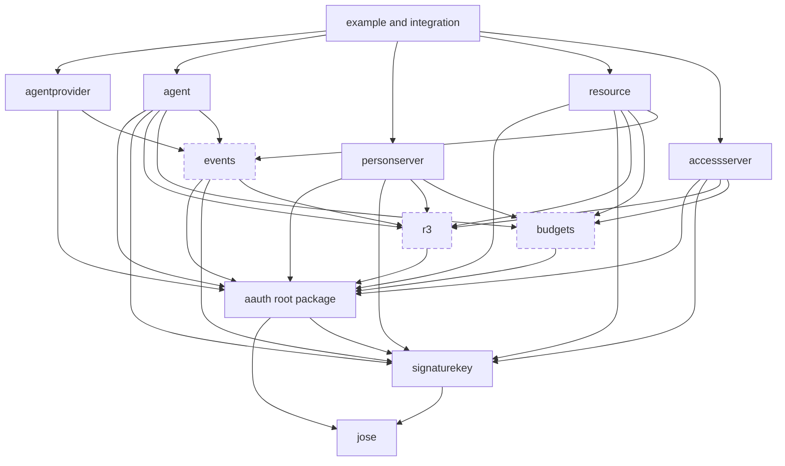

# Architecture

This repository is a Go implementation of the source family mapped in
[PROTOCOL.md](PROTOCOL.md). The architecture follows ordinary Go composition:
small protocol packages own reusable wire semantics, role packages own role
behavior, and applications provide policy, persistence, keys, clocks, and
transport.

[CONFORMANCE.md](CONFORMANCE.md) is the implementation-status ledger. An API
or package name in this document is not by itself a conformance claim.

## Design rules

1. **Keep source terminology recognizable.** A reader should be able to move
   between an editor draft, a Go type, and a test without learning a private
   vocabulary first.
2. **Separate wire truth from policy.** Parsing and cryptographic validation
   establish what a peer sent. A role-specific policy decides whether to
   accept it.
3. **Keep state with the deciding role.** There is no universal store,
   lifecycle, evidence envelope, or verified-context aggregate.
4. **Make consequences explicit.** Client methods perform one protocol
   exchange. They return a result or a typed continuation; they do not hide
   polling, browser interaction, sleep, or consequence retries.
5. **Preserve exact bytes when retained identity depends on bytes.** When a
   compact token, signed request, R3 document, approved mission blob, or result
   is retained, its original bytes remain available; a parsed value does not
   replace them. The immediate mission path does not retain proposal request
   bytes.
6. **Compose companion behavior explicitly.** Core does not silently accept
   R3, Events, or Budget semantics. The role handling a token invokes the
   companion package that understands each authorization-bearing claim.
7. **Make the easy path runnable.** Every complete journey has an executable
   example with in-memory policy and stores. Hosts replace those dependencies
   without replacing protocol code.

## Current and target boundaries

The current repository already has the `aauth`, `jose`, `signaturekey`,
`agentprovider`, `agent`, `personserver`, `resource`, and `accessserver`
packages. Their implemented behavior is the subset listed in
[CONFORMANCE.md](CONFORMANCE.md).

The current mission slice is one immediate top-level lifecycle composed with
both three-party PS issuance and four-party PS-to-AS federation. The root
package owns proposal, blob, update, completion, digest, and response values;
`agent` performs each exchange once; and `personserver` owns exact-byte mission
state, ordered accepted updates, policy evaluation, person-accepted
completion, and Auth-token retention before release. `resource` copies only
the signed digest into the Resource token. `accessserver` treats that digest as
opaque PS-validated context and copies it into the Auth token. Mission text and
updates never cross the Person Server boundary, and no generic lifecycle or
evidence object joins these boundaries.

The target model expands those packages and adds `r3`, `budgets`, and `events`.
Sections below define the target ownership contract. Planned packages use a
dashed border in the graph; present-tense support must never be inferred from
this target map.

## Package graph

Arrows mean target imports. Protocol packages do not import role packages, and
role packages do not import one another.

Private packages may provide strict JSON, bounded HTTP, and test helpers.
They do not own protocol semantics.

## Protocol packages

### Root package `aauth`

The current root package owns the implemented Core wire semantics. In the
target architecture it owns the complete Core value layer:

- Server and Agent identifiers.
- Core metadata documents and endpoint URL rules.
- Agent, Person, Resource, and Auth token headers and claims.
- Token minting, parsing, cryptographic verification, and Core context checks.
- `AAuth-Requirement`, `AAuth-Access`, `AAuth-Capabilities`, errors, and
  revocation request values.
- Mission, permission, audit, interaction, clarification, and deferred-response
  wire values.
- Immutable raw extension members from verified tokens.

It does not decide whether an Agent is enrolled, a Person is known, a scope is
allowed, a mission should be approved, or a Resource is trusted. It does not
own pending requests, token records, mission state, or application storage.

Token verification has two layers:

1. Core verifies JOSE, issuer discovery, time, audience, proof-key, and Core
   claim rules.
2. The accepting role decodes and validates each companion claim it supports
   before making a policy or serving decision.

Unrecognized additive claims remain available to host policy where the source
allows them. Recognized authorization-bearing companion claims are never
treated as inert JSON.

### `jose`

`jose` owns the deliberately small JOSE profile needed by the protocol:

- JWK validation and RFC 7638 thumbprints.
- Caller-owned signing keys.
- Compact JWS parse, sign, and verify.
- Exact protected-header, payload, signature, and compact bytes.
- Fully specified algorithm and key-shape checks.

It has no AAuth role, HTTP, policy, discovery, or storage knowledge. Its public
surface follows Go cryptographic conventions: accept interfaces where callers
may use hardware or external signers, return immutable parsed values, and make
unsupported algorithms explicit.

### `signaturekey`

The current `signaturekey` package implements the schemes and proof behavior
needed by executing paths. The target completes HTTP Signature Keys
independently of AAuth role policy:

- Structured-field grammar and signature-label correlation.
- All defined schemes: `hwk`, `jkt-jwt`, `jwks_uri`, `jwks`, `jwt`,
  `self-jwt`, `x509`, and opt-in provisional `cached`.
- Request preparation, covered-component and content-digest validation,
  signature verification, and proof-time bounds.
- Scheme and algorithm negotiation.
- Typed `Signature-Error` results.
- Bounded discovery with caller-supplied egress admission.
- Optional bounded key/assertion caches with cache lookup separate from
  assertion validation.

The package proves a request and reports the signer/key material. It never
turns a valid signature into authorization.

### `r3`

The planned `r3` package will own pure Rich Resource Request semantics:

- Standard and third-party vocabulary identifiers.
- Per-vocabulary operation types and validation.
- Authorization request extensions and access annotations.
- R3 document, display, grant, and proposal values.
- Exact-byte document identity and parameter digest comparison.
- Operation membership and grant/per-call matching.
- Typed R3 token-claim extensions.

It does not fetch documents, decide policy, retain proposals, execute calls,
or write AS audit records. Those consequences belong to the participating
roles.

### `budgets`

The planned `budgets` package will own the Budget companion's reusable
semantics:

- Exact non-negative amount, unit, and decimal-scale values.
- Monotonic narrowing and denomination checks.
- Resource/Auth token claim extensions and consumed records.
- `AAuth-Budget` header and trailer parsing/formatting.
- Reservation, commit, release, and hard-cap invariants.
- Usage-query request/response values.
- Capability and requirement reason values.

It does not choose a person's ceiling, price an operation, decide whether a
failed call is chargeable, or create a cross-Resource ledger. Those are policy
inputs owned by PS and Resource compositions.

### `events`

The planned `events` package will own reusable Events semantics:

- AP metadata extension.
- Subscribe and Event token types and validation.
- Registration, ticket, subscription, and delivery values.
- Use-limit transition rules.
- AsyncAPI/R3 discovery declarations.
- Agent-side event verification and duplicate identity.

It does not define AP-to-agent transport. The AP role accepts a host delivery
adapter for polling, push, SSE, WebSocket, or another local mechanism.

### Bootstrap and interoperability

Bootstrap is informational and platform-specific, so it does not become an
invented portable wire package. The target `agentprovider` API exposes
enrollment and refresh composition points, while executable examples
demonstrate the two-key, single-key, and self-hosted patterns using Core and
Signature-Key primitives.

The interoperability profile is an integration-test and example boundary, not
a library package. Its five surfaces must run through the same exported APIs
that applications use.

## Role packages

Each role package already owns Core HTTP handlers or client steps plus small
interfaces for the policy and state that role controls. The descriptions below
state their target boundary, including companion behavior not yet implemented.
Interfaces live next to the code that consumes them.

### `agentprovider`

The target owns Agent-token issuance, AP metadata/JWKS, optional enrollment and
refresh composition, subscribe-token issuance, and the Events inbox. It
accepts host policy for enrollment, attestation, renewal, revocation, and
AP-to-agent event delivery.

### `agent`

The target owns explicit caller steps:

- Discover a role.
- Obtain or refresh an Agent token through a selected Bootstrap pattern.
- Propose, inspect, update, and complete a mission.
- Obtain Person, Resource, and Auth tokens.
- Follow one deferred, interaction, clarification, or payment continuation.
- Perform one protected call or one R3 per-call retry.
- Register an Events subscription and verify a delivered event.
- Read Budget feedback and decide whether to request reauthorization.

Each method performs one exchange and returns serializable continuation data
where another exchange is required. The caller decides whether and when to
continue. A higher-level helper may drive a complete journey, but it is built
from the same explicit steps and exposes its progress.

### `personserver`

The target owns Agent-person binding, directed identifiers, Person-token
records, missions, permission/audit/interaction endpoints, three-party
authorization, and PS-to-AS federation. Its policy inputs receive verified
Core and companion values in source terminology. Mission approval stores the
exact approved bytes before returning their digest.

### `resource`

The target owns Resource metadata/JWKS, the five access modes, Resource-local
sessions, authorization endpoints, Resource-token issuance, requirements,
protected calls, revocation, held invocations, R3 document/proposal/result
state, Events registration/delivery, and Budget reservations.

Access mode is selected by the matched endpoint or R3 operation, not fixed for
the entire server. Core scope, R3 operations, and Budget constraints are
evaluated independently; none is projected into another.

### `accessserver`

The target owns four-party PS authentication, Resource-token verification,
policy, narrowing, Auth-token issuance, and R3 audit. An R3-capable issuance
boundary commits the token and its URI/hash audit facts together or publishes
neither.

## State interfaces

Target state is split by protocol fact instead of accumulated in one store.
Examples include:

- `PersonTokenStore`, `MissionStore`, and `PendingAuthorizationStore` at a PS.
- `SessionStore`, `HeldInvocationStore`, `R3DocumentStore`,
  `R3ProposalStore`, `SubscriptionStore`, and `BudgetLedger` at a Resource.
- `R3IssuanceStore` at an AS.
- `EventInbox` at an AP.

An interface states only the atomicity, idempotency, lookup, and retention
properties required by that state machine. It does not prescribe a database,
file format, encryption system, process model, or universal record envelope.

Every complete journey ships with concurrency-safe in-memory implementations
for examples and tests. Applications may replace them with durable stores.
Where the protocol requires atomic publication or replay, the store contract
must make that property testable; a handler must not simulate it with a
sequence of unrelated calls.

## HTTP composition

Role servers are `http.Handler` values. The repository does not own the
application's listener, TLS termination, process lifecycle, or deployment.
Handlers still enforce protocol-level bounds: strict JSON where required,
body limits, time limits, redirect refusal or egress admission, exact issuer
matching, signature coverage, and typed protocol responses.

The Agent accepts an `http.Client` or narrow transport interface. Tests can
therefore run roles in process, across `httptest` servers, or against another
implementation without changing protocol code.

## Failure model

Failures have three layers:

1. Parse and cryptographic errors from `jose` or `signaturekey`.
2. Typed AAuth protocol outcomes such as requirements, pending responses,
   denials, expiry, and registered errors.
3. Host failures from policy, persistence, transport, or application work.

Protocol adapters preserve the typed layer and its recovery action. A store or
host error is never rewritten as a protocol denial, and a valid protocol
denial is never returned as an opaque internal error.

## Evidence structure

Tests mirror the package and protocol boundaries:

| Test seam | What it proves |
| --- | --- |
| Unit | Grammar, JOSE, exact bytes, claim rules, state transition, and negative vectors |
| Store contract | Atomicity, idempotency, retention, replay, and concurrent limits for one focused state interface |
| Role integration | One handler/client exchange with real proof, discovery, policy, and store behavior |
| Journey | A complete multi-role path, including interruption or duplicate presentation where the protocol requires recovery |
| Interoperability | The five profile surfaces and selected companion paths against another implementation or black-box role |

The machine-readable map in `internal/specmodel` assigns every normative source
heading and every uppercase normative or field-presence occurrence to a
protocol-value package, state-owning role, role-behavior package where
applicable, dependency set, and proof seam. [CONFORMANCE.md](CONFORMANCE.md)
then links implemented capabilities to executable tests. This gives a reader a
straight path from source text to Go ownership to observed behavior without
turning documentation into a second specification.

## Intentional non-goals

- No all-protocol `VerifiedEvidence`, `Context`, `Transaction`, or `Store`
  object.
- No policy language embedded in token parsing.
- No hidden polling or automatic replay of consequential requests.
- No invented Bootstrap wire protocol or AP-to-agent Events transport.
- No claim that examples are deployment templates.
- The first stable API is designed from the current sources; unpublished
  prototypes do not define it.
