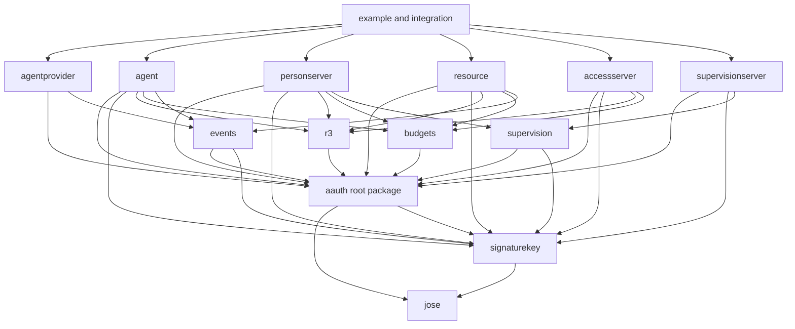

# Architecture

This repository is a Go implementation of the source family mapped in
[PROTOCOL.md](PROTOCOL.md). The architecture follows ordinary Go composition:
small protocol packages own reusable wire semantics, role packages own role
behavior, and applications provide policy, persistence, keys, clocks, and
transport.

[CONFORMANCE.md](CONFORMANCE.md) is the implementation-status ledger. An API
or package name in this document is not by itself a conformance claim.

## Design rules

1. **Keep source terminology recognizable.** A reader should be able to move
   between an editor draft, a Go type, and a test without learning a private
   vocabulary first.
2. **Separate wire truth from policy.** Parsing and cryptographic validation
   establish what a peer sent. A role-specific policy decides whether to
   accept it.
3. **Keep state with the deciding role.** There is no universal store,
   lifecycle, evidence envelope, or verified-context aggregate.
4. **Make consequences explicit.** Client methods perform one protocol
   exchange. They return a result or a typed continuation; they do not hide
   polling, browser interaction, sleep, or consequence retries.
5. **Preserve exact bytes when retained identity depends on bytes.** When a
   compact token, signed request, R3 document, approved mission blob, or result
   is retained, its original bytes remain available; a parsed value does not
   replace them. Immediate mission approval need not retain the proposal;
   deferred review retains its exact signed bytes before returning `202`.
6. **Compose companion behavior explicitly.** Core does not silently accept
   R3, Events, or Budget semantics. The role handling a token invokes the
   companion package that understands each authorization-bearing claim.
7. **Make the easy path runnable.** Every complete journey has an executable
   example with in-memory policy and stores. Hosts replace those dependencies
   without replacing protocol code.

## Current and target boundaries

The current repository already has the `aauth`, `jose`, `signaturekey`,
`agentprovider`, `agent`, `personserver`, `resource`, and `accessserver`
packages. Their implemented behavior is the subset listed in
[CONFORMANCE.md](CONFORMANCE.md).

The current mission slice supports immediate approval or a retained proposal
for separately authenticated host review. The root package owns proposal,
approved blob, update, completion, digest, and response values. `agent` makes
one explicit proposal or poll call. `personserver` retains exact deferred
proposal bytes in a bounded host queue and atomically commits approval with the
Mission and returned Person tokens. A stale approval becomes terminal expiry
before credential delivery. The same role owns ordered accepted
updates, policy evaluation, and person-accepted completion. `resource` and
`accessserver` receive only the signed mission digest needed by ordinary
three- or four-party authorization. Mission text and updates never cross the
Person Server boundary, and no generic lifecycle or evidence object joins
these roles.

The current Bootstrap slice has explicit two-key and single-durable-key hosted
profiles, with Ed25519 or ES256 keys. Both share durable-key `hwk` enrollment and one stable Agent
identity. Refresh then either verifies a durable-to-ephemeral `jkt-jwt` or a
direct durable `hwk` proof. Both retain the exact first Agent-token result
before release. `agent` performs each caller-selected exchange once and
returns material for a new immutable authenticated client. Endpoint paths,
JSON envelopes, refresh identity, replay rules, and policy errors are
documented implementation choices because Bootstrap does not standardize
them. A third, source-defined self-hosted composition fixes one user-controlled
key as both AP signing and Agent confirmation key, publishes the ordinary AP
metadata/JWKS handler, and self-issues fresh Agent tokens without a refresh
endpoint.

Hosted administration stays outside the Bootstrap wire profile. The
application authenticates the administrator, then asks its `EnrollmentStore`
to atomically disable, restore, or permanently revoke the retained enrollment.
The common transition helper preserves identity and key, advances one expected
revision, and makes exact retry converge. Revocation prevents later refresh;
it does not alter an already-issued Agent token. The separate Core revocation
path lets the AP explicitly target a configured PS or a known direct
Agent-identity Resource. Each recipient retains the exact `(iss, jti)` marker
through its own role-local store and checks it after token and proof
verification but before policy or application dispatch. No shared revocation
lifecycle or automatic Resource registry joins those roles. Each package's
`storetest.RunAgentTokenRevocation` checks the same source operation through
that role-local interface.

The current Events slice adds the `events` value package plus explicit
`agentprovider`, `resource`, and `agent` role surfaces for public and protected
subscriptions. The AP owns subscribe-token issuance and its inbox, the
Resource owns public registration, opaque protected-ticket issuance and
consumption, and outbound delivery, and the Agent owns local context and replay
correlation. Each role receives its own small store interface; no shared Events
lifecycle object crosses those boundaries.

The current Permission slice covers top-level missionless and mission-bound
local actions. The root package owns the `granted` and `denied` wire values;
`agent` performs one signed request or poll; and `personserver` owns verified
intent, immediate or deferred policy, and purpose-specific store interfaces.
Missionless calls use `PermissionStore`. Mission-bound calls require the
server's token store to implement `MissionPermissionStore`, placing mission,
mission-bound token, and permission transitions in one atomic boundary. A host
handle recovers retained intent and a copied exact mission view after Server
recomposition but carries no person authority. The application authenticates
the person, interprets parameters, and executes an action only after receiving
the typed grant.

The current Audit slice is one top-level mission-bound post-action path. The
root package owns the exact audit document, `agent` makes one signed
submission, and `personserver` compares stable mission identity and lifecycle
state while appending through `MissionAuditStore`. Accepted updates do not
invalidate an append because Core says they do not change the mission. The
audit store extends the mission lifecycle boundary because an append must race
atomically with expiry or completion. Audit does not execute the action, and
it does not create a general evidence container.

The current Interaction Endpoint slice has separate question and relay state
machines, each usable with or without a mission. The root package owns exact
documents, `agent` performs one signed request or poll, and `personserver` hands
untrusted Markdown and an optional exact mission view to host policy in either
composition. `InteractionQuestionStore` and `InteractionRelayStore` own only
their focused deferred state; their mission-aware counterparts extend the
existing mission boundary for immediate retention and deferred transitions.
Neither is a generic interaction engine or the complete mission log.

The current Supervision slice adds the `supervision` package, which owns the
supervision server's metadata, the signed request envelope and bodies,
decisions, events, mission reports, errors, the signature profile of a signed
decision, and the Person Server's client for a supervision server. The
`supervisionserver` package is the supervision server role: it verifies
Person Server requests, keeps connections, decisions, mission blobs and
delivered events in its own store, and hands each act to host policy.
`personserver` owns routing, the decision points, the Agent's pending
supervised request, the log, the ordered event queue and replay, all behind
`SupervisionStore`. For a routed Agent each decision point consults the
supervisor in place of host policy; a decision that arrives after the Agent
was answered `202` is applied by serving the Agent's retained signed request
again, verified as it was made, so issuance stays in one code path. Neither
role imports the other.

The current model includes focused `r3`, `events`, `budgets` and
`supervision` protocol packages. Sections below distinguish their implemented profiles from target
ownership. Present-tense support must never be inferred from the target import
map alone.

The hosted-service example composes existing role APIs; it does not add a
hosted-service package. Enrollment, permission, mission review, Resource-owned
account selection, R3, Budget, one successful connector dispatch,
exhausted-Budget refusal before a second dispatch, and revocation remain
independently configurable role capabilities.
Their composition is evidence that the package boundaries work together, not
a new cross-role lifecycle abstraction.

## Package graph

Arrows mean target imports. Protocol packages do not import role packages, and
role packages do not import one another.

Private packages may provide strict JSON, bounded HTTP, and test helpers.
They do not own protocol semantics.

## Protocol packages

### Root package `aauth`

The current root package owns the implemented Core wire semantics. In the
target architecture it owns the complete Core value layer:

- Server and Agent identifiers.
- Core metadata documents and endpoint URL rules.
- Agent, Person, Resource, and Auth token headers and claims.
- Token minting, parsing, cryptographic verification, and Core context checks.
- `AAuth-Requirement`, `AAuth-Access`, `AAuth-Capabilities`, errors, and
  revocation request values.
- Mission, permission, audit, interaction, clarification, and deferred-response
  wire values.
- Immutable raw extension members from verified tokens.

It does not decide whether an Agent is enrolled, a Person is known, a scope is
allowed, a mission should be approved, or a Resource is trusted. It does not
own pending requests, token records, mission state, or application storage.

Token verification has two layers:

1. Core verifies JOSE, issuer discovery, time, audience, proof-key, and Core
   claim rules.
2. The accepting role decodes and validates each companion claim it supports
   before making a policy or serving decision.

`MintResourceTokenCore`, `VerifyResourceTokenCore`, `MintAuthTokenCore`, and
`VerifyAuthTokenCore` are extension-author seams, not application
authorization APIs. They expose the verified Core layer plus raw companion
members so an independent Go package can implement a companion specification
without reversing the dependency graph. A companion package must consume its
complete recognized claim set before returning an authorization value. The
ordinary token APIs remain fail-closed when those claims are present.

Unrecognized additive claims remain available to host policy where the source
allows them. Recognized authorization-bearing companion claims are never
treated as inert JSON.

### `jose`

`jose` owns the deliberately small JOSE profile needed by the protocol:

- JWK validation and RFC 7638 thumbprints.
- Caller-owned signing keys.
- Compact JWS parse, sign, and verify.
- Exact protected-header, payload, signature, and compact bytes.
- Fully specified algorithm and key-shape checks.

It has no AAuth role, HTTP, policy, discovery, or storage knowledge. Its public
surface follows Go cryptographic conventions: accept interfaces where callers
may use hardware or external signers, return immutable parsed values, and make
unsupported algorithms explicit.

### `signaturekey`

The current `signaturekey` package implements the schemes and proof behavior
needed by executing paths. The target completes HTTP Signature Keys
independently of AAuth role policy:

- Structured-field grammar and signature-label correlation.
- All defined schemes: `hwk`, `jkt-jwt`, `jwks_uri`, `jwks`, `jwt`,
  `self-jwt`, `x509`, and opt-in provisional `cached`.
- Request preparation, covered-component and content-digest validation,
  signature verification, and proof-time bounds.
- Scheme and algorithm negotiation.
- Typed `Signature-Error` results.
- Bounded discovery with caller-supplied egress admission.
- Optional bounded key/assertion caches with cache lookup separate from
  assertion validation.

The package proves a request and reports the signer/key material. It never
turns a valid signature into authorization.

### `r3`

The current `r3` package is the vocabulary-neutral R3 value layer:

- An explicit immutable registry with no global registration side effects.
- Strict document, proposal, display, parameter, reference, grant, and
  authorization values.
- Exact-byte artifact identity and structural-or-digest parameter matching.
- Adapter-owned operation union, equality, subset, and disjointness.
- A small copy-safe invocation value containing only one registered operation
  and its presented parameters.
- An atomic native-definition contract that returns copied operations, sparse
  advisory hints, and an exact digest-input receipt from one parse.
- Immutable authoritative snapshots used for operation containment without
  retaining source bytes, parser state, or an adapter AST.
- Strict Resource- and Auth-token R3 claim extensions.

The seven standard operation grammars live under `r3/vocab/`; third-party
vocabularies implement the same typed operation-codec contract. Each standard
adapter also owns one bounded native-definition parser. `DefinitionMaterial`
is the transient output of one parse. `AuthoritativeSnapshot` contains only
the copied operation set, sparse hints, and `SourceReceipt` over the adapter's
named digest-input encoding. `DefinitionRegistry` prevents accidental mixing
of parser registrations; it does not prove that a host selected a trustworthy
parser or source.

MCP, OpenAPI, and the focused AsyncAPI adapter parse sparse access hints.
GraphQL introspection returns a typed identity-unavailable refusal. The gRPC,
WSDL, and GraphQL adapters define no annotation parser; OData refuses AAuth
annotations until the draft defines a resolvable term namespace and target.
An exported parser is not a claim of complete native-format coverage.

It does not fetch documents, decide policy, retain proposals, execute calls,
or write issuance audit records. Network and external dependency acquisition,
freshness, and parser-resource bounds remain host responsibilities. "Atomic"
means one internally consistent parse result; it does not mean a durable
transaction, retained evidence record, or source attestation.

### `budgets`

The current `budgets` package owns the Budget companion's reusable semantics:

- Exact non-negative amount, unit, and decimal-scale values.
- Same-denomination amount narrowing, Resource-declared denomination checks,
  and later-issuer denomination preservation.
- Resource/Auth token claim extensions and consumed records.
- Fixed-price `AAuth-Budget` response parsing and formatting.
- Budget-specific `AAuth-Requirement` reasons without replacing Core's
  Resource-token requirement.

It does not choose a person's ceiling, price an operation, decide whether a
failed call is chargeable, or create a cross-Resource ledger. Those are policy
inputs owned by PS and Resource compositions. The current Resource profile
retains a purpose-specific `BudgetLineage` through host storage before releasing
the Resource token, then uses one atomic `BudgetStore.Charge` after every other
authorization check and before application dispatch. A variable cost is
reserved first, as `BudgetConfig.Maximum` through a `BudgetReserver` store,
and settled by the handler with `SettleBudget`, as a cost-only trailer once
the response has started. A store that implements usage queries answers
signed `POST /usage`, and a step-up Resource token's `budget_consumed` record
reaches Person Server and Access Server policy. In four-party Core, the Person Server
and Access Server independently resolve trusted Resource unit metadata, the PS
may narrow the amount in its signed request, and the AS may narrow it again.

### `events`

The current `events` package owns reusable token and delivery semantics shared
by public and protected subscription paths:

- AP metadata extension.
- Subscribe and Event token types and validation, including the `body_s256`
  binding between an Event token and its delivery body.
- Exact token, signed-content-type, and payload delivery identity.
- Agent-side event verification and duplicate identity.
- The AsyncAPI `aauth_subscribe` security-scheme declaration check.

Role packages own registration, subscription, use-limit, and delivery state.
The Resource role separately owns the protected ticket because the source
defines it as opaque and Resource-controlled; its store contract atomically
consumes that ticket with registration. The package does not define AP-to-Agent
transport or automatically validate payloads against AsyncAPI. A complete
Events-specific AsyncAPI discovery surface is not implemented; a Resource can
serve one validated AsyncAPI document through its Events service.

### Bootstrap and interoperability

Bootstrap is informational and platform-specific, so it does not become an
invented portable wire package. The target `agentprovider` API exposes
enrollment and refresh composition points, while executable examples
demonstrate the two-key, single-key, and self-hosted patterns using Core and
Signature-Key primitives.

The implemented hosted profiles share enrollment and expose separate
path-agnostic refresh handlers at Agent-Provider-origin URLs configured in the
explicit Agent caller. Both require body-bound JSON requests. The preferred
profile uses `jkt-jwt` to rotate to an ephemeral key; the simpler profile uses
the durable `hwk` key directly. Both store refresh replay state with the Agent
Provider. Neither is added to Agent Provider metadata or described as a
portable Bootstrap protocol. The self-hosted composition instead uses the
ordinary metadata and token format Core already defines; it adds no hosted
wire surface.

The interoperability profile is an integration-test and example boundary, not
a library package. Its five surfaces must run through the same exported APIs
that applications use.

## Role packages

Each role package already owns Core HTTP handlers or client steps plus small
interfaces for the policy and state that role controls. The descriptions below
state their target boundary, including companion behavior not yet implemented.
Interfaces live next to the code that consumes them.

### `agentprovider`

The current package owns Agent-token issuance, one-level sub-agent issuance
from a parent token it verifies with its own key (directly or through the
hosted `SubagentHandler`), AP metadata/JWKS, optional enrollment and refresh
composition, host-managed enrollment state transitions, explicit Agent-token
revocation clients for a PS or known direct Resource, subscribe-token
issuance, and the Events inbox. It accepts host policy for enrollment,
attestation, renewal, sub-agent issuance, and AP-to-Agent event delivery.

### `agent`

The target owns explicit caller steps:

- Discover a role.
- Obtain or refresh an Agent token through a selected Bootstrap pattern.
- Propose, inspect, update, and complete a mission.
- Obtain Person, Resource, and Auth tokens.
- Follow one deferred, interaction, clarification, or payment continuation.
- Perform one protected call or one R3 per-call retry.
- Register an Events subscription and verify a delivered event.
- Begin one Budget call, read its feedback, and decide whether to request reauthorization.

Each method attempts at most one protocol or application consequence; read-only
discovery may precede it. Methods return serializable continuation data where
another exchange is required. The caller decides whether and when to continue.
A higher-level helper may drive a complete journey, but it is built from the
same explicit steps and exposes its progress.

Core authorization may include one optional account selected by the Agent and
validated by the Resource. The Resource token, issuer policy, Auth token,
Agent verification, and protected principal preserve that exact value in both
authorization topologies. Account is Core context; no companion profile owns
or enables it.

The current R3 path is explicit at the Agent boundary. The caller supplies a
registered operation set, receives and verifies the Resource token, presents
its exact compact form to the Person Server, verifies
the returned Auth token, and chooses whether to begin, retry, or poll one HTTP
call. Each method performs one network consequence. R3 documents remain opaque
to the Agent.

The current fixed-price Budget path follows the same shape. The caller supplies
the request and signed Budget Auth token. `BeginBudgetCall` returns either one
caller-owned response or one verified step-up. An unverifiable result after
HTTP handoff is a typed uncertain outcome carrying the full signed grant, not
an automatic retry. A proactive grant may also name one Resource-validated
account. The Resource token, PS and AS policy inputs, Auth token, Resource
lineage, metering state, and application principal preserve that exact account;
Budgets adds no second account mechanism.

### `personserver`

The target owns Agent-person binding, directed identifiers, Person-token
records, missions, permission/audit/interaction endpoints, three-party
authorization, and PS-to-AS federation. Its policy inputs receive verified
Core and companion values in source terminology. Mission approval stores the
exact approved bytes before returning their digest.

A configured Agent-token revocation store is checked across the Person
Server's existing Agent-authenticated endpoints. The AP-signed `/revoke`
request and later Agent request meet only at the exact token reference; a
retained marker refuses use before person or authorization policy. The same
store also governs a sub-agent token carried as a request parameter, and the
Agent and sub-agent tokens a PS-hosted or federated wait was started with:
their pending records retain the token identifiers, so a revocation ends the
wait with `revoked`.

A separate, optional Agent-binding revocation store holds, by top-level Agent
identity, each binding a host revoked and when it established a replacement.
The PS consults it before Person, mission and Auth issuance, before a host
approval, before releasing any pending Person-token, mission, consent or
federated result, before each AS poll, and for the caller behind a call
chain. A pending record's creation time, or a presented token's issuance
time, must follow any replacement. The store holds no tokens and cascades
nothing to Resources or ASes. Parent-mediated federated waits retain the exact
sub-agent token in the PS continuation record; the parent alone polls or
cancels it.

Interactive Person-token issuance uses the same `PersonToken` and
`PollPersonToken` Agent calls with or without a mission. For a mission-bound
request, `MissionDeferredTokenStore` keeps pending creation, host decision,
token retention, poll, and terminal consume in the mission lifecycle boundary.
The host handle exposes a copied exact mission view; the correlation code is
still not approval authority.

Deferred direct authorization follows the same composition rule without
creating a second Agent workflow. `BeginExchange`, optional clarification, and
`PollExchange` are unchanged. The ordinary authorization store owns the
purpose-specific pending state; `MissionDeferredAuthorizationStore` adds only
the mission-aware transitions that must share the mission backend transaction.
The host handle exposes the exact active mission, while Agent snapshots retain
the already-signed Resource token rather than duplicating mission content.

For R3, the Person Server independently fetches the exact Resource artifact
after local token and person-lineage checks. In direct three-party class
authorization, one typed policy receives Core context plus the exact document,
narrows both Core scope and operations, and the PS signs the token after
atomically retaining its mandatory R3 audit through `r3.IssuanceStore`. In
four-party authorization, separate document and proposal consent callbacks
receive their corresponding typed artifacts; the PS forwards the original
compact tokens to the Access Server and verifies the returned reference,
account, and authorization against the same registered vocabulary and exact
artifact.

The direct clarification path extends one already verified pending
authorization rather than creating a second consent object. The ordinary
`personserver.DeferredAuthorizationStore` continues to own interaction and terminal token
state. Applications that enable chat additionally implement the focused
`AuthorizationClarificationStore` over those same records. That extension
retains a bounded question and an answer accepted through a signed Agent
request, enforces the deadline, and makes a same-state answer retry
idempotent. Cancellation is terminal. The host—not the protocol library—authenticates the person,
sanitizes Markdown, and decides whether the answer permits authorization.
There is no cross-domain pending-request or evidence container.

`PermissionStore` retains one complete verified action request and either its
immediate decision or a bounded pending state. Host grant and denial compare
that exact context, first-writer wins, and one terminal Agent poll consumes the
decision before delivery. For a mission-bound request,
`MissionPermissionStore` extends the existing mission/token boundary rather
than creating a parallel mission view. It compares the complete mission on
create, decision, poll, and consume; a host decision is also bound to the exact
mission view returned by `ResumePermission`. Permission records are a focused
sublog and are not reused for clarification, interaction relay, application
execution, or the complete cross-event mission log.

Mission audit state stays with mission lifecycle state. `MissionAuditStore`
compares stable identity and lifecycle state and appends one exact record in
Audit-entry order. Identical records are distinct actions, not idempotent
retries. A host read is owner-scoped; the current HTTP surface exposes
submission only. Cross-event ordering with updates, tokens, permissions, and
interactions belongs to the still-unimplemented complete mission log.

Mission-bound interaction relay state follows the same composition rule.
`MissionInteractionRelayStore` embeds the ordinary mission and relay contracts
so all relay transitions compare the exact active mission atomically. Policy
and a resumed host handle receive caller-owned copies of that mission view. A
relay remains a delivery-progress sublog; it does not become the complete
cross-event mission log or the authority for the Resource operation.

Mission-bound question state uses `MissionInteractionQuestionStore` for the
same reason. An immediate answer or unreachable result is retained before the
response, while deferred create, resolution, poll, and consume compare the
exact active mission. A resumed host handle carries the mission snapshot it
displayed; a later accepted update requires the host to resume again.

### `resource`

The target owns Resource metadata/JWKS, the five access modes, Resource-local
sessions, authorization endpoints, Resource-token issuance, requirements,
protected calls, revocation, held invocations, R3 document/proposal/result
state, Events registration/delivery, and Budget accounting.

A direct Agent-identity Resource may expose the same `/revoke` URL used by an
Auth-token Resource while keeping the stores and signer roles distinct. An AP
proof selects the Agent-token marker store; a PS proof selects the observed
Auth-token store. Direct Agent use checks its marker only after the Agent token
and proof key verify, then refuses before the application handler.

Each current Resource server enforces its configured runtime access mode.
Parsed operation hints support Agent-side preparation only; they do not select
Resource enforcement behavior, replace a runtime `AAuth-Requirement`, or grant
access. Core scope, R3 operations, and Budget constraints are evaluated
independently; none is projected into another.

The current R3 paths let one Resource advertise several registered
vocabularies at once. Each configured vocabulary supplies a
parser-registration-validated authoritative snapshot whose receipt names the
advertised discovery endpoint. Authorization requests and protected-call
mappings must be semantically contained in that snapshot before document
creation or enforcement. The HTTP Resource
binding maps a protected request to one registered operation and, only after
class lineage succeeds, extracts presented parameters for a per-call
invocation. Proposal policy receives that transport-independent invocation.
Document, proposal, retry, and held stores remain shared across vocabularies.
Authorization commits the exact class document before exposing its Resource
token. Direct protected use verifies the PS- or AS-signed class grant without an
enforcement-time fetch. For a per-call operation, the Resource constructs and
retains one exact proposal, exposes it to the entitled PS and AS, and returns
either a baseline `401` retry or Resource-held `202`. The resulting
one-operation Auth token can claim one execution; later presentation of the
same exact compact token returns the retained result. Proposal fetch custody
expires separately from execution custody. An Auth token must be issued while
the proposal Resource token is valid, but may first complete later within the
bounded Core Auth-token lifetime. Standard adapters derive snapshots from
bounded caller-acquired native sources. Network and external dependency
acquisition, plus non-HTTP credential and execution bindings, remain host
work.

The direct MCP class path can compose with the fixed-price Budget profile
without projecting one companion into the other. `r3` exposes explicitly
combined token functions that validate and consume both claim sets; the
single-companion functions continue to reject mixed tokens. The Resource maps
and verifies the operation first, atomically charges the Budget second, and
dispatches the application request only after both succeed. A replacement
Resource token for an over-cap call must preserve the exact R3 document
reference. Because R3 supplies the operation authority, this composition does
not require a duplicate Core scope.

### `accessserver`

The bounded deferred Core path retains an exact PS-authenticated request through
`accessserver.DeferredAuthorizationStore`. The AS policy may request payment or
wait for approval before granting. The PS owns its separate
`FederatedAuthorizationStore`: it fences one explicit AS poll, verifies the
result and retains it for authenticated Agent delivery. Payment settlement and
billing relationships stay in host policy; there is no shared PS/AS store or
implicit polling loop. Both roles consume terminal delivery conditionally.

The target owns four-party PS authentication, Resource-token verification,
policy, narrowing, Auth-token issuance, and R3 audit. An R3-capable issuer
commits the mandatory audit record before publishing the token.

The current R3 path independently fetches and verifies the exact Resource
artifact before policy. Separate class-document and per-call-proposal callbacks
receive ordinary Core context plus vocabulary-neutral typed values. Class
policy returns an authorization already proven through the registered codec.
The Access Server commits the Auth-token reference, vocabulary URI, and
mandatory audit facts through the shared `r3.IssuanceStore` before responding.
A store error withholds the token; the handler performs no hidden retry because
the source defines no stable request replay key.

## State interfaces

Target state is split by protocol fact instead of accumulated in one store.
Examples include:

- `EnrollmentStore` at an AP for a durable-key enrollment, atomic administrative
  state transition, and exact refresh result keyed by the verified identity
  and delegation JTI.
- `PersonTokenStore`, `MissionStore`, `MissionProposalStore`, `MissionAuditStore`,
  `PendingAuthorizationStore`, `PermissionStore`, `InteractionQuestionStore`,
  `FederatedAuthorizationStore`, and `AgentBindingRevocationStore` at a PS.
- `SessionStore`, `HeldInvocationStore`, `R3DocumentStore`,
  `R3ProposalStore`, `SubscriptionStore`, and `BudgetStore` at a Resource.
- `r3.IssuanceStore` at whichever PS or AS issues the R3 Auth token.
- `EventInbox` at an AP.

An interface states only the atomicity, idempotency, lookup, and retention
properties required by that state machine. It does not prescribe a database,
file format, encryption system, process model, or universal record envelope.
The public `*/storetest` packages turn the applicable interface contracts into
executable adapter checks; they complement rather than replace backend restart,
transaction-failure, and operational tests.

`MissionProposalStore` is used only when deferred mission review is enabled.
It extends the existing mission store with exact proposal retention, a bounded
pending queue, one host decision, and one terminal poll. Approval commits the
Mission and returned Person-token records in that same transaction; it does
not introduce a separate mission authority.

The current `R3DocumentStore` is deliberately one small immutable-record
boundary. It copies values across the interface, converges concurrent exact
commits, refuses same-URI replacement, keeps committed records loadable across
server recomposition, and exposes them only through the signed Resource
handler. It is not a general authorization or evidence store.

`R3ProposalStore` is create-only by full per-invocation URI and retains exact
bytes indefinitely so the PS and AS can later re-fetch the proposal named by
permanent audit provenance. `R3RetryStore` and
`HeldInvocationStore` separately own single-use execution, fencing, uncertain
retention, and exact-token replay. None is a universal lifecycle store.

`r3.IssuanceStore` is another focused boundary. One commit retains the
Auth-token reference and mandatory audit facts. Exact repeats converge and a
different record at the same token reference conflicts. It has no protocol
lookup method because immediate R3 defines no caller-visible retry identity.
When direct R3 also enables revocation, the mandatory R3 audit commits first.
A later revocation-store error still withholds the token, but may leave an
audit record for a minted token that was never disclosed.

Every complete journey ships with concurrency-safe in-memory implementations
for examples and tests. Applications may replace them with durable stores.
Where the protocol requires atomic publication or replay, the store contract
must make that property testable; a handler must not simulate it with a
sequence of unrelated calls.

## HTTP composition

Role servers are `http.Handler` values. The repository does not own the
application's listener, TLS termination, process lifecycle, or deployment.
Handlers still enforce protocol-level bounds: strict JSON where required,
body limits, time limits, redirect refusal or egress admission, exact issuer
matching, signature coverage, and typed protocol responses.

The Agent accepts an `http.Client` or narrow transport interface. Tests can
therefore run roles in process, across `httptest` servers, or against another
implementation without changing protocol code.

## Failure model

Failures have three layers:

1. Parse and cryptographic errors from `jose` or `signaturekey`.
2. Typed AAuth protocol outcomes such as requirements, pending responses,
   denials, expiry, and registered errors.
3. Host failures from policy, persistence, transport, or application work.

Protocol adapters preserve the typed layer and its recovery action. A store or
host error is never rewritten as a protocol denial, and a valid protocol
denial is never returned as an opaque internal error.

## Evidence structure

Tests mirror the package and protocol boundaries:

| Test seam | What it proves |
| --- | --- |
| Unit | Grammar, JOSE, exact bytes, claim rules, state transition, and negative vectors |
| Store contract | Atomicity, idempotency, retention, replay, and concurrent limits for one focused state interface |
| Role integration | One handler/client exchange with real proof, discovery, policy, and store behavior |
| Journey | A complete multi-role path, including interruption or duplicate presentation where the protocol requires recovery |
| Interoperability | The five profile surfaces and selected companion paths against another implementation or black-box role |

The machine-readable map in `internal/specmodel` assigns every normative source
heading and every uppercase normative or field-presence occurrence to a
protocol-value package, state-owning role, role-behavior package where
applicable, dependency set, and proof seam. [CONFORMANCE.md](CONFORMANCE.md)
then links implemented capabilities to executable tests. This gives a reader a
straight path from source text to Go ownership to observed behavior without
turning documentation into a second specification.

## Intentional non-goals

- No all-protocol `VerifiedEvidence`, `Context`, `Transaction`, or `Store`
  object.
- No policy language embedded in token parsing.
- No hidden polling or automatic replay of consequential requests.
- No invented Bootstrap wire protocol or AP-to-agent Events transport.
- No claim that examples are deployment templates.
- The first stable API is designed from the current sources; unpublished
  prototypes do not define it.
