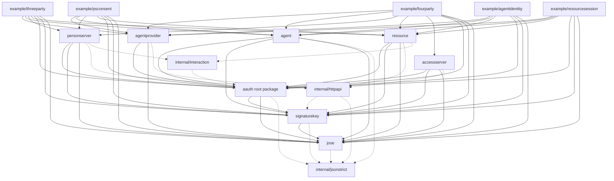
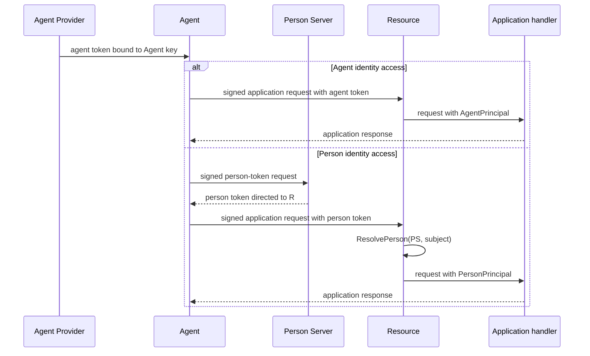
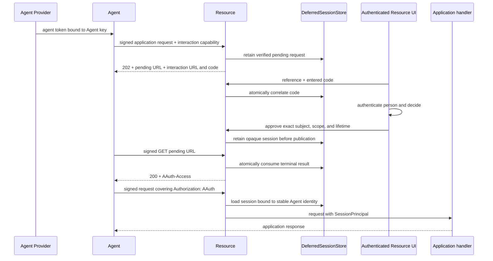
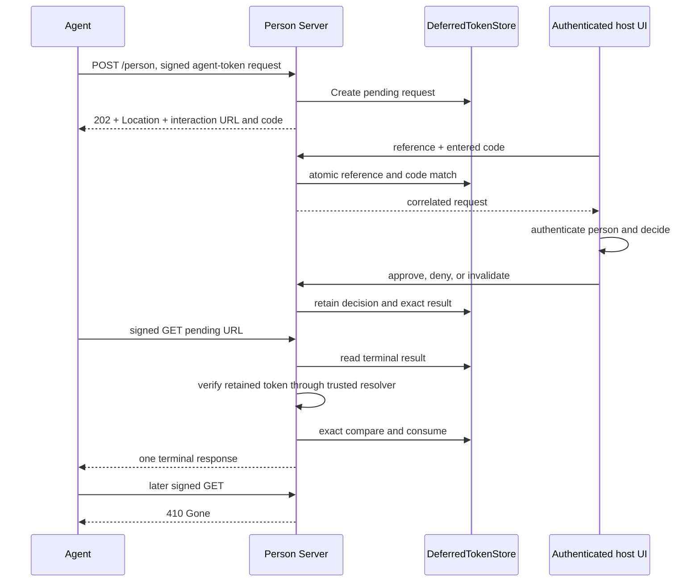
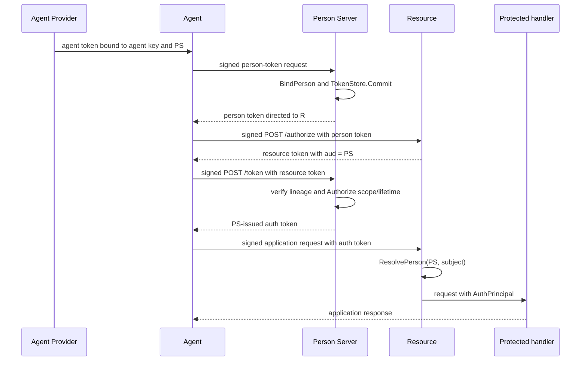
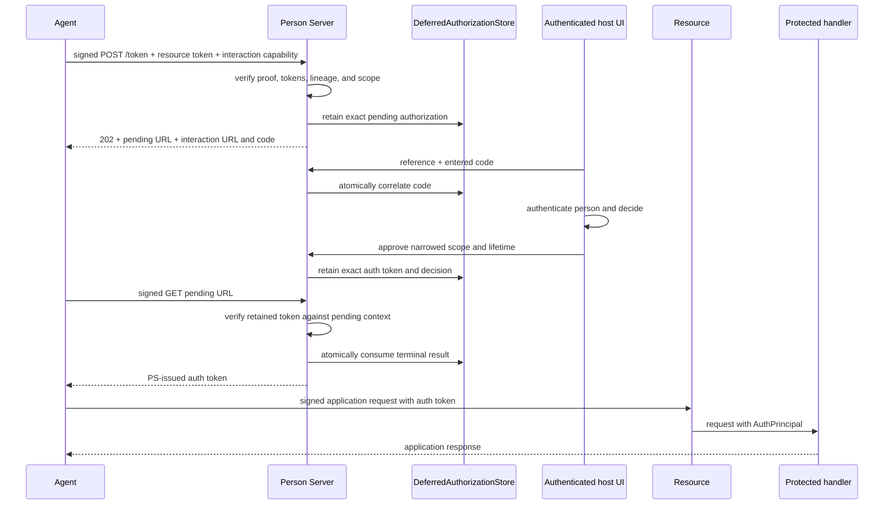
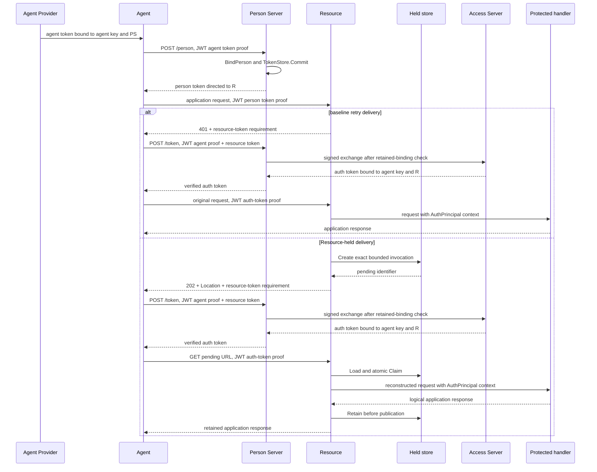

# Architecture

This repository currently implements direct Agent and Person identity access,
Resource-managed opaque sessions, immediate and deferred three-party PS
authorization, and one four-party federated AAuth Core flow in Go. It also
implements Person-Server-hosted interaction and baseline or Resource-held
delivery of the auth-token requirement. It separates token semantics, HTTP
request proof, role behavior, application policy, and application storage. It
does not define one universal verification object that spans those layers.

The exact editor sources behind this design are listed in
[SPECIFICATIONS.md](SPECIFICATIONS.md). See [CONFORMANCE.md](CONFORMANCE.md) for
the implemented boundary.

## Package graph

Arrows mean “imports.” Solid edges connect public packages. Dashed edges point
to private support packages. Protocol packages never depend on a role.

The three private support packages are deliberately small:

- `internal/jsonstrict` rejects duplicate names and non-exact spellings of
  known struct fields while leaving case-sensitive map keys and additive
  extension members intact.
- `internal/httpapi` applies bounded JSON decoding and common HTTP response
  encoding for server roles.
- `internal/interaction` generates and compares human-readable correlation
  codes and derives their non-plaintext store keys.

The five `example` programs are executable compositions. The `integration`
directory contains an external test package and adds no production import
edge.

## Package ownership

### `jose`

`jose` owns the selected Ed25519 JOSE profile: JWK validation and thumbprints,
caller-owned signing keys, compact JWS parsing and signing, and signature
verification. It has no AAuth role or policy knowledge.

### `signaturekey`

`signaturekey` owns HTTP Message Signature construction and verification,
`Signature-Key` credentials, covered-component checks, content-digest checks,
proof time bounds, typed signature failures, and metadata-to-JWKS key
resolution. A verifier first prepares a request, then selects the key required
by the credential profile, then verifies the prepared proof.

The resolver receives an application-supplied HTTP client and egress-admission
function. It follows the role metadata document to `jwks_uri`, validates the
issuer relationship, bounds every fetch, and caches the result in memory. It
supports the Core one-minute refresh floor for unknown or rotated keys. The
package exposes a replay key; the current role packages do not provide a replay
store.

### Root `aauth`

The root package owns Core protocol values and checks:

- server and agent identifiers;
- agent, person, resource, and auth token claims;
- token minting and verification;
- issuer role, discovery-document, type, time, and key checks;
- person-token and auth-token request-context checks; and
- typed AAuth problem responses.

Token verification returns typed claims. It does not decide whether a person
is known, a Person Server is trusted, or requested scopes should be granted.
Additional agent and auth-token claims remain copy-safe JSON values for host
policy; known claims from unimplemented companion specifications fail closed.

### `agentprovider`

`agentprovider` mints top-level agent tokens through a Go API and serves Agent
Provider metadata and JWKS. The caller decides whether issuance is allowed.
The package does not expose an enrollment, refresh, or sub-agent endpoint.

### `agent`

`agent` validates its configured agent token, discovers role endpoints,
obtains and verifies person, resource, and auth tokens, signs each request, and
performs protected HTTP calls. `CallAsAgent` performs one direct agent-token
call after Resource metadata discovery. `CallAsAgentWithComponents` performs
the same call with caller-supplied additional signature components and no
metadata dependency. A one-level sub-agent can use Resource-side calls with
its own key, but `PersonToken`, `PollPersonToken`, and `Exchange` refuse its
direct Person Server calls; the parent-mediated authorization flow is not yet
implemented. A client whose token names no Person Server closes a valid
`person-token` requirement returned by either direct call and surfaces the
unsatisfiable requirement as an error. `PersonToken` returns either a verified token or a `PendingPersonToken`;
`PollPersonToken` performs one signed `GET` and returns the next verified
state. `Begin` performs one call with a person token. It returns an ordinary
response, a verified `401` auth-token requirement, or a verified Resource-held
`202`. `PollAuthToken` performs one signed `GET` for that held result.
`BeginExchange` performs one PS token request and returns either a verified auth
token or a verified `PendingExchange`; `PollExchange` performs one signed
bodyless `GET`. Generic pending, approval, and interaction are directly
representable. An unsupported requirement is a typed `Failure` alongside the
verified continuation. Retryable responses remain caller-owned and do not hide
another request. The caller supplies PS capabilities explicitly. The
Resource-session methods are separate: `BeginResourceSession` makes one
Agent-token request after metadata discovery, `PollResourceSession` makes one
signed pending `GET`, and `DoWithResourceSession` makes one proof-bound session
call after metadata discovery. The matching `WithComponents` methods accept an
exact signature profile and skip metadata. Pending state retains that profile;
the caller declares interaction capability explicitly, and fresh poll field
values are always caller-supplied. Retryable `429` and `503`
poll responses remain caller-owned. `ResourceSessionState` preserves only the
opaque token, Resource, and stable Agent identity needed for local restore. The
client never sleeps, opens interaction URLs, exchanges, retries, or resends a
request implicitly.

The client rejects redirects and checks each returned token's identity, key,
scope, and applicable time bounds. A person token cannot outlive the agent
token used to request it. A resource token may outlive the person token that
was valid at issuance, and an auth token may outlive that short resource token
but not the agent token used to obtain it. The client refuses unsupported token
branches instead of silently dropping their meaning. For `Exchange`, the
signed auth token's `dwk` selects the verified issuer role while the verified
resource-token audience independently fixes the expected issuer. This supports
PS-AS collocation without allowing the returned token to change its issuer.

### `personserver`

`personserver` owns four endpoint paths:

- `/person` verifies an agent-token request. It either calls `BindPerson` and
  returns a retained person token, or creates a pending interaction selected by
  `RequirePersonTokenInteraction`.
- `/person/pending/{id}` verifies one signed poll and returns pending,
  interacting, or exactly one terminal result followed by permanent `410`.
- `/token` verifies an agent and resource token and reloads the retained
  binding. `NewPSAuthorization` may select a host-authenticated interaction
  through `RequireAuthorizationInteraction`, then falls back to `Authorize`
  when that policy declines. A deferred-only composition omits `Authorize` and
  fails safely if its interaction policy declines. `NewFederatedAuthorization`
  calls `Consent` and sends a signed exchange to the selected Access Server.
- `/token/pending/{id}` reauthenticates the original Agent and proof key and
  returns waiting, interacting, or exactly one terminal authorization result.

Both compositions require `BindPerson` and `TokenStore` and may select
interactive person-token issuance when that store also implements
`DeferredTokenStore`. PS authorization uses `Authorize`, a paired interaction
policy and `DeferredAuthorizationStore`, or both. The deferred path parks the
fully verified three-party request before the host decision. Federation adds
`Consent`, `AccessServerEndpoint`, and an HTTP client.
At the authenticated UI, the host atomically matches the pending URL reference
and entered code, then separately authenticates the person before approving or
denying the request. Deferred PS consent permits exactly three failed code
entries before closing the request. After successful correlation, later code
entries cannot change it. The host may add UI and network rate limits. Neither
the code nor reference is decision authority.

### `resource`

`resource` has five explicit compositions:

- `NewAgentIdentity` verifies an agent token and request proof, then supplies
  `AgentPrincipal` to the handler. It needs no Resource key, PS, AS, scope
  catalog, or person resolver.
- `NewPersonIdentity` verifies a directed person token and request proof,
  resolves `(iss, sub)`, then supplies scope-free `PersonPrincipal` to the
  handler. It needs no Resource key, AS, or scope catalog.
- `NewResourceManaged` verifies an agent token and request proof, applies
  immediate policy and can optionally fall back to Resource-owned interaction,
  then supplies `SessionPrincipal` for an opaque proof-bound session. The
  immediate-only composition needs `SessionStore`; interaction adds
  `DeferredSessionStore`. Neither needs a Resource signing key, PS, AS, or JWT
  issuance.
- `NewPSAuthorization` publishes JWKS and `/authorize`, issues each resource
  token to the verified Person Server, and accepts only PS-issued auth tokens.
- `NewFederatedAuthorization` publishes the same surface, issues resource
  tokens to one configured Access Server, and accepts only AS-issued auth
  tokens. It alone exposes Resource-held delivery in this cut. Its explicit
  topology remains federated when the PS and AS share one origin.

Each composition publishes its exact metadata `access_mode`. Identity-only
direct modes omit `jwks_uri`, `authorization_endpoint`, and scope descriptions
because they issue no Resource token. The Resource-managed composition
publishes scope descriptions but still omits Resource signing keys and an
authorization endpoint.

A host can also supply `HeldInvocationStore`. The Resource then snapshots a
person-token request within explicit limits, durably creates the invocation,
and returns `202` with the same resource-token requirement. A later signed
`GET` verifies the exact auth-token context before atomically claiming the
invocation. The Resource reconstructs the application request, executes the
handler once, retains the complete logical response, and publishes it only
after retention succeeds. The same exact compact auth token replays the
retained response; another token cannot consume it.

Held execution models a finite logical HTTP response, not a live connection.
It preserves ordinary status, headers, bounded body, and valid trailers. It
rejects request transfer framing and response features that cannot be retained
and replayed, including streaming, full duplex, hijacking, server push, and
hop-by-hop framing. Routes that require those features use baseline retry
delivery, selected through `HoldAuthTokenRequest`.

The original transport connection and middleware context are not serializable
parts of `HeldInvocation`. Execution uses a fresh context with the auth-token
remaining verified lifetime as its timeout and does not inherit poll
cancellation. A host that needs trace, locale, or other application context
must derive it again from retained authenticated inputs before the protected
handler runs.

The host supplies the scope catalog, a required-scope function that maps each
protected request to one or more declared scopes, `ResolvePerson`, optional
extra signed components, and the protected handler. The federated constructor
also requires the Access Server identifier. `ResolvePerson` matches or creates
the stable `(ps, sub)` record; its separate `PersonContext` contains current
tenant and additional claims that must not redefine that identity. Route
authorization runs before this potentially stateful callback. Account binding
is not supported in this cut.

### `accessserver`

`accessserver` accepts a Person Server’s `jwks_uri`-authenticated exchange at
`/token`. It verifies the agent and resource tokens, calls
`TrustPersonServer`, calls `Authorize`, and issues an auth token whose scope is
a subset of the request. Policy selects a lifetime of at most one hour, capped
by the agent token used for the exchange; it is not capped by the short-lived
resource token.

The policy callbacks receive ordinary Go values, including copy-safe
additional agent claims. They do not receive raw HTTP proofs or an all-layer
verification object.

## Direct identity sequences

The executing version is
[`TestCurrentCoreDirectIdentityAccessModes`](integration/direct_identity_access_test.go).

## Resource-managed session sequence

The interaction code is correlation data, not approval authority. The host
authenticates the person separately. Every poll and session use presents a
current AP-issued Agent token and matching request proof. The executing path is
[`TestCurrentCoreResourceManagedSessionAcrossResourceRecomposition`](integration/resource_managed_session_test.go).

## Person-token interaction sequence

`ResumePersonTokenInteraction` reconstructs the host handle after a `Server`
value is recomposed around the same store. The integration evidence uses an
in-memory store; it does not prove persistence across process restart.

## Three-party PS-authorization sequence

The Resource and Person Server use explicit constructors, so neither one
accepts a four-party token by accidentally treating a PS as an AS.

The executing version is
[`TestCurrentCoreImmediatePSAuthorization`](integration/three_party_authorization_test.go).

## Deferred three-party PS-consent sequence

The pending deadline is the earliest of host policy, the initial Agent-token
expiry, and the original resource-token expiry. Recomposition uses the same
store and stable Agent identity; no Go object address is authority. The
authenticated host can also retain denial, abandonment, or an internal
interaction failure. The first poll returns the registered terminal response;
every later poll returns `410 invalid_code`. The executing path is
[`TestCurrentCoreDeferredPSAuthorizationAcrossRecomposition`](integration/deferred_ps_authorization_test.go).

## Four-party auth-token requirement sequence

`agentprovider.Issue` is a local Go call in this cut. Each token or protected
operation request after that is signed. Metadata and JWKS discovery use
ordinary HTTPS `GET` requests.

The Resource authorization endpoint at `/authorize` is also available when an
agent wants a resource token before making the application request.

The executing version of this sequence is
[`TestCurrentCoreFourParty`](integration/core_four_party_test.go).

## Trust and policy boundaries

| Boundary | Library check | Host decision |
| --- | --- | --- |
| Token signature | `aauth` resolves the issuer key and verifies the compact token | Which issuers are reachable through the configured resolver |
| Agent issuance | `agentprovider` validates and signs the claims | Whether the caller may receive that token |
| Agent identity access | `resource` verifies the agent token, top-level or one-level sub-agent relationship, proof key, and request signature | The application handler applies local policy to `AgentPrincipal` |
| Person binding | `personserver` verifies the agent token and request proof | `BindPerson` chooses the directed subject and tenant |
| Person interaction | `personserver` atomically matches issuer, pending reference, and code; verifies a retained token before consuming its terminal result | The host authenticates the person, decides, and rate-limits failed code entries |
| Person identity access | `resource` verifies the directed person token, proof key, and request signature | `ResolvePerson` matches `(iss, sub)`; the handler applies local policy to `PersonPrincipal` |
| Resource-managed session | `resource` verifies the current agent token and request proof, exact retained grant, opaque session binding, route scope, and signed `authorization` field | The Resource host decides subject, scope, and lifetime and supplies `SessionStore`; if interaction is enabled, it also authenticates the person and supplies `DeferredSessionStore` |
| PS authorization | `personserver` verifies the retained token chain and keeps the grant within the resource-token scope and one-hour lifetime | `Authorize` narrows scopes and selects lifetime or refuses access |
| Deferred PS consent | `personserver` retains the fully verified request, enforces the fixed three-attempt code bound, correlates one host visit, reauthenticates every poll, and verifies an approved token before delivery | The host authenticates the person and records approval, denial, abandonment, or internal interaction failure through `DeferredAuthorizationStore` |
| Federated consent | `personserver` verifies the retained token chain | `Consent` allows or refuses the request before AS federation |
| Federation | `accessserver` verifies the Person Server proof and token context | `TrustPersonServer` admits the PS; `Authorize` narrows scopes and lifetime |
| Scoped protected call | `resource` verifies the auth token and exact request proof, then enforces the route’s required scopes | `ResolvePerson` matches or creates `(ps, sub)`; the configured handler applies application behavior to `AuthPrincipal` |
| Held completion | `resource` verifies the retained resource token, exact auth-token scope and proof key, atomic claim, and retained response before publication | The host store makes `Create`, `Claim`, and `Retain` durable; the handler supplies the application result |
| Discovery network | `signaturekey` validates metadata, issuer, JWKS, and keys | `Admit` filters URLs; the supplied transport pins DNS and rejects forbidden resolved addresses |

## Storage boundary

The immediate flow requires `personserver.TokenStore`. `/person` must commit a
`PersonTokenRecord` before returning the token. `/token` must load that record
and match its Person Server, resource, subject, tenant, mission digest, expiry,
and retention bound before issuing directly or federating the request.

Interactive person-token issuance requires `personserver.DeferredTokenStore`.
It creates one pending record before returning `202`; atomically matches the
issuer, URL reference, and code digest; retains approval, denial, expiry, or
invalidation; and serves polling reads without consuming them. For a terminal
result, the Person Server first validates the exact token through its trusted
resolver and only then asks the store to compare and consume that result. This
allows a transient resolver failure to be retried and permits only one terminal
HTTP response.

Deferred three-party consent requires
`personserver.DeferredAuthorizationStore`. Its record contains only the
verified Agent, Resource, person, scope, capability, key, and deadline facts
needed for the later decision. Creation precedes `202`; the code only
correlates an authenticated host visit; three wrong code presentations close a
waiting request, while later presentations cannot change an interacting one;
approval races converge on the first complete retained token and semantic
decision; every poll reauthenticates the stable Agent and proof key; and one
approved, denied, abandoned, expired, or server-error result is consumed before
delivery. Internal retained-state failures use registered `500 server_error`.
A later poll returns `410 invalid_code`.

Immediate-only Resource-managed authorization requires `resource.SessionStore`.
Resource-managed interaction adds `resource.DeferredSessionStore`.
`CreatePending` precedes the first `202`; code consumption enforces the
retained attempt and expiry bounds; `Approve` atomically refuses an expired
pending record or retains the exact proposed session before returning its
opaque token; each poll reloads the stable Agent identity; and `ConsumeResult`
changes one terminal result to permanent gone before HTTP delivery. Session
use reloads the retained `SessionRecord` and rechecks Resource, Agent, lifetime,
and route scopes after verifying the current Agent proof.

Held delivery additionally requires `resource.HeldInvocationStore`.
`Create` precedes the first `202`; `Claim` atomically grants execution or
returns a replay; `Retain` stores an independent logical response before any of
that response becomes observable. A failed or indeterminate execution never
returns to the executable state. Store implementations copy mutable headers
and bodies at every boundary.

These stores are part of the authorization boundary, not just queues. They
contain sensitive requests, headers, tokens, and decisions. An adapter must
preserve their confidentiality and exact integrity; changing retained input
can change the eventual result.

The repository does not provide durable store implementations. The integration
tests use in-memory stores to exercise these contracts and server-value
recomposition. They do not prove process-restart persistence. Discovery caches
and Agent pending handles are process-local. There is no token revocation
store, person directory, or general deferred-operation store in this cut.

An approved person token is validated before delivery. Its signing key must
remain trusted and resolvable until delivery or expiry. The built-in Person
Server JWKS publishes only the active key, so key rotation with outstanding
interactions requires a host-supplied resolver and JWKS policy that retains the
required prior key.

## Composition rule

Each layer returns the smallest value needed by its caller:

- `jose` returns verified compact-JWS facts;
- `signaturekey` returns one verified HTTP proof;
- `aauth` returns one typed token claim set;
- role packages turn those results into narrow policy inputs; and
- the Resource gives the application exactly one of `AgentPrincipal`,
  `PersonPrincipal`, `SessionPrincipal`, or `AuthPrincipal` for the configured
  access mode.

Each value stands alone; callers do not need one shared wrapper to use the API.
Applications can record audit data separately from protocol verification.
