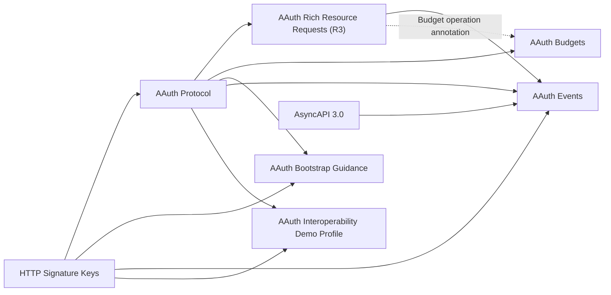
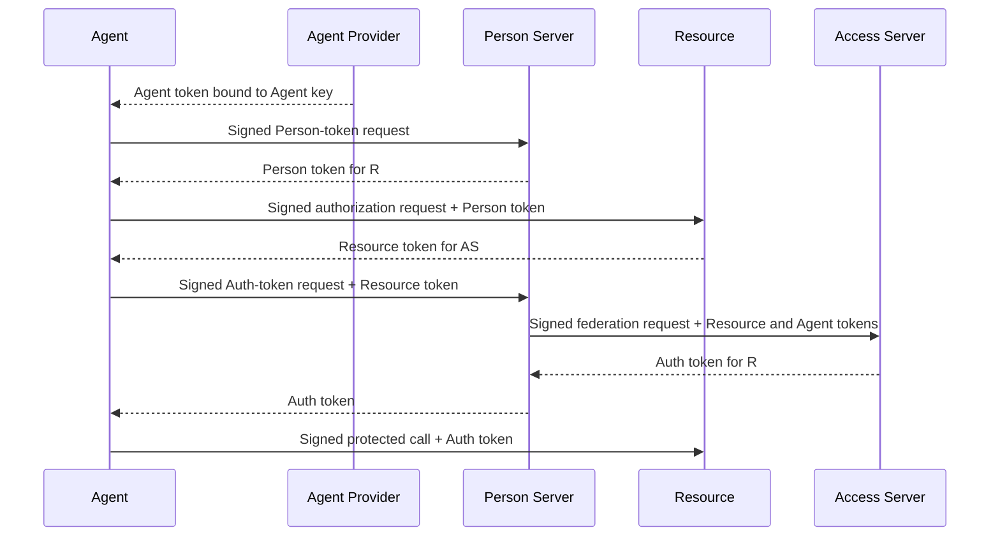
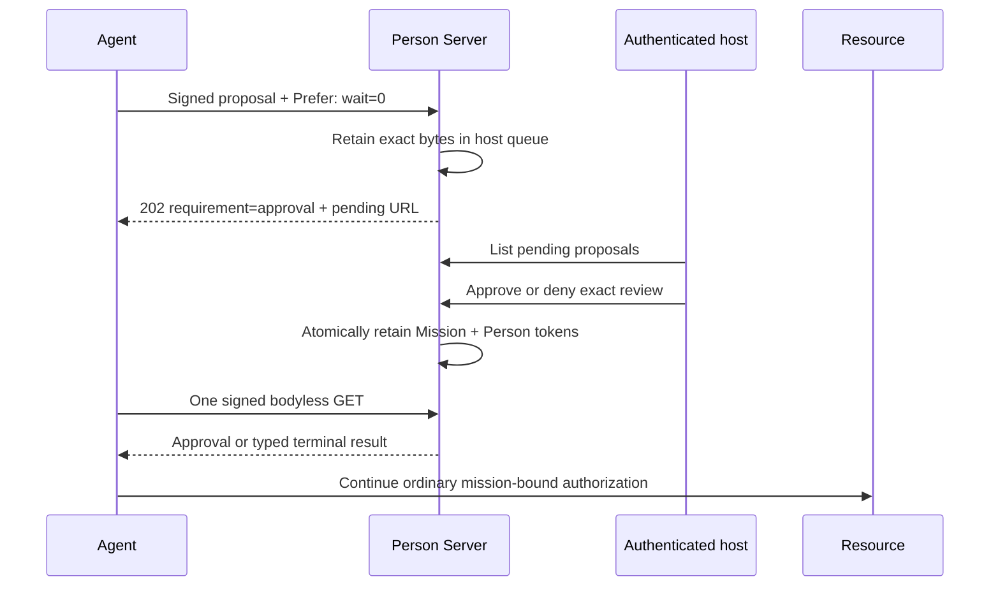
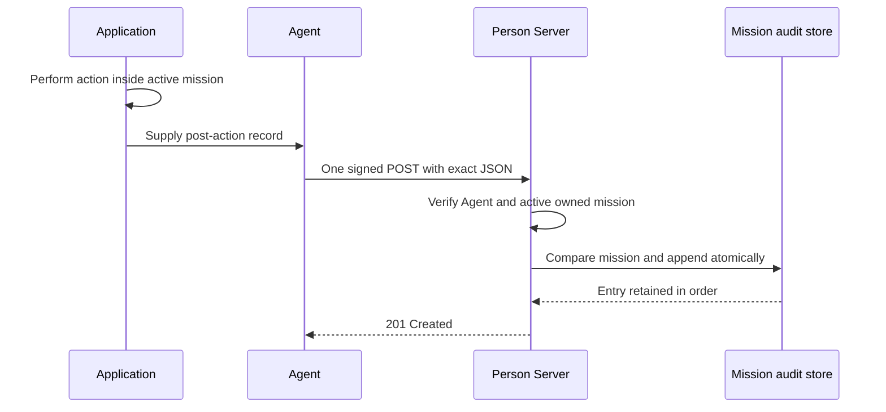
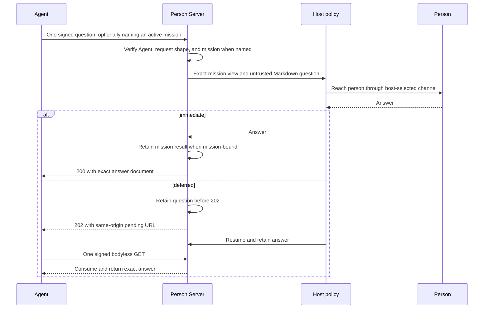
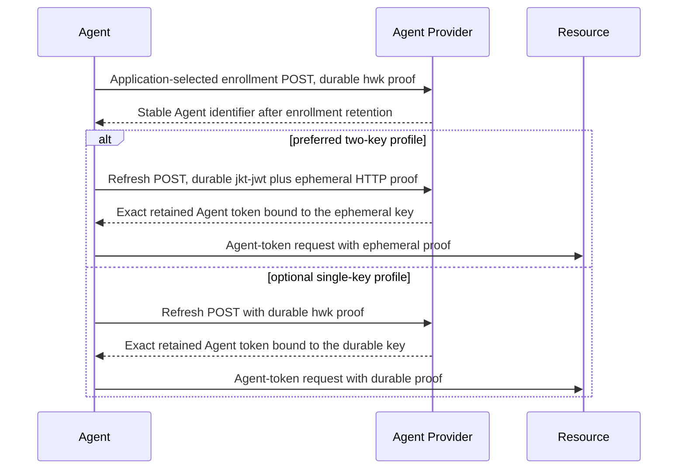
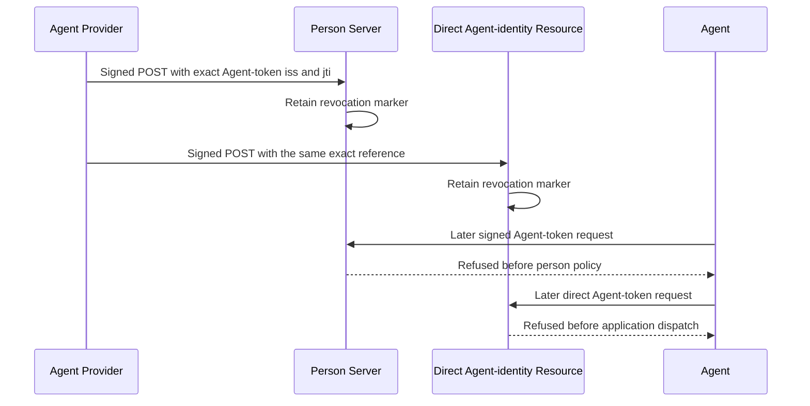
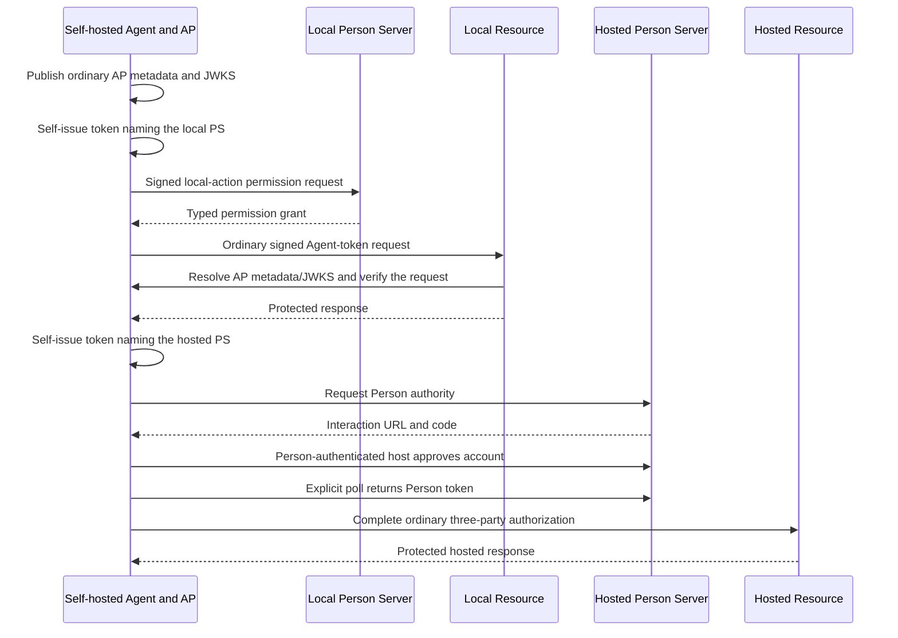

# Protocol map

This document is a reading map for the AAuth source family pinned in
[SPECIFICATIONS.md](SPECIFICATIONS.md). It shows how the documents compose,
which role owns each protocol fact, and where an implementation can observe
the required behavior. It does not replace the source text and does not claim
that every mapped behavior is implemented; that claim belongs in
[CONFORMANCE.md](CONFORMANCE.md).

## Source family



Solid arrows mean that one source builds on another source's protocol. The
dotted R3/Budgets edge is an explicit composition seam rather than ownership
in either direction.

The documents have different authority:

| Source | What it defines | Status in this model |
| --- | --- | --- |
| AAuth Protocol | Roles, identities, token profiles, requirements, endpoints, missions, deferred responses, delegation, revocation, discovery, and five access modes | Normative protocol |
| HTTP Signature Keys | How a signed HTTP message conveys or discovers its verification key | Normative protocol; `cached` remains explicitly provisional in the editor source |
| AAuth Rich Resource Requests (R3) | Machine-readable operations, grants, per-call proposals, and exact-byte authorization descriptions | Normative companion protocol |
| AAuth Events | Resource-to-Agent-Provider subscription and event delivery | Normative companion protocol; AP-to-agent delivery is deliberately unspecified |
| AAuth Budgets | Budget offers, narrowing, hard-cap accounting, feedback, and usage queries | Normative companion protocol |
| AAuth Bootstrap Guidance | Platform-specific enrollment and refresh patterns | Informational guidance, not a new conformance surface |
| AAuth Interoperability Demo Profile | Five complete demonstrations that implementations should be able to compose | Informational profile using the protocols above |

## Roles and identities

AAuth roles are protocol identities, not processes. A deployment may collocate
roles, but each role keeps its own identifier, metadata document, keys, and
protocol responsibilities.

| Role | Identifier and discovery | Owns |
| --- | --- | --- |
| Agent | `aauth:local@domain`; AP-issued Agent token | Its signing key, requests, local context, and explicit retry decisions |
| Agent Provider (AP) | HTTPS issuer; `aauth-agent.json` | Agent identity and keys; optional enrollment/refresh policy; Events inbox |
| Resource | HTTPS issuer; `aauth-resource.json` | API policy, Resource tokens, local sessions, held calls, R3 documents and proposals, subscriptions, and budget enforcement |
| Person Server (PS) | HTTPS issuer; `aauth-person.json` | Agent-person binding, directed person identity, local-action permission, consent, missions, Person tokens, and three-party Auth tokens |
| Access Server (AS) | HTTPS issuer; `aauth-access.json` | Four-party policy, Auth-token issuance, and R3 issuance audit |
| Person | No Core wire identifier | Approval, denial, clarification, and other human decisions exposed through a PS or Resource interaction |

The same `sub` string from two issuers does not name the same person. Person
identity is always the pair `(iss, sub)`. Tenant and mission values are
authorization context, not identity components.

## Access modes

A Resource chooses an access mode per endpoint or, with R3, per operation.
These are different protocol outcomes rather than security levels.

R3 annotations publish expected preparation. In this implementation they
produce advisory planning values only. The Resource's configured runtime mode
and any returned `AAuth-Requirement` remain authoritative.

| Mode | Credential presented to the Resource | What the Resource learns |
| --- | --- | --- |
| Agent identity | Agent token | AP-attested Agent identity and proof key |
| Resource-managed session | Opaque `AAuth-Access` credential plus Agent proof | A Resource-local relationship established by its own policy or interaction |
| Person identity | Person token | A PS-directed person identity for this Resource, without delegated authorization |
| Three-party authorization | PS-issued Auth token | Person identity and authorization decided by the PS |
| Four-party federation | AS-issued Auth token | Person identity from the PS and authorization decided by the AS |

Any operation can still return a runtime `AAuth-Requirement`; discovery and
R3 annotations never replace enforcement.

## Core wire objects

### Tokens

Every token uses a fully specified asymmetric `alg`, a distinct `typ`, and a
`kid`. The Agent proves possession of the key named by `cnf.jwk` or
`agent_jkt` through an HTTP Message Signature.

| Token | Issuer | Audience | Binding and context |
| --- | --- | --- | --- |
| `aa-agent+jwt` | AP | No `aud` | Agent identifier, Agent proof key, optional PS, optional parent Agent |
| `aa-person+jwt` | PS | One Resource | Directed person `sub`, Agent proof key, optional mission and tenant; never scope or account |
| `aa-resource+jwt` | Resource | PS or AS | PS, directed person, presented Person-token record, Agent key thumbprint, and `scope` or companion authorization claims as applicable |
| `aa-auth+jwt` | PS or AS | One Resource | PS, directed person, Agent proof key, granted Core and companion authorization context |
| `aa-subscribe+jwt` | AP | One Resource | Agent identifier, Agent proof key, opaque subscription `eid`, optional use limit |
| `aa-event+jwt` | Resource | One Agent | Subscription `eid`; self-issued and intentionally has no `cnf` |

Core does not settle whether every Resource token must carry `scope`: its
payload list includes it, while Core permits a companion claim to replace it
and R3 treats it as optional. The model's disposition is that Core scope is
optional or replaceable. The target implementation must handle every
authorization-bearing companion claim explicitly before a role makes a policy
or serving decision.

### HTTP fields and discovery

| Object | Purpose |
| --- | --- |
| `Signature-Input`, `Signature`, `Signature-Key` | Bind each request to a selected proof key and protect the key-distribution declaration itself |
| `AAuth-Requirement` | Name the next protocol requirement and its bounded parameters |
| `AAuth-Access` / `Authorization: AAuth` | Carry a Resource-owned opaque session, proof-bound by the request signature |
| `AAuth-Capabilities` | Advertise additive Agent capabilities without making unknown values fatal |
| `AAuth-Budget` | Report unsigned per-response cost, remaining, reservation, or required figures; ignore cached or denomination-conflicting feedback, and keep signed token claims authoritative |
| Role metadata and JWKS | Discover role endpoints and keys while exact-matching the advertised issuer to the retrieval origin |

Signature-Key defines eight schemes: `hwk`, `jkt-jwt`, `jwks_uri`, `jwks`,
`jwt`, `self-jwt`, `x509`, and provisional `cached`. Scheme selection,
algorithm selection, assertion validation, cache lookup, authorization, and
network egress admission are separate decisions.

## Stateful protocol boundaries

State stays with the role whose decision or consequence it represents. AAuth
does not define one global lifecycle or evidence record.

| State | Owner | Source or named profile boundary |
| --- | --- | --- |
| Agent enrollment and refresh result | AP | Repository hosted profiles: bind one durable-key identity to one stable Agent; retain an exact Agent-token result for a valid two-key or single-key refresh replay; let an authenticated host disable, restore, or permanently revoke future refresh without rewriting issued tokens |
| Agent-person binding and directed identifiers | PS | Stable within the PS and Resource pair; opaque outside the PS |
| Issued Person-token record | PS | Retained long enough to verify any Resource token that names it |
| Mission blob and updates | PS | Exact approved bytes determine `s256`; termination is one-way |
| Resource session | Resource | Opaque to the Agent and proof-bound on every use |
| Deferred request | Issuing server | Polling follows the returned same-origin location and terminal status rules |
| Authorization clarification dialogue | PS | Retain each bounded question and signed Agent answer with the pending three-party authorization; the host renders sanitized content and makes the eventual decision |
| Held invocation and first result | Resource | Execute once; replay the retained result for duplicate valid presentation |
| R3 document bytes | Resource | Persist exact bytes, serve them at an immutable URI, and use their SHA-256 as identity; changed bytes receive a new URI |
| R3 issuance audit | Auth-token issuer | Commit the URI/hash and issuance facts atomically with token issuance; the issuer is the PS in three-party or the AS in four-party |
| R3 per-call proposal and result | Resource | Exact parameters, one approval consumption, one execution, retained replay |
| Events subscription | Resource and AP | Resource retains route identity; AP retains active inbox state and atomically advances any use limit |
| Accepted event delivery | AP | Return `202` only after durable acceptance for delivery |
| Fixed-price Budget consumption | Resource | Atomically charge the exact precomputed cost without exceeding the token cap; in the direct MCP class composition, verify the R3 operation first and preserve its reference in any Budget step-up |
| Person-level budget ceiling | PS | Narrow allocations without disclosing or inventing a cross-Resource grant |

“Retain,” “durably accept,” and “atomically write” appear only where the
sources require them or an explicitly named repository profile defines them.
They do not imply a universal persistence API.

Before issuing an R3 Resource token, the Resource validates the declared
operation set against a parser-registration-validated snapshot derived from
its advertised native definition. Parsing is pure and caller-fed: discovery
I/O, external dependency acquisition, freshness, and resource bounds remain
outside the R3 value layer. Each bounded adapter resolves only the internal
relationships needed to derive operation identities. The snapshot receipt
identifies the parser's exact digest input; it is not the R3 document's
`r3_s256`.

## Complete protocol journeys

For the narrow repository deployment profile that composes enrollment,
permission, mission review, direct MCP plus Budget, connector execution, and
Agent-token revocation on one set of roles, run `go run
./example/hostedservice`. The sections below explain the protocol journeys
individually.

### Immediate four-party authorization



Three-party authorization removes the AS exchange and has the PS issue the
Auth token. Agent identity, Person identity, and Resource-managed access are
narrower compositions of the same proof, discovery, and requirement
primitives.

For direct three-party R3, the Resource first validates the requested
operations against its authoritative definition and returns a PS-audience
Resource token naming the exact retained document. The PS fetches and verifies
that document, selects a subset through host policy, signs the Auth token, and
atomically retains its mandatory R3 audit record before returning the token.
The Resource then enforces `r3_granted` without fetching the document again.
Per-call R3 remains a four-party path in this implementation.

### Deferred mission proposal



`Client.ProposeMission` is the immediate-only call. `Client.BeginMission`
returns either `Approval()` or `Pending()`; neither polls automatically. A
server that unexpectedly defers `ProposeMission` returns a typed error that
still exposes the verified pending value. A pending value can be snapshotted
and restored across Agent restart. Repeated
`202`, `429`, and `503` responses return an updated pending value and retry
interval; the caller owns its timer and cancellation.
The host reads `Server.PendingMissionProposals`, authenticates the responsible
person through application code, then calls `ApproveMissionProposal` or
`DenyMissionProposal`. The review value is context, not authentication, and
its untrusted Markdown must be sanitized before display.

The proposal-store contract owns durable discovery and the atomic decision
boundary; the executable adapter is in-memory. An approval that becomes stale
before delivery returns one typed expiry instead of unusable credentials; its
already-retained Mission and token records remain expired history and are not
disclosed through the pending URL.
Terminal polling is otherwise one-shot: the store records delivery before
returning the winning result, and later polls receive `410`. Core defines no
stable identity for recovering a lost initial `202` (`AAG-F012`, since withdrawn) or terminal
response (`AAG-F004`, since withdrawn). This approval-only profile does not implement mission
clarification. It also requires the original proposal key until decision;
`AAG-F105` records the unresolved renewal boundary.

### Local-action permission

```mermaid
sequenceDiagram
    participant A as Agent
    participant P as Person
    participant PS as Person Server
    participant App as Application

    A->>PS: Signed POST with action, parameters, optional mission_s256
    PS->>PS: If named, load exact active mission context
    PS->>PS: Retain pending request against mission before 202
    PS-->>A: 202 + same-origin pending URL
    P->>PS: Host-authenticated grant or denial
    PS->>PS: Atomically retain first decision
    A->>PS: One signed bodyless GET
    PS-->>A: Typed grant or denial; consume result
    A->>App: Execute only after grant
```

The Permission Endpoint governs an action that has no remote Resource. The
library verifies and carries intent but does not render the description,
authenticate the person, interpret the parameters, or execute the action.
Immediate policy returns a retained decision in one request. Deferred policy
returns a private continuation and requires an explicit caller poll; no method
sleeps or loops.

For a verified mission, `MissionResult.ApprovesTool` exactly matches a name
against `approved_tools`. While the mission is active, a listed tool skips this
endpoint; an empty, case-different, or unlisted action uses it. This is
Agent-side planning, not protocol enforcement or a live mission-status check:
no remote party observes local tool use.

Without `mission_s256`, the focused Permission store owns the request. With a
mission, the Agent names an approved mission and the PS gives policy and the
deferred host view its exact blob plus accepted updates. One
`MissionPermissionStore` owns mission, token, and permission state, so create,
decision, poll, and terminal consume each compare the exact active mission in
the same transaction. A mission update after host review forces a fresh resume;
expiry or termination prevents a grant from being released. These records are
the permission sublog, not the complete cross-event mission log. Full log
ordering remains unimplemented.

### Mission-bound action audit



Audit reports an action already performed; the library never performs the
action. The Agent submits once and does not retry an uncertain response because
Core supplies no stable request identity. The Person Server stores the exact
request before acknowledging it. Host code can read the ordered Audit-entry
sublog through `MissionAuditStore`. The complete cross-event mission log and
an Agent-facing retrieval route are not implemented here.

### Missionless or mission-bound Interaction question



The library carries raw Markdown but does not render it or choose a person
communication channel. The Agent submits once and does not retry an uncertain
initial result. A question may optionally name an active mission. Policy and a
resumed host then receive the same exact mission view; immediate retention,
deferred creation, resolution, poll, and consume all compare mission lifecycle
state atomically. A separately authenticated host answers a deferred question,
and the Agent polls explicitly once per call. These records remain a focused
Interaction sublog; complete cross-event mission-log composition remains open.

### Resource-hosted interaction relay

```mermaid
sequenceDiagram
    participant R as Resource
    participant A as Agent
    participant PS as Person Server
    participant Host as Host policy
    participant P as Person
    R-->>A: 202 + Resource pending URL + URL/code requirement
    A->>PS: One signed relay, optionally naming an active mission
    PS->>PS: Verify mission when named; retain exact relay before 202
    PS-->>A: PS relay pending URL
    PS->>Host: Exact mission view, description, URL, and code
    Host->>P: Present the relay through a host-selected channel
    P-->>Host: Engage with the Resource URL
    Host->>PS: Mark engagement
    A->>PS: One signed bodyless GET
    PS-->>A: Terminal interacting state
    A->>R: Continue polling the authoritative Resource URL
```

`RequestInteractionRelay` submits one `interaction` or `payment`, optionally
bound to an active mission by `mission_s256`. For a mission-bound relay, policy
and the separately authenticated host receive the same exact mission view;
create, resolution, poll, and terminal consume all compare mission lifecycle
state in the relay store's transaction. The Person Server retains the exact
request before `202`; the host either marks engagement or states that it can
make no more progress. `max_wait` can shorten the policy window.
`PollInteractionRelay` performs exactly one poll and never follows the Resource
URL.

When the Person Server returns `424 interaction_unavailable`, the Agent result
returns the original verified URL and code for direct presentation. Once a
relay was accepted, its pending URL reports only relay progress. The Resource's
original pending URL remains authoritative for completing the underlying
operation. Core names `pending` and `interacting` but does not define the
terminal success response shape; this implementation uses `200` with the same
one-member status document and records that choice as `AAG-F102` (since withdrawn).

### Clarification during three-party consent

```mermaid
sequenceDiagram
    participant A as Agent
    participant P as Person
    participant PS as Person Server
    participant R as Resource

    A->>PS: Signed Auth-token request; interaction + clarification capabilities
    PS-->>A: 202 interaction + pending URL
    P->>PS: Open consent session
    PS-->>A: Explicit poll returns 202 clarification + question
    A->>PS: One signed clarification_response
    PS->>PS: Retain exact answer with pending authorization
    P->>PS: Host-authenticated approval
    A->>PS: One explicit poll
    PS-->>A: Auth token
    A->>R: One protected call
```

The Agent receives the question and optional choices as typed values, but the
library does not render their Markdown. The host sanitizes both questions and
answers before showing them to a person. A question has a bounded deadline.
The current safe profile permits one round because Core gives an answer no
round identifier (`AAG-F095`). An exact same-state answer replay is idempotent;
a changed replay conflicts. A signed `DELETE` cancels the active question and
makes every later pending-URL request return `410 Gone`.

Each clarification answer, cancellation, poll, or missionless `updated_request`
sends one request. No method continues to another step on the caller's behalf.
A missionless clarification accepts `updated_request` when the replacement
resource token and `presented_token` match the pending ask on `iss`, `ps`,
`sub`, `agent_jkt`, `mission_s256`, and `tenant`, a parent-mediated ask matches
the child key, both expiries cover the pending deadline, and the resource-token
lifetime stays within the configured maximum. A retained person-token record
must agree. A revoked binding or a revoked token that started the wait is
refused, and the retained scopes are replaced. Account, Budget, mission-bound,
R3, and AS-relayed updated requests are not accepted.

### Hosted Agent bootstrap profiles



Bootstrap supplies both hosted key patterns but does not define portable endpoint
discovery, JSON envelopes, statuses, or replay semantics. This repository
profile makes those choices explicitly: all endpoints are selected
by the application on the AP origin; request bodies use signed
`application/json`; enrollment carries `evidence`; refresh carries optional
`ps` plus `evidence`; and `(durable identity, refresh jti)` identifies one
exact retained refresh request and result. Two-key refresh derives that JTI and
expiry from the durable-signed delegation. Single-key refresh carries them in
the durable-key-signed JSON body and bounds the recovery window to 24 hours.
Both freshly sign the outer request. An exact retry returns the same Agent
token; a changed profile, proof key, or body conflicts. The generic AAuth token
and Signature-Key formats remain unchanged.

### Agent-token revocation



Enrollment disablement or revocation stops new refreshes. Token revocation is
the separate immediate path for a token that already exists. The AP names each
known recipient explicitly; Core defines no Resource registry or automatic
fan-out. The PS and Resource expose role-local store interfaces with the same
source operation rather than one cross-role lifecycle object.

### Self-hosted Agent profile



`agentprovider.NewSelfHostedAgent` fixes one HTTPS issuer, top-level Agent
identifier in that issuer's namespace, and Ed25519 key. Its handler is the
ordinary Agent Provider metadata/JWKS handler, and `Issue` is ordinary current
Agent-token issuance with that same key as `cnf.jwk`. There is no enrollment or
refresh endpoint, no alternate token form, and no verifier exception. Core's
functional sections and Bootstrap define this profile; Core's later
distinct-AP rationale contradicts them (`AAG-F104`). The repository's local
composition additionally uses the token's `person_server` with the ordinary
Permission Endpoint before a direct Agent-identity Resource call. It then
self-issues a second token naming a hosted Person Server and uses the same
Agent identity and proof key through an explicit account-link interaction,
Agent poll, and hosted three-party call; see
[LOCAL-AGENT-PROFILE.md](LOCAL-AGENT-PROFILE.md).

### Mission-bound interoperability profile

The profile's five demonstrations form one coherent progression:

1. The Agent proposes a mission; the PS returns the exact approved mission
   bytes and their digest.
2. The PS issues a mission-bound Person token to the Agent's current key.
3. The Resource verifies it, issues a Resource token, and publishes exact
   issuer metadata and JWKS.
4. The PS or AS issues an Auth token; the Resource verifies the token and the
   Agent's proof and establishes `(iss, sub)` continuity.
5. A parent may obtain the Person-side credential for one sub-agent; the child
   key remains the proof key seen by the Resource.

Mission approval is the first surface, not an optional decoration on an
otherwise complete profile.

The current Go mission example uses the three-party profile variant and adds
two Core lifecycle steps that are not separate interop-profile surfaces: one
exact accepted update before later policy and person-accepted completion after
protected use. The four-party example and integration path apply the same lifecycle
while keeping the exact mission and ordered accepted updates at the PS,
sending only `mission_s256` to the AS, and retaining an exact digest and claims
record for the verified AS-issued token before release.

### R3 per-call authorization

The Agent requests typed operations. The Resource validates them against its
advertised vocabulary and creates a document whose operation set is exactly
the requested validated set. It stores the exact bytes at an immutable URI and
returns their URI and digest in a Resource token. The PS and AS independently
fetch and verify the document. The AS may grant only a subset of that exact
set, divided between granted and per-call operations.

For a per-call operation, the Resource creates an exact proposal. It either
holds the invocation (`202`) or requires an equal retry (`401`). Approval may
authorize that proposal once. The Resource executes once and returns its
retained first result on duplicate valid presentation.

### Events delivery

The implemented public variant begins when the AP retains one subscription and
issues its subscribe token. In the protected variant, a prior authenticated
Resource interaction instead causes the Resource to retain and return an
opaque short-lived ticket URL bound to the JWK Thumbprint of the key it
verified in that interaction and to application context. The Agent then
obtains the same kind of subscribe token and signs one POST to that exact
ticket path. The Resource verifies that the subscribe token's `cnf.jwk` has
the recorded thumbprint, expiry, and single use and atomically consumes the
ticket with registration. The ticket encoding and the
application decision to issue it remain Resource-owned.

In both variants, the Agent verifies the token, retains its own context, and
signs one registration request. The Resource retains the registration,
resolves the AP's current event endpoint at delivery time, admits that
endpoint, then signs a self-issued Event token, whose `body_s256` carries the
payload digest, and the request with the same key. The AP verifies the token,
the proof, and `body_s256`, validates the subscription, atomically enforces
any use limit, durably accepts the exact token, signed content type, and
payload, and only then returns `202`. Its host uses an out-of-scope mechanism
to reach the Agent, which independently verifies the Event token, its own
identifier, and the payload against `body_s256`, and correlates the event with
its local context.

Registration retries with the same subscribe token and exact parameters
recover the first Resource record; changed parameters conflict. Delivery has
an explicit prepare/send split and no hidden retry. An exact token, signed
content type, and payload retry recovers the first AP acceptance without
consuming another use. A
bodyless event or registration covers only the base components, and its token
carries no `body_s256`.

The Events draft conflicts with itself on expired events (`MUST NOT` versus
`SHOULD NOT`). The implementation follows the stricter normative behavior.

The draft also reuses `eid` for every delivery in a subscription while telling
the Agent to deduplicate by `(iss, eid)`. That would discard every legitimate
event after the first. The implementation treats `eid` only as subscription context and
deduplicates an exact accepted delivery by hashing the compact Event token,
the signed content type, and the exact payload bytes with unambiguous
separators.

### Budgeted access

The profiles below charge a fixed price. A Resource may instead reserve a
maximum and settle a lower cost, with a cost-only trailer on a streamed
response; that profile is listed under AAuth Budgets in
[JOURNEYS.md](JOURNEYS.md). Direct three-party
supports both source-defined entry paths. Proactively, the Agent requests
one denomination. Reactively, the Agent's ordinary Person-token call receives
a Budget-bearing Resource token in the `401`; the host's `InitialOffer` policy
selects one declared unit and amount rather than the library guessing among
currencies. For a same-denomination proactive offer, the Resource may only
lower the amount. It may instead select another denomination from its own
`budget_units`; that establishes the Resource's new offer, while its ordering
against the Agent request remains unresolved by `AAG-F088` (since withdrawn). In both paths the
Person Server preserves the Resource-selected unit and scale and may only
lower the amount; its Auth token is the signed cap. After all ordinary
authorization checks, the Resource atomically charges the exact known cost
before application dispatch and reports cost and remaining Budget as an RFC
9651 Dictionary.

Immediate four-party Core uses the same Resource offer and protected-call
enforcement. The Person Server and Access Server each resolve trusted current
`budget_units` metadata. The PS copies `unit` and `decimals` from the Resource
token and may lower only the amount. If it omits the optional member, that
omission is not a grant: the AS issues no `budget` claim, and the PS rejects a
token that carries one. When the PS sends a ceiling, AS policy may lower only
the amount, and the PS verifies the returned claim against both the Resource
offer and that ceiling. The Agent reads a present grant from the Auth token and
accepts a token that omits the claim without substituting the Resource offer.

The direct Core path also composes with an active mission. The exact mission
digest flows from the mission Person token through the Resource and Auth tokens
into the charge record; Person Server policy receives the active mission, and
mission-token retention compares that lifecycle atomically. A completed or
expired mission prevents another exchange before policy. Mission-plus-R3 stays
disabled until its separate R3 issuance audit can share that same atomic
mission transition. Direct class-document R3 uses
`MissionR3IssuanceStore` to commit the mission comparison, Auth-token record,
and mandatory R3 issuance facts together before release.

An insufficient or exhausted request consumes nothing. Its `401` carries a
host-asserted replacement Resource token selected from retained Person-token
state, the ordinary Core auth-token requirement, and a typed Budget reason.
The Resource calls `RetainLineage` before releasing the initial Resource token,
so a host can retain that state without observing the Agent's token flow. The
libraries verify the replacement's observable context but cannot prove which
retained record the host selected or its freshness from the presented Auth
token alone.
`BeginBudgetCall` verifies and returns that step-up without exchanging or
retrying it. After a definite insufficiency or exhaustion refusal, the
application can pass its verified replacement token to `Exchange` and make one
explicit retry under the fresh narrowed grant; Core, R3+Budget, and
hosted-service runnable journeys prove that composition. No library method
retries a chargeable consequence automatically.
When a post-send outcome cannot be verified, it carries the full signed grant
as the only locally proved upper bound. A step-up Resource token may carry
`budget_consumed` for the presented Auth token. The Person Server and Access
Server verify that record and hand it to policy; they do not keep a grant
store in order to admit it. The host joins `jti` to its own ledger. Until a
figure arrives, `budgets.AccountedSpend` holds the full grant; a record
replaces that assumption and does not settle the allocation.
`budgets.Free` applies the draft's settlement formula. A Resource whose Budget
store implements `BudgetUsageStore` publishes `usage_endpoint` and serves a
signed `POST /usage`. The response is not signed. A streamed response can send `reserved` in the
header and `cost` in an `AAuth-Budget` trailer. The fixed-price protected path
still commits the known cost before dispatch. `BudgetConfig.Maximum` reserves
that bound first. `SettleBudget` after the header is written commits the spent
part as a cost-only trailer. `SettleBudget` before the write sends a fixed-price
header and no trailer. A handler that writes and does not settle commits the
hold as the trailer; a handler that writes nothing gets that fixed-price header
for the whole hold. The commit uses the resource clock as the charge time. A
usage response reports the store's completeness time when the store sets one.
A step-up record is committed spend and does not count other requests' holds.
A direct Person Server sizes a sub-agent or one-hop call-chain auth token from
that token's own offer; the grant is not a remainder of a parent or upstream
budget. The Agent treats a `reserved` header without `cost` as
complete and assumes the reservation until `ApplyTrailer` reads a cost-only trailer. Automatic reauthorization
and reactive Resource-held or R3+Budget first calls are not part of these
profiles.

## Source tensions and implementation choices

The model does not silently resolve contradictions in the editor sources.
Choices below are recorded in detail in
[INTERPRETATIONS.md](INTERPRETATIONS.md); questions suitable for the editors
remain in [SPEC-FEEDBACK.md](SPEC-FEEDBACK.md).

| Tension | Target disposition |
| --- | --- |
| Core lists Resource-token `scope`, while companion authorization may replace it | Treat `scope` as optional or replaceable; enforce co-present constraints independently |
| R3 permits same-URI replacement but also treats URI plus hash as a permanent refetchable record (`AAG-F005`) | Published document URIs are immutable; new bytes receive a new URI and referenced bytes remain available |
| R3 lets a broader document merely cover a request, so the AS may not know the exact requested operations (`AAG-F014` and `AAG-F014a`, both since withdrawn) | Issue an exact-request document and constrain every AS grant to its operation set |
| Events gives two strengths for expired-token refusal | Apply `MUST NOT` |
| Events uses subscription `eid` as a delivery deduplication key (`AAG-F058`, since resolved) | Use an exact token, signed-content-type, and payload fingerprint; retain `eid` as routing context |
| Signature-Key labels `cached` an open design | Keep it opt-in and visibly provisional |
| Bootstrap defines hosted key patterns but no portable wire or replay rule | Keep routes application-selected and document explicit AP-owned exact-result profiles rather than adding metadata fields or a generic Bootstrap package |
| Core and Bootstrap define self-hosting, while one Core rationale paragraph forbids a self-signed Agent token (`AAG-F104`) | Implement the functional self-hosted profile without verifier exceptions and ask the editors to reconcile the rationale |

## Model-to-code rule

Each normative source heading maps to one protocol capability, one
protocol-value package, one state-owning role, a corresponding role-behavior
package where applicable, and one controlled proof seam. The machine-readable
map in `internal/specmodel` checks the exact source hashes, line counts,
normalized heading sequence, non-overlapping ranges, ownership vocabularies,
source tensions, and all uppercase normative or field-presence occurrences.
Each occurrence retains its source line, strength, exact-line digest,
dependencies, and owning heading. That heading supplies its value package,
state-owning role, behavior package, and proof seam. This prevents a source
update from disappearing into prose or being counted in two packages.

Implementation status remains separate. A capability is not implemented
because it has a model entry, exported type, or unit test. It becomes
implemented only when [CONFORMANCE.md](CONFORMANCE.md) names the executing
path, its important negative cases, and reproducible evidence at the required
seam.
