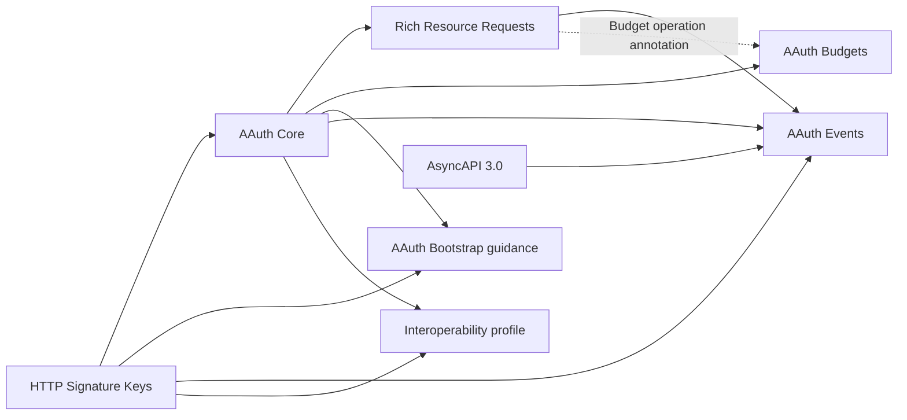
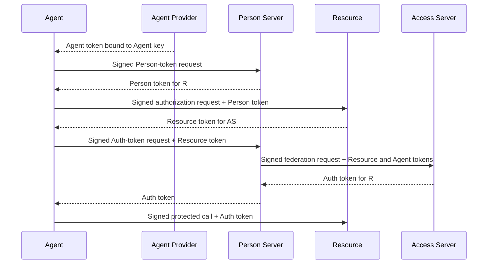

# Protocol map

This document is a reading map for the AAuth source family pinned in
[SPECIFICATIONS.md](SPECIFICATIONS.md). It shows how the documents compose,
which role owns each protocol fact, and where an implementation can observe
the required behavior. It does not replace the source text and does not claim
that every mapped behavior is implemented; that claim belongs in
[CONFORMANCE.md](CONFORMANCE.md).

## Source family

Solid arrows mean that one source builds on another source's protocol. The
dotted R3/Budgets edge is an explicit composition seam rather than ownership
in either direction.

The documents have different authority:

| Source | What it defines | Status in this model |
| --- | --- | --- |
| AAuth Core | Roles, identities, token profiles, requirements, endpoints, missions, deferred responses, delegation, revocation, discovery, and five access modes | Normative protocol |
| HTTP Signature Keys | How a signed HTTP message conveys or discovers its verification key | Normative protocol; `cached` remains explicitly provisional in the editor source |
| Rich Resource Requests (R3) | Machine-readable operations, grants, per-call proposals, and exact-byte authorization descriptions | Normative companion protocol |
| AAuth Events | Resource-to-Agent-Provider subscription and event delivery | Normative companion protocol; AP-to-agent delivery is deliberately unspecified |
| AAuth Budgets | Budget offers, narrowing, hard-cap accounting, feedback, and usage queries | Normative companion protocol |
| AAuth Bootstrap | Platform-specific enrollment and refresh patterns | Informational guidance, not a new conformance surface |
| Interoperability demo profile | Five complete demonstrations that implementations should be able to compose | Informational profile using the protocols above |

## Roles and identities

AAuth roles are protocol identities, not processes. A deployment may collocate
roles, but each role keeps its own identifier, metadata document, keys, and
protocol responsibilities.

| Role | Identifier and discovery | Owns |
| --- | --- | --- |
| Agent | `aauth:local@domain`; AP-issued Agent token | Its signing key, requests, local context, and explicit retry decisions |
| Agent Provider (AP) | HTTPS issuer; `aauth-agent.json` | Agent identity and keys; optional enrollment/refresh policy; Events inbox |
| Resource | HTTPS issuer; `aauth-resource.json` | API policy, Resource tokens, local sessions, held calls, R3 documents and proposals, subscriptions, and budget enforcement |
| Person Server (PS) | HTTPS issuer; `aauth-person.json` | Agent-person binding, directed person identity, consent, missions, Person tokens, and three-party Auth tokens |
| Access Server (AS) | HTTPS issuer; `aauth-access.json` | Four-party policy, Auth-token issuance, and R3 issuance audit |
| Person | No Core wire identifier | Approval, denial, clarification, and other human decisions exposed through a PS or Resource interaction |

The same `sub` string from two issuers does not name the same person. Person
identity is always the pair `(iss, sub)`. Tenant and mission values are
authorization context, not identity components.

## Access modes

A Resource chooses an access mode per endpoint or, with R3, per operation.
These are different protocol outcomes rather than security levels.

| Mode | Credential presented to the Resource | What the Resource learns |
| --- | --- | --- |
| Agent identity | Agent token | AP-attested Agent identity and proof key |
| Resource-managed session | Opaque `AAuth-Access` credential plus Agent proof | A Resource-local relationship established by its own policy or interaction |
| Person identity | Person token | A PS-directed person identity for this Resource, without delegated authorization |
| Three-party authorization | PS-issued Auth token | Person identity and authorization decided by the PS |
| Four-party federation | AS-issued Auth token | Person identity from the PS and authorization decided by the AS |

Any operation can still return a runtime `AAuth-Requirement`; discovery and
R3 annotations never replace enforcement.

## Core wire objects

### Tokens

Every token uses a fully specified asymmetric `alg`, a distinct `typ`, and a
`kid`. The Agent proves possession of the key named by `cnf.jwk` or
`agent_jkt` through an HTTP Message Signature.

| Token | Issuer | Audience | Binding and context |
| --- | --- | --- | --- |
| `aa-agent+jwt` | AP | No `aud` | Agent identifier, Agent proof key, optional PS, optional parent Agent |
| `aa-person+jwt` | PS | One Resource | Directed person `sub`, Agent proof key, optional mission and tenant; never scope or account |
| `aa-resource+jwt` | Resource | PS or AS | PS, directed person, presented Person-token record, Agent key thumbprint, and `scope` or companion authorization claims as applicable |
| `aa-auth+jwt` | PS or AS | One Resource | PS, directed person, Agent proof key, granted Core and companion authorization context |
| `aa-subscribe+jwt` | AP | One Resource | Agent identifier, Agent proof key, opaque subscription `eid`, optional use limit |
| `aa-event+jwt` | Resource | One Agent | Subscription `eid`; self-issued and intentionally has no `cnf` |

Core does not settle whether every Resource token must carry `scope`: its
payload list includes it, while Core permits a companion claim to replace it
and R3 treats it as optional. The model's disposition is that Core scope is
optional or replaceable. The target implementation must handle every
authorization-bearing companion claim explicitly before a role makes a policy
or serving decision.

### HTTP fields and discovery

| Object | Purpose |
| --- | --- |
| `Signature-Input`, `Signature`, `Signature-Key` | Bind each request to a selected proof key and protect the key-distribution declaration itself |
| `AAuth-Requirement` | Name the next protocol requirement and its bounded parameters |
| `AAuth-Access` / `Authorization: AAuth` | Carry a Resource-owned opaque session, proof-bound by the request signature |
| `AAuth-Capabilities` | Advertise additive Agent capabilities without making unknown values fatal |
| `AAuth-Budget` | Report unsigned pacing and accounting information; signed token claims remain authoritative |
| Role metadata and JWKS | Discover role endpoints and keys while exact-matching the advertised issuer to the retrieval origin |

Signature-Key defines eight schemes: `hwk`, `jkt-jwt`, `jwks_uri`, `jwks`,
`jwt`, `self-jwt`, `x509`, and provisional `cached`. Scheme selection,
algorithm selection, assertion validation, cache lookup, authorization, and
network egress admission are separate decisions.

## Stateful protocol boundaries

State stays with the role whose decision or consequence it represents. AAuth
does not define one global lifecycle or evidence record.

| State | Owner | Required boundary |
| --- | --- | --- |
| Agent-person binding and directed identifiers | PS | Stable within the PS and Resource pair; opaque outside the PS |
| Issued Person-token record | PS | Retained long enough to verify any Resource token that names it |
| Mission blob and updates | PS | Exact approved bytes determine `s256`; termination is one-way |
| Resource session | Resource | Opaque to the Agent and proof-bound on every use |
| Deferred request | Issuing server | Polling follows the returned same-origin location and terminal status rules |
| Held invocation and first result | Resource | Execute once; replay the retained result for duplicate valid presentation |
| R3 document bytes | Resource | Persist exact bytes, serve them at an immutable URI, and use their SHA-256 as identity; changed bytes receive a new URI |
| R3 issuance audit | AS | Commit the URI/hash and issuance facts atomically with token issuance |
| R3 per-call proposal and result | Resource | Exact parameters, one approval consumption, one execution, retained replay |
| Events subscription | Resource and AP | Resource retains route identity; AP retains active inbox state and atomically advances any use limit |
| Accepted event delivery | AP | Return `202` only after durable acceptance for delivery |
| Budget reservation and consumption | Resource | Atomically reserve, commit, or release without exceeding the token cap |
| Person-level budget ceiling | PS | Narrow allocations without disclosing or inventing a cross-Resource grant |

“Retain,” “durably accept,” and “atomically write” appear only where the
sources require them. They do not imply a universal persistence API.

## Complete protocol journeys

### Immediate four-party authorization

Three-party authorization removes the AS exchange and has the PS issue the
Auth token. Agent identity, Person identity, and Resource-managed access are
narrower compositions of the same proof, discovery, and requirement
primitives.

### Mission-bound interoperability profile

The profile's five demonstrations form one coherent progression:

1. The Agent proposes a mission; the PS returns the exact approved mission
   bytes and their digest.
2. The PS issues a mission-bound Person token to the Agent's current key.
3. The Resource verifies it, issues a Resource token, and publishes exact
   issuer metadata and JWKS.
4. The PS or AS issues an Auth token; the Resource verifies the token and the
   Agent's proof and establishes `(iss, sub)` continuity.
5. A parent may obtain the Person-side credential for one sub-agent; the child
   key remains the proof key seen by the Resource.

Mission approval is the first surface, not an optional decoration on an
otherwise complete profile.

### R3 per-call authorization

The Agent requests typed operations. The Resource validates them against its
advertised vocabulary and creates a document whose operation set is exactly
the requested validated set. It stores the exact bytes at an immutable URI and
returns their URI and digest in a Resource token. The PS and AS independently
fetch and verify the document. The AS may grant only a subset of that exact
set, divided between granted and per-call operations.

For a per-call operation, the Resource creates an exact proposal. It either
holds the invocation (`202`) or requires an equal retry (`401`). Approval may
authorize that proposal once. The Resource executes once and returns its
retained first result on duplicate valid presentation.

### Events delivery

The AP issues a subscribe token for one Resource. The Agent registers it at a
public endpoint or at a short-lived, single-use ticket obtained from an
earlier protected interaction. The Resource later resolves the AP's current
event endpoint, signs a self-issued event token and request with the same key,
and posts it. The AP validates the subscription and any use limit, durably
accepts the delivery, then uses its own out-of-scope mechanism to reach the
Agent.

The Events draft conflicts with itself on expired events (`MUST NOT` versus
`SHOULD NOT`) and its examples use polymorphic `EdDSA` where normative text
forbids it. The target implementation follows the stricter normative behavior
and does not use the conflicting example as an acceptance vector.

The draft also reuses `eid` for every delivery in a subscription while telling
the Agent to deduplicate by `(iss, eid)`. That would discard every legitimate
event after the first. The target treats `eid` only as subscription context and
deduplicates an exact accepted delivery by hashing the compact Event token, a
zero separator, and the exact payload bytes.

### Budgeted access

The Resource declares the denomination and offers a maximum. The PS and,
where present, AS may only narrow it. The final Auth token is the signed cap.
The Resource atomically reserves a finite maximum before chargeable work,
commits or releases it afterward, and reports remaining/cost information.
Exhaustion never consumes budget. Usage queries are independently signed and
can return only dimensions previously observed in accepted Auth tokens from
the calling PS.

## Source tensions and implementation choices

The model does not silently resolve contradictions in the editor sources.
Choices below are recorded in detail in
[INTERPRETATIONS.md](INTERPRETATIONS.md); questions suitable for the editors
remain in [SPEC-FEEDBACK.md](SPEC-FEEDBACK.md).

| Tension | Target disposition |
| --- | --- |
| Core lists Resource-token `scope`, while companion authorization may replace it | Treat `scope` as optional or replaceable; enforce co-present constraints independently |
| R3 permits same-URI replacement but also treats URI plus hash as a permanent refetchable record (`AAG-F005`) | Published document URIs are immutable; new bytes receive a new URI and referenced bytes remain available |
| R3 lets a broader document merely cover a request, so the AS may not know the exact requested operations (`AAG-F014`, `AAG-F014a`) | Issue an exact-request document and constrain every AS grant to its operation set |
| Events gives two strengths for expired-token refusal | Apply `MUST NOT` |
| Events examples use `EdDSA` where normative text forbids it | Follow the prohibition; do not use the example as a vector |
| Events uses subscription `eid` as a delivery deduplication key (`AAG-F058`) | Use an exact token-and-payload delivery fingerprint; retain `eid` as routing context |
| Signature-Key labels `cached` an open design | Keep it opt-in and visibly provisional |

## Model-to-code rule

Each normative source heading maps to one protocol capability, one
protocol-value package, one state-owning role, a corresponding role-behavior
package where applicable, and one controlled proof seam. The machine-readable
map in `internal/specmodel` checks the exact source hashes, line counts,
normalized heading sequence, non-overlapping ranges, ownership vocabularies,
source tensions, and all uppercase normative or field-presence occurrences.
Each occurrence retains its source line, strength, exact-line digest,
dependencies, and owning heading. That heading supplies its value package,
state-owning role, behavior package, and proof seam. This prevents a source
update from disappearing into prose or being counted in two packages.

Implementation status remains separate. A capability is not implemented
because it has a model entry, exported type, or unit test. It becomes
implemented only when [CONFORMANCE.md](CONFORMANCE.md) names the executing
path, its important negative cases, and reproducible evidence at the required
seam.
