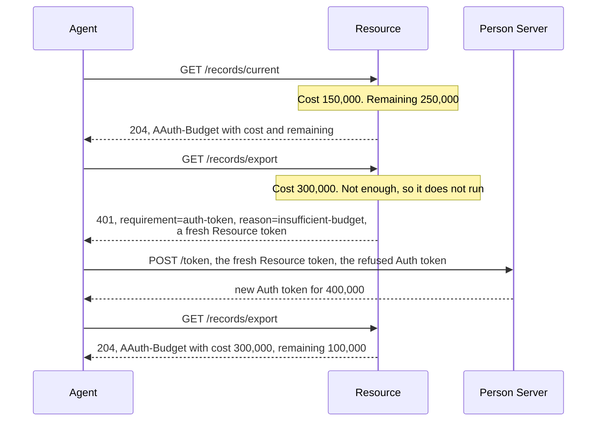

# Budgets

A Budget caps what an agent may spend at a Resource. The Resource offers an
amount in a unit it declares, in its Resource token. The Person Server grants
that amount or less, in the Auth token's `budget`. Each call is charged before
your handler runs, and the answer says what it cost and what is left, in an
`AAuth-Budget` header. When the grant cannot cover a call, the Resource
refuses it with a fresh Resource token, and the agent takes that to the
Person Server for a new grant.

The Budget is a hard cap: a call that the remaining amount does not cover is
not run.

Terms are defined in [How AAuth works](../how-aauth-works.md).

## Flow

From `example/budget`, after the agent has an Auth token for 400,000 units:



## Smallest working code

The Resource's price list is its `Cost` function, which returns the price of
one request before the request runs:

<!-- sample: example/budget/main.go -->
```go
Cost: func(_ context.Context, request resource.BudgetCostRequest) (int64, error) {
	if !request.Grant.Unit().Equal(unit) {
		return 0, errors.New("budget example: unexpected signed Budget denomination")
	}
	switch request.Request.URL.Path {
	case "/records/reactive":
		return 100_000, nil
	case "/records/current":
		return 150_000, nil
	case "/records/export":
		return 300_000, nil
	default:
		return 0, errors.New("budget example: no fixed price for request")
	}
},
```

The agent sends each metered request with `BeginBudgetCall`, not `Do`, and
reads the result:

<!-- sample: example/budget/main.go -->
```go
return client.BeginBudgetCall(ctx, clientagent.BudgetCall{
	Request: request, AuthToken: authToken,
})
```

The result has the response (`Response()`), the checked `AAuth-Budget`
values (`Feedback()`, `Cost()`) and the grant (`Grant()`). When the Resource
refused the call, `AuthorizationRequired()` gives the fresh Resource token and
the reason instead.

```sh
go run ./example/budget
```

```text
AAuth Core reactive Budget success: first Person-token call returned a 600000 offer; Person Server granted 400000; charged 100000; remaining 300000
AAuth R3 Budget success: operations records.current and records.export; Resource offered 600000; Person Server granted 400000; charged 150000; remaining 250000
AAuth R3 Budget refusal: insufficient-budget; required 300000; remaining 250000; R3 reference preserved; protected calls 1
AAuth R3 Budget recovery: replacement offer exchanged; fresh grant 400000; retry charged 300000; remaining 100000; protected calls 2
```

## Turning it on

**At the Resource**, set `PSAuthorizationConfig.Budget` to a
`resource.BudgetConfig`:

- `Units`: the units it charges in, each with a maximum, from
  `budgets.NewUnit` and `budgets.NewBoundedUnitDeclaration`. The metadata
  publishes them (`budget_units`).
- `InitialOffer` (an agent's first call with a Person token) and `Offer` (an
  agent that asks for a Budget in `POST /authorize`): the amount to offer.
- `Cost`: the price of each call, as above.
- `Store`: what each grant has spent (`testutil.NewBudgetStore()` for tests).
- `Challenge`: the fresh Resource token for a refused call, which your code
  mints (the example uses `r3.MintBudgetResourceToken`). `RetainLineage`
  keeps the details of each Person token that `Challenge` needs for that.

**At the Person Server**, set `Budget` to a `personserver.BudgetConfig`, whose
`ResolveResourceUnits` returns the units a Resource declares. `Authorize`
then receives the offer in `request.Budget`, and returns the amount to grant
in `AuthorizationDecision.Budget`: the same unit, an amount no larger.

**At the agent**, ask for an amount up front with `AuthorizeRequest.Budget`,
or let the first call get the offer.

## When the budget runs out

The refusal is `401` with `requirement=auth-token`, a fresh Resource token
and `reason=insufficient-budget` (this call costs more than is left) or
`reason=budget-exhausted` (nothing is left). `AAuth-Budget` gives what is left
and, for the first, what the call requires. The call did not run.

The agent exchanges the fresh Resource token at its Person Server, presenting
the refused Auth token, and sends the call again with the new Auth token. The
client never does this by itself.

When the answer to a metered call cannot be trusted, for example because it
has no `AAuth-Budget` header, `BeginBudgetCall` returns a
`*agent.BudgetCallUncertainError`. Assume the whole grant was spent
(`AssumedCost()`), and do not send the call again without deciding to.

## More control

- `BudgetConfig.Maximum` holds back an upper bound before the call, and
  `resource.SettleBudget` in your handler charges the actual, lower cost. The
  `Store` must then also implement `resource.BudgetReserver`.
- With an Access Server, the Person Server sends a ceiling with the request
  and the Access Server grants within it
  (`personserver.FederatedBudgetConfig`).
- [Sign and verify Budget usage](../../USE-IN-YOUR-SERVICE.md#sign-and-verify-budget-usage)
  covers the usage endpoint, where an agent reads what a grant has spent.

## Limits

From [CONFORMANCE.md](../../CONFORMANCE.md): a second Auth token is not
reduced by what the first spent, and nothing is drawn from a parent's or an
upstream token's Budget. Getting a Budget from a first call is three-party
only. Shrinking a grant in place, Budgets for four-party sub-agents, an
interrupted streamed response, and durable stores are not implemented.

## Next

- [R3](r3.md): operations with prices.
- [Errors](../errors.md): the other refusals.
