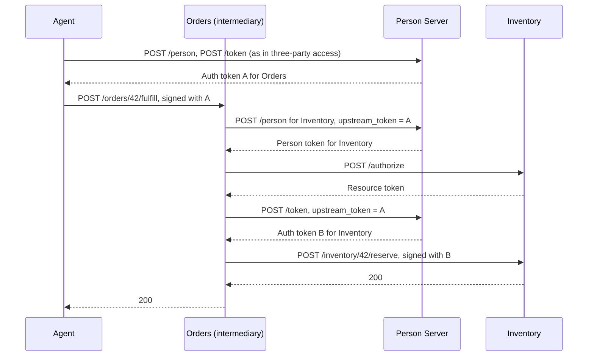

# Call chaining

Call chaining is one Resource calling another Resource for the same person.
The first Resource, the **intermediary**, acts as an agent of its own: it has
its own Agent token and key. When it calls the second Resource, it asks the
person's Person Server for tokens, and sends along the Auth token its own
caller presented, as `upstream_token`. The Person Server checks that token,
and issues downstream tokens that last no longer than it.

Terms are defined in [How AAuth works](../how-aauth-works.md).

## Flow

From `example/callchaining`: an agent calls Orders, and Orders calls
Inventory. Both trust the same Person Server.



## Run it

```sh
go run ./example/callchaining
```

```text
AAuth two-resource call chain complete: orders.fulfill used inventory.reserve.
```

## The code

Orders' handler takes the Auth token its caller presented, with
`resource.AuthTokenFromContext`, and calls Inventory with it. `relay` is
Orders' own `agent.Client`, made with Orders' Agent token and key:

<!-- sample: example/callchaining/main.go -->
```go
func callInventory(ctx context.Context, relay *clientagent.Client, upstreamToken string) (string, error) {
	personResult, err := relay.PersonToken(ctx, clientagent.PersonTokenRequest{
		Resource: resourceTwoID, UpstreamToken: upstreamToken,
	})
	if err != nil {
		return "", err
	}
	personToken, ok := personResult.Token()
	if !ok {
		return "", errors.New("Person Server unexpectedly required interaction")
	}
	resourceToken, err := relay.Authorize(ctx, clientagent.AuthorizeRequest{
		Resource: resourceTwoID, PersonToken: personToken,
		Scopes: []string{resourceTwoScope}, UpstreamToken: upstreamToken,
	})
	if err != nil {
		return "", err
	}
	authToken, err := relay.Exchange(ctx, clientagent.ExchangeRequest{
		ResourceToken: resourceToken, PresentedToken: personToken, UpstreamToken: upstreamToken,
	})
	if err != nil {
		return "", err
	}
	request, err := http.NewRequestWithContext(ctx, http.MethodPost, resourceTwoID+"/inventory/42/reserve", nil)
	if err != nil {
		return "", err
	}
	response, err := relay.Do(ctx, clientagent.Call{
		Request: request, AuthToken: authToken, UpstreamToken: upstreamToken,
	})
	if err != nil {
		return "", err
	}
```

The requests name no Person Server: the upstream token names it, and the
client sends each request there. `UpstreamToken` on `Authorize` and `Do` is
never sent to Inventory; the client uses it to check that the downstream
tokens last no longer than the upstream one.

On the Person Server, `CallChaining` holds the two decisions for chained
requests, apart from the ones for direct requests. `request.Upstream` is the
verified upstream token's claims:

<!-- sample: example/callchaining/main.go -->
```go
CallChaining: &personserver.CallChainingConfig{
	BindPerson: func(_ context.Context, request personserver.PersonTokenRequest) (personserver.Person, error) {
		if request.Agent != resourceOneAgentID || request.Resource != resourceTwoID ||
			!validUpstream(request.Upstream, originalAgentKey.PublicJWK()) {
			return personserver.Person{}, errors.New("unexpected call-chaining person-token request")
		}
		return personserver.Person{Subject: resourceTwoSubject, Lifetime: 25 * time.Minute}, nil
	},
	Authorize: func(_ context.Context, request personserver.AuthorizationRequest) (personserver.AuthorizationDecision, error) {
		if request.Agent != resourceOneAgentID || request.Resource != resourceTwoID ||
			request.Subject != resourceTwoSubject ||
			!slices.Equal(request.Scopes, []string{resourceTwoScope}) ||
			!validUpstream(request.Upstream, originalAgentKey.PublicJWK()) {
			return personserver.AuthorizationDecision{}, errors.New("unexpected call-chaining authorization request")
		}
		return personserver.AuthorizationDecision{Scopes: request.Scopes, Lifetime: 15 * time.Minute}, nil
	},
},
```

`CallChaining` also needs `IssuedTokens`, a store of the Auth tokens this
Person Server issued, so that it can recognize an upstream token as its own
and find the agent it was issued to (`testutil.NewIssuedAuthTokenStore()`
for tests).

## Rules the library enforces

- The upstream token must be one this Person Server issued, or one an Access
  Server issued that it delivered, and must have been issued for the
  intermediary: its audience is the intermediary's Agent token issuer.
  Otherwise the answer is `400 invalid_upstream_token`.
- An expired upstream token is `400 expired_upstream_token`; a revoked one, or
  one whose agent's token or link to the person was revoked, is
  `400 revoked_upstream_token`.
- Downstream Person and Auth tokens expire no later than the upstream token.
- A mission on the upstream token carries down the chain, and the chain ends
  with `403 mission_terminated` when the mission does.
- The intermediary's person at the downstream Resource has a different
  identifier from the caller's person at the intermediary: each Resource sees
  its own.

## Four-party chains

With an Access Server, set `FederatedAuthorizationConfig.CallChaining` (a
`BindPerson` and a `Consent`) and `IssuedTokens` on the Person Server. The
Person Server forwards the upstream token to the Access Server, which checks
it again. A chain can repeat: an intermediary's downstream Auth token is the
next hop's upstream token.
[Chain a call through an Access Server](../../USE-IN-YOUR-SERVICE.md#chain-a-call-through-an-access-server)
has the details.

## Limits

From [CONFORMANCE.md](../../CONFORMANCE.md): a sub-agent as an intermediary,
chained R3, and a three-party Person Server waiting for the person's consent
on a chained request are not implemented. An account on the upstream token is
not carried down, and nothing is drawn from an upstream Budget.

## Next

- [Agent](../roles/agent.md): the client the intermediary uses.
- [Errors](../errors.md#token-endpoint-errors): the `_upstream_token` codes.
