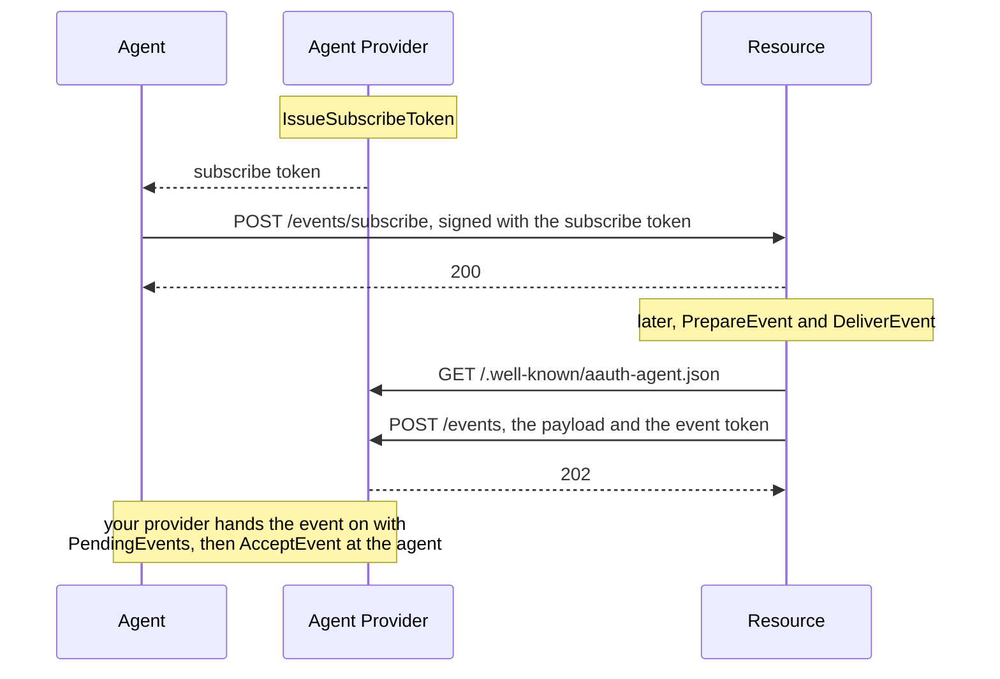

# Events

With Events, a Resource can notify an agent later: a slot opened, an order
shipped. The agent does not receive the event itself. It goes to the agent's
Agent Provider, which holds it for the agent.

1. The agent's provider issues a **subscribe token**, which names the agent's
   key and the Resource it may subscribe at.
2. The agent registers a subscription with the Resource, signing the request
   with the subscribe token.
3. Later the Resource sends an event: a payload and a signed **event token**
   that carries the payload's hash. It posts both to the provider's
   `event_endpoint`, which it finds in the provider's metadata.
4. The provider checks the event and keeps it for the agent. How the agent
   gets it from there is up to your provider; the drafts leave that hop open.
5. The agent checks the event token and the payload before acting on it.

A **protected** subscription is one the Resource ties to a person: the
Resource issues a ticket URL while serving a request from a person's agent,
and the agent registers there.

Terms are defined in [How AAuth works](../how-aauth-works.md).

## Flow



## The code

From `example/events`. The provider issues a subscribe token for one use, and
the agent registers it with the Resource:

<!-- sample: example/events/main.go -->
```go
issued, err := provider.IssueSubscribeToken(ctx, agentprovider.SubscribeRequest{
	Agent: agentID, Resource: resourceID, ConfirmationKey: agentKey.PublicJWK(),
	Lifetime: 10 * time.Minute, MaxUses: 1,
})
if err != nil {
	return err
}
if _, err := agentClient.RegisterPublicSubscription(ctx, clientagent.PublicSubscriptionInput{
	Endpoint: resourceID + "/events/subscribe", SubscribeToken: issued.Compact,
	Parameters: []byte(`{"event_types":["slot.available"]}`), ContentType: "application/json",
	Context: []byte("appointment waitlist"),
}); err != nil {
	return err
}
```

`Context` stays with the agent: it is how the agent recognizes, later, what an
event is about. The Resource sends an event:

<!-- sample: example/events/main.go -->
```go
prepared, err := eventService.PrepareEvent(ctx, resource.EventInput{
	AgentProvider: agentProviderID, EventID: issued.EventID, ContentType: "application/json",
	Payload: []byte(`{"event_type":"slot.available","slot":"10:00"}`), Lifetime: 5 * time.Minute,
})
if err != nil {
	return err
}
result, err := eventService.DeliverEvent(ctx, prepared)
```

And the provider hands it to the agent, which checks it:

<!-- sample: example/events/main.go -->
```go
pending, err := provider.PendingEvents(ctx, agentID)
if err != nil {
	return clientagent.ReceivedEvent{}, err
}
if len(pending) == 0 {
	return clientagent.ReceivedEvent{}, errors.New("events example: the Agent Provider holds no event for the Agent")
}
delivery := pending[0]
received, err := agentClient.AcceptEvent(ctx, clientagent.EventDeliveryInput{
	EventToken: delivery.Token, Payload: delivery.Payload, ContentType: delivery.ContentType,
})
if err != nil {
	return clientagent.ReceivedEvent{}, err
}
if err := provider.AcknowledgeEvent(ctx, agentID, delivery.Fingerprint); err != nil {
	return clientagent.ReceivedEvent{}, err
}
```

```sh
go run ./example/events
```

```text
AAuth public event complete: {"event_type":"slot.available","slot":"10:00"}; remaining uses 0
AAuth protected event complete: {"event_type":"appointment.changed"}
```

## Each role

- **Agent Provider.** Set `agentprovider.Config.Events`: the
  `EventEndpoint` URL it publishes, a source of event IDs, a key resolver for
  the Resources that send events, and a `Store` for subscriptions and the
  events it holds. `Handler()` then serves the endpoint. `PendingEvents` and
  `AcknowledgeEvent` are for your own hand-off to the agent.
- **Resource.** `resource.NewEventService` with an `EventServiceConfig`: the
  Resource's issuer and signing key, the subscription endpoint, a `Store`,
  `RegisterPublic` (accept or refuse a subscription; wrap
  `resource.ErrEventSubscriptionDenied` to refuse), a resolver for providers'
  event endpoints (`resource.NewHTTPEventEndpointResolver`),
  `AdmitEventEndpoint`, and an HTTP client. `AsyncAPIDocument` publishes the event channels; it must
  declare the `aauth_subscribe` security scheme. `Protected` adds ticketed
  subscriptions, issued with `IssueProtectedSubscriptionTicket`.
- **Agent.** Set `agent.Config.Events` with a `Store` for subscription
  contexts and seen events. `AcceptEvent` checks the event token, the
  payload's hash and the audience, and returns `Duplicate: true` for an event
  it has seen before; act only on a new one.

A failed delivery is a `*resource.EventDeliveryError`. When its `Accepted` is
true, the provider took the event, and sending the same prepared event again
has no second effect.

## Limits

From [CONFORMANCE.md](../../CONFORMANCE.md): the library ships no durable
stores. `testutil.NewEventInboxStore` and `testutil.NewProtectedEventStore`
are in-memory stores for tests and examples. A service supplies stores that
pass the `agentprovider/storetest` and `resource/storetest` contracts. The hop from the
provider to the agent is your provider's own.

## Next

- [Agent Provider](../roles/agent-provider.md): where the events arrive.
- [Deliver events to an Agent](../../USE-IN-YOUR-SERVICE.md#deliver-events-to-an-agent):
  the full reference.
