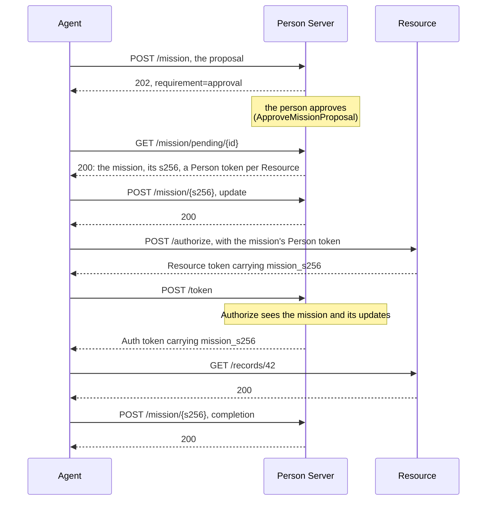

# Missions

A mission is a task the person approves up front. The agent proposes it to the
Person Server: a description in Markdown, the tools it means to use, and the
Resources it means to call. The person approves it, perhaps narrowed. The
approved mission is a JSON document, and its SHA-256 hash, `mission_s256`, is
carried by every Person, Resource and Auth token issued for it, so each
request can be checked against the mission it serves.

The agent can update the mission as the work goes on, and completes it at the
end. A mission ends when it is completed, when it expires, or when your host
ends it; later requests under it are refused with `403 mission_terminated`.

Terms are defined in [How AAuth works](../how-aauth-works.md).

## Flow

From `example/mission`, where the person reviews the proposal before
approving it:



## Smallest working code

The agent proposes, and the person approves. Here the host's review queue
stands in for the person's screen:

<!-- sample: example/mission/main.go -->
```go
proposalResult := must(reader.BeginMission(ctx, clientagent.MissionRequest{
	PersonServer: personServerID,
	Proposal: aauth.MissionProposal{
		Description: "# Read the report inputs",
		Tools:       []aauth.MissionTool{{Name: readTool, Description: "Read one report record"}},
		Resources:   []string{resourceID},
	},
}))
pending, ok := proposalResult.Pending()
if !ok {
	log.Fatal("mission proposal unexpectedly completed without host review")
}
reviews := must(people.PendingMissionProposals(ctx, 10))
if len(reviews) != 1 {
	log.Fatalf("host mission queue contains %d proposals, want 1", len(reviews))
}
proposal := reviews[0].Proposal()
if err := people.ApproveMissionProposal(ctx, reviews[0], personserver.MissionDecision{
	Description: proposal.Description, ApprovedTools: proposal.Tools,
	ApprovedResources: proposal.Resources, ExpiresAt: &missionExpiry,
}); err != nil {
	log.Fatal(err)
}
completed := must(reader.PollMissionProposal(ctx, pending))
mission, approved := completed.Approval()
if !approved {
	log.Fatal("approved mission remained pending")
}
if !mission.ApprovesTool(readTool) {
	log.Fatal("approved tool was not recognized")
}
if mission.ApprovesTool("SendMessage") {
	log.Fatal("unapproved tool was treated as approved")
}
fmt.Printf("mission pre-approves %s; SendMessage still requires permission\n", readTool)
update := must(reader.UpdateMission(ctx, clientagent.MissionUpdateRequest{
	PersonServer: personServerID, MissionS256: mission.Mission().S256,
	Description: "Report inputs selected",
}))
if update.S256() == "" {
	log.Fatal("mission update returned no exact document digest")
}
personToken, ok := mission.PersonToken(resourceID)
if !ok {
	log.Fatal("mission approval omitted the approved Resource person token")
}
```

```sh
go run ./example/mission
```

```text
mission pre-approves ReadRecords; SendMessage still requires permission
mission-bound call complete for person-123
mission completed with person acceptance
```

## Proposing and approving

On the Person Server, set `Missions` to a `personserver.MissionConfig`, and use
a `Tokens` store that also keeps missions (`testutil.NewMissionStore()` for
tests). Its fields are your decisions:

- **`Approve`** answers a proposal at once, with a `MissionDecision`: the
  description, tools and Resources approved, and when the mission expires.
- **`DeferProposal`** instead holds the proposal for the person. The host lists
  held proposals with `PendingMissionProposals`, and answers each with
  `ApproveMissionProposal` or `DenyMissionProposal`. One of `Approve` and
  `DeferProposal` is required.
- **`AcceptUpdate`** decides an update; **`ConfirmPersonAcceptedCompletion`**
  decides a completion. Without one, that request is refused.

From `example/mission`, which holds each proposal for the person. A held
proposal needs a non-zero `Lifetime`; with zero, the proposal fails with
`500 server_error`:

<!-- sample: example/mission/main.go -->
```go
Missions: &personserver.MissionConfig{
	DeferProposal: func(context.Context, personserver.MissionApprovalRequest) (personserver.MissionProposalPendingPolicy, bool, error) {
		return personserver.MissionProposalPendingPolicy{Lifetime: 5 * time.Minute, RetryAfter: 0}, true, nil
	},
	AcceptUpdate: func(_ context.Context, request personserver.MissionUpdatePolicyRequest) error {
		if request.Document.Update.Description == "" {
			return errors.New("mission update description is required")
		}
		return nil
	},
	ConfirmPersonAcceptedCompletion: func(_ context.Context, request personserver.MissionCompletionPolicyRequest) error {
		if !personAcceptedCompletion {
			return fmt.Errorf("%w: the responsible person has not accepted completion", personserver.ErrMissionDenied)
		}
		return nil
	},
},
```

On the agent, `BeginMission` sends the proposal and `PollMissionProposal`
polls a pending one; both return a `MissionProposalResult`. `Approval()`
gives the approval, and `Pending()` the proposal still waiting. The approval holds the mission (`Mission()`, whose
`S256` names it in later requests) and a Person token for each approved
Resource (`PersonToken(resource)`). `ApprovesTool` tells the agent whether a
tool is in the approved list; it is for the agent's own planning, and nothing
at the Resource enforces it.

## Issuing under a mission

A Person token from the mission approval carries `mission_s256`, and so does
everything obtained with it. On the Person Server, `BindPerson` and `Authorize`
receive the mission, its approved content and the updates the Person Server
accepted, in `request.Mission`, and can decide from them. At the Resource,
`resource.AuthPrincipalFromContext` gives the mission's hash in `MissionS256`.

`UpdateMission` sends a `MissionUpdateRequest` with a new description, as in
the sample above, and returns a `MissionUpdateResult`, whose `S256()` is the
new document's hash. `CompleteMission` sends a `MissionCompletionRequest`
with a summary; once it is accepted, the mission is terminated, and every
later request under it gets `403 mission_terminated`:

<!-- sample: example/mission/main.go -->
```go
if err := reader.CompleteMission(ctx, clientagent.MissionCompletionRequest{
	PersonServer: personServerID, MissionS256: mission.Mission().S256,
	Summary: "Protected report read completed",
}); err != nil {
	log.Fatal(err)
}
```

This library's Person Server answers both at once, unless a supervision
server decides them; `BeginMissionUpdate` and `BeginMissionCompletion` return
a request to poll when the answer has to wait.

`ReadMission` reads the mission back from its own URL: the approved bytes,
checked against `mission_s256`, and every accepted update, oldest first. A
terminated mission is refused with `403 mission_terminated`.

## Ending a mission

The person, an administrator or the agent's operator may end a mission before
it is complete. Your host decides who may, authenticates them, and calls
`TerminateMission` on the Person Server with the mission's agent, its
`mission_s256` and a reason: `revoked` when someone withdrew it, `superseded`
when another mission replaces it, `administrative` under local policy, or one
of your own. From then on every request under the mission gets
`403 mission_terminated` with that reason. A mission that had already ended
keeps its first reason, which the result's `Reason` reports.

With `TokenRevocation` configured with `HTTPClient` and `Admit`, the Person
Server also revokes every unexpired token it issued under the mission, at each
Resource and Access Server, as `RevokePersonToken` does. When the result's
`Pending` is true, call `TerminateMission` again after its `RetryAfter`. A
supervision server deciding for the agent is told the mission ended.

## Limits

From [CONFORMANCE.md](../../CONFORMANCE.md): the Person Server can hold a
proposal for the person, but not an update or a completion. Its own
clarification questions about a mission, and mission-bound requests a parent
agent makes for a sub-agent, are not implemented. Ending a mission is a Go
call; the draft leaves its HTTP endpoint (`mission_control_endpoint`) to a
companion specification.

## Next

- [Supervision](supervision.md): a supervision server deciding mission
  proposals in the person's place.
- [Person Server](../roles/person-server.md): where `Missions` is configured.
