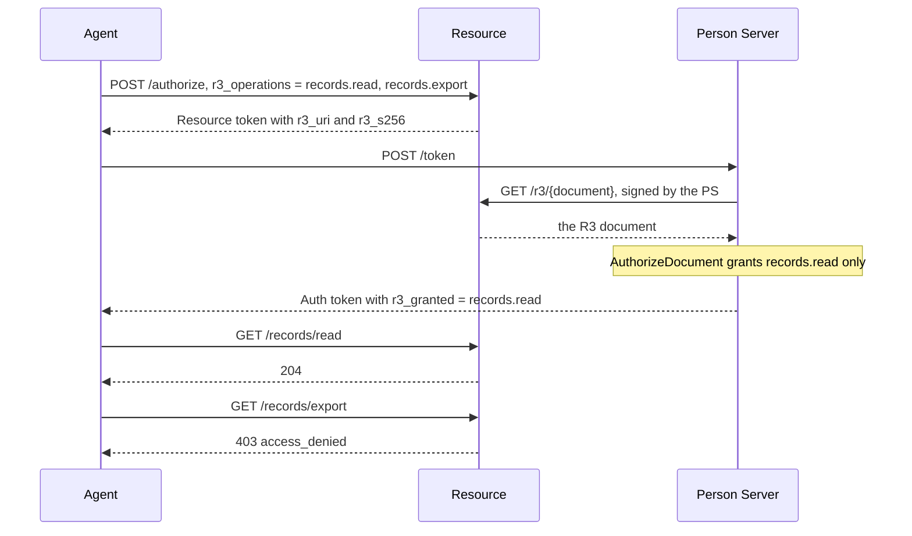

# R3: Rich Resource Requests

With R3, an agent asks for named operations instead of broad scopes: MCP tool
names, OpenAPI operation IDs, gRPC methods. The Resource writes the requested
operations into an **R3 document**, with a description for the person, and
puts its address and hash in the Resource token (`r3_uri`, `r3_s256`). The
Person Server fetches the document, decides which operations the person
grants, and lists them in the Auth token (`r3_granted`). On each request, the
Resource maps the HTTP request to one operation and refuses it unless it was
granted.

Terms are defined in [How AAuth works](../how-aauth-works.md).

## Flow

From `example/r3threeparty`: the agent asks for two MCP tools, and the person
grants one.



## Run it

```sh
go run ./example/r3threeparty
```

```text
AAuth direct R3 three-party flow complete: granted records.read; withheld records.export
```

## The code

All three roles share a **registry** of the vocabularies they understand, here
MCP's:

<!-- sample: example/r3threeparty/main.go -->
```go
registry, err := r3.NewRegistry(mcp.Vocabulary())
if err != nil {
	return fmt.Errorf("create R3 registry: %w", err)
}
definitions, err := r3.NewDefinitionRegistry(mcp.DefinitionRegistration())
```

The Resource reads its MCP tool list as its definition, describes each
requested set of operations for the person, and maps each HTTP request to an
operation:

<!-- sample: example/r3threeparty/main.go -->
```go
R3: &resource.R3Config{
	Registry: registry, Definitions: definitions,
	Vocabularies: []resource.R3VocabularyConfig{{
		Definition: definition,
		DisplayForOperations: func(_ context.Context, operations r3.OperationSet, _ *string) (*r3.Display, error) {
			equal, err := operations.Equal(requested)
			if err != nil || !equal {
				return nil, errors.New("unexpected MCP operation request")
			}
			return &display, nil
		},
	}},
	Documents: newMemoryDocumentStore(),
	HTTP: resource.R3HTTPAdapter{OperationForRequest: func(request *http.Request) (r3.Operation, bool, error) {
		switch request.URL.Path {
		case "/records/read":
			return readOperation, true, nil
		case "/records/export":
			return exportOperation, true, nil
		default:
			return r3.Operation{}, false, nil
		}
	}},
},
```

The Person Server fetches the document from the Resource, under its own
`Admit` rule, and grants what the person allows:

<!-- sample: example/r3threeparty/main.go -->
```go
R3: &personserver.DirectR3Config{
	Registry: registry, HTTPClient: httpClient,
	Admit: func(_ context.Context, endpoint string) error {
		if !strings.HasPrefix(endpoint, resourceID+"/r3/") {
			return errors.New("R3 document endpoint is not admitted")
		}
		return nil
	},
	AuthorizeDocument: func(_ context.Context, request personserver.AuthorizationRequest, _ r3.Reference, document r3.Document) (personserver.DirectR3Decision, error) {
		equal, err := document.OperationSet().Equal(requested)
		if err != nil || !equal || request.Subject != "person-123" || request.Resource != resourceID {
			return personserver.DirectR3Decision{}, errors.New("unexpected direct R3 authorization request")
		}
		granted, err := r3.NewGrantedOperations(mcp.Vocabulary(), readOperation)
		if err != nil {
			return personserver.DirectR3Decision{}, err
		}
		grant, err := r3.NewGrant(granted, document)
		if err != nil {
			return personserver.DirectR3Decision{}, err
		}
		return personserver.DirectR3Decision{
			Lifetime: 30 * time.Minute, Grant: grant,
		}, nil
	},
	Issuances: newMemoryIssuanceStore(),
},
```

The agent turns R3 on with `agent.Config.R3` and asks for the operations with
`AuthorizeRequest.R3Operations`:

<!-- sample: example/r3threeparty/main.go -->
```go
resourceToken, err := agent.Authorize(ctx, clientagent.AuthorizeRequest{
	Resource: resourceID, PersonToken: personToken, R3Operations: &requested,
})
```

## Turning it on

- **Vocabularies.** `r3/vocab/` has adapters for MCP, OpenAPI, gRPC, GraphQL,
  AsyncAPI, WSDL and OData. Each turns a definition your service already has
  (an MCP `tools/list` answer, an OpenAPI document) into operations. The
  adapters parse definitions you pass them; they fetch nothing.
- **The Resource** publishes its vocabularies in its metadata
  (`r3_vocabularies`), keeps each R3 document in `Documents`, and serves it at
  `/r3/{document}` only to a Person Server or Access Server that signs the
  request.
- **The Person Server** needs `DirectR3Config.Issuances`, which records each
  grant it issues; `testutil.NewR3IssuanceStore()` for tests.
- **Four-party.** An Access Server takes `accessserver.Config.R3`, and its
  Person Server `FederatedAuthorizationConfig.R3`. Four-party access also
  supports **per-call** R3: the Resource holds one call until the person
  approves that call alone. `example/fourparty` runs
  the four-party class grant.

## Limits

The library implements the R3 subsets this page describes, not the whole
draft. Per-call R3 is four-party only. Chained R3, fetching definitions from the
network, and access rules derived from the annotations in a definition are
not implemented. For a supervised agent, the supervisor decides an R3 request
as it decides any Auth token request; see
[Supervision](supervision.md).

## Next

- [Budgets](budgets.md): R3 operations can carry a price.
- [Person Server](../roles/person-server.md) and
  [Resource](../roles/resource.md): where `R3` is configured.
