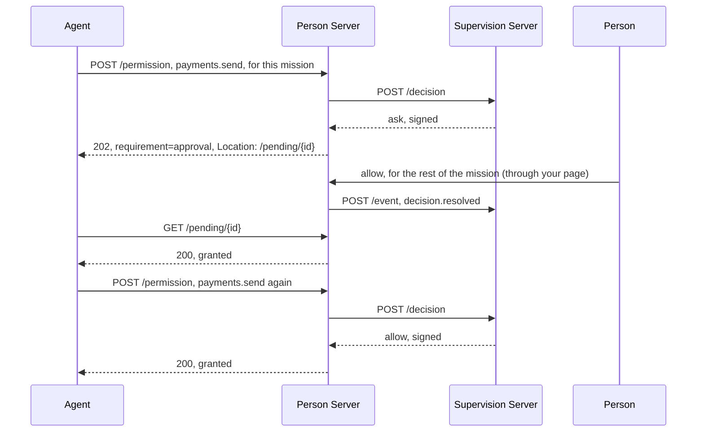

# Supervision

Supervision lets a person hand the routine decisions about an agent to a
supervision server: their employer's, or one of their own. The Person Server
still talks to the agent, issues every token and keeps the record, but for a
supervised agent it makes no decision of its own. It puts each request to the
agent's supervision server and applies the answer:

- **allow**: the Person Server grants the request, within any narrower terms
  the supervisor set (a refined mission, fewer scopes, an earlier expiry);
- **deny**: the Person Server refuses it;
- **ask**: the request waits for the person, who answers at the Person Server,
  and the answer, with how far it reaches, goes back to the supervisor.

If the supervisor cannot be reached, the request waits for the person too.

The requests supervised are mission proposals, updates and completions,
Person and Auth token requests, and permission requests. The
[Supervision Server](../roles/supervision-server.md) guide covers the
supervisor's side; this page covers the Person Server's.

Terms are defined in [How AAuth works](../how-aauth-works.md).

## Flow

One request that the supervisor asks the person about:



## Run it

```sh
go run ./example/supervision
```

```text
Personal supervisor connected after the person confirmed https://person.example
Work agent: builds.start granted by the organization's supervisor
Mission approved as refined: "Ask before any payment."
Asked the person: The agent wants to pay an invoice. (supervisor recommends allow)
Person allowed it for the mission; the next payment was granted without asking
Personal supervisor offline: the person allowed the person-token request
Supervisor back online, told: decision.resolved (supervisor unavailable), person_token.issued
Signed decisions in the log verified: 1 by https://governance.example, 3 by https://supervisor.example
```

## The code

The Person Server routes each agent to its supervisor with `Route`. The
example's own policies return an error, because the Person Server never calls
them for a supervised agent; it still needs them for agents nobody
supervises:

<!-- sample: example/supervision/main.go -->
```go
routes := map[string]personserver.Supervisor{
	workAgentID:     {Issuer: organizationSSID, Subject: "org-person-7", Tenant: "example.org"},
	personalAgentID: {Issuer: personalSSID, Subject: "own-person-1"},
}
notCalled := errors.New("the Person Server does not decide for a supervised Agent")
supervisionStore := testutil.NewSupervisionStore()
people, err := personserver.NewPSAuthorization(personserver.PSAuthorizationConfig{
	Issuer: personServerID, SigningKey: keys["person-server"], KeyResolver: resolver, Clock: clock,
	NewID: newID, Tokens: testutil.NewMissionStore(),
	BindPerson: func(context.Context, personserver.PersonTokenRequest) (personserver.Person, error) {
		return personserver.Person{Subject: "person-at-files", Lifetime: time.Hour}, nil
	},
	Authorize: func(context.Context, personserver.AuthorizationRequest) (personserver.AuthorizationDecision, error) {
		return personserver.AuthorizationDecision{}, notCalled
	},
	Missions: &personserver.MissionConfig{
		Approve: func(context.Context, personserver.MissionApprovalRequest) (personserver.MissionDecision, error) {
			return personserver.MissionDecision{}, notCalled
		},
	},
	Permission: &personserver.PermissionConfig{
		Policy: func(context.Context, personserver.PermissionPolicyRequest) (personserver.PermissionPolicyResult, error) {
			return personserver.PermissionPolicyResult{}, notCalled
		},
	},
	Supervision: &personserver.SupervisionConfig{
		Route: func(_ context.Context, agent personserver.SupervisedAgent) (personserver.Supervisor, bool, error) {
			supervisor, ok := routes[agent.Agent]
			return supervisor, ok, nil
		},
		Store: supervisionStore, HTTPClient: httpClient, Admit: network.Admit,
	},
})
```

`BindPerson` still runs after an allow: it gives the person's identifier at
the Resource. A `Supervisor` names the supervision server, the person's
identifier there, and an optional tenant.

When the supervisor asks, the host shows the person the request and records
their answer:

<!-- sample: example/supervision/main.go -->
```go
reviews, err := people.PendingSupervision(ctx, 10)
if err != nil || len(reviews) != 1 || reviews[0].Ask == nil {
	return errors.New("the Person Server holds no ask for the person")
}
if err := print("Asked the person: %s (supervisor recommends %s)", reviews[0].Ask.Summary, reviews[0].Ask.Recommendation); err != nil {
	return err
}
// The host authenticates the person, shows them the request and the
// supervisor's summary, and records their answer and its reach.
if err := people.ResolveSupervision(ctx, reviews[0].Reference, personserver.SupervisionAnswer{
	Answer: supervision.AnswerAllow, Apply: supervision.ApplyMission,
}); err != nil {
	return err
}
```

## Held acts

A request that waits answers the agent `202` with `requirement=approval` and a
pending URL, `/pending/{id}` on the Person Server. The agent polls it with the
`Pending` value its method returned. A clarification from the supervisor
arrives as `requirement=clarification`, and the agent answers it the same way
as a Person Server's own question.

On the host:

- `PendingSupervision` lists the requests waiting for a person, and
  `ReviewSupervision` loads one. Authenticate the person before you show it.
- `ResolveSupervision` records the person's answer and its reach: `once`, the
  rest of the `mission`, `always`, or a value the supervisor offered. The
  supervisor remembers the reach; the Person Server applies none itself.
- `AskSupervisedAgent` lets the person question the agent first.
- `AdvanceSupervision` checks again on a request the supervisor deferred.
- `ConnectSupervisor` connects a person to a supervisor ahead of the first
  request, and `DeliverSupervisionEvents` sends the events held while the
  supervisor was unreachable.

## Reports and records

The Person Server tells the supervisor what happened, as events in order for
each person: tokens issued, decisions resolved, missions approved and
terminated, audit records, interactions, and Agent tokens revoked.

Decisions are signed by the supervisor, and the Person Server refuses unsigned
ones unless you set `AllowUnsignedDecisions`. It keeps each signed decision in
its log, and `supervision.VerifyExchange` checks one again later.

## Limits

From [CONFORMANCE.md](../../CONFORMANCE.md): R3 and Resource-initiated
interaction for a supervised agent are refused with a
`SupervisionCompositionError`. A four-party supervised request that would also
have to wait for the Access Server is refused. Telling the supervisor of a
revoked Resource token, and passing an agent's updated request to it, are not
implemented. The stores in `testutil` are in memory, and no other
implementation has been run against these roles.

## Next

- [Supervision Server](../roles/supervision-server.md): the supervisor's
  side.
- [Missions](missions.md): what a supervisor can refine.
