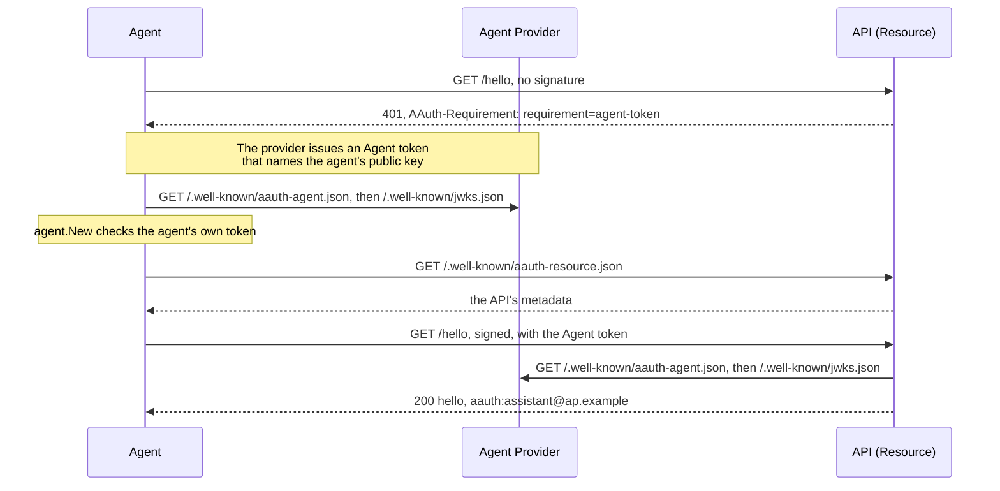

# Get started

This page takes you from an empty directory to an agent calling an API over
TLS on your own machine. Apart from downloading the module, nothing leaves the
machine: there is no account to create, no DNS change and no port to open.

## Before you start

Install [Go](https://go.dev/dl/) 1.25 or later. `go version` shows which one
you have.

## 1. Make a module and get the library

```sh
mkdir hello-aauth
cd hello-aauth
go mod init example.com/hello-aauth
go get gitlab.com/sidecat-dev/aauth-go@6fcdb1e
```

The library has no release tags: you build against a commit on `main`, named
by its hash. `go get` records that commit in `go.mod` as a pseudo-version,
`v0.0.0-20261102114704-6fcdb1ef51b0`. Commit `go.mod` and `go.sum` with your
code, so that every build uses the same commit. To move to a later commit, run
`go get` again with its hash.

## 2. Add the program

Save the program at the end of this page as `main.go` in `hello-aauth`. It is
also in the repository, as
[`example/gettingstarted/main.go`](../example/gettingstarted/main.go).

## 3. Run it

```sh
go mod tidy
go run .
```

`go mod tidy` adds the library's own dependencies to `go.sum`. The program
prints:

```text
unsigned: 401 requirement=agent-token
signed: 200 hello, aauth:assistant@ap.example
not admitted: 403
```

In a clone of the repository, `go run ./example/gettingstarted` runs the same
program.

## 4. What happened

The program starts two HTTPS servers on loopback ports, each with a new
self-signed certificate that the program's client trusts and nothing else
does. The client sends `https://ap.example` and `https://api.example` to those
ports, and refuses every other host.

- The **Agent Provider** at `ap.example` issues Agent tokens. An **Agent
  token** is a signed statement from the provider: this agent is
  `aauth:assistant@ap.example`, and it holds this public key. The provider
  publishes its metadata at `/.well-known/aauth-agent.json`, and its public key
  at `/.well-known/jwks.json`, so that anyone can check its tokens.
- The **API** at `api.example` is what AAuth calls a **Resource**. On each
  request it checks the signature and the Agent token, then calls your
  handler, which decides whether to let this agent in.

The agent makes its own key pair. It never sends the private key anywhere: the
provider puts the public key in the Agent token, and the agent signs each
request with the private key.

The agent and the API each check the provider's tokens with a **key
resolver**, which fetches the provider's metadata and public key the first
time it needs them and keeps them for later requests.



The three lines of output are three requests:

1. **`unsigned: 401 requirement=agent-token`.** The request had no signature.
   The API answers `401` with an `AAuth-Requirement` header that says what it
   needs: an Agent token.
2. **`signed: 200 hello, aauth:assistant@ap.example`.** The agent signed the
   request. Before signing, `CallAsAgent` read the API's metadata, which can
   name extra parts of the request to sign. The signature covers the method,
   the host, the path and the `Signature-Key` header, which carries the Agent
   token. The API checked the provider's signature on the token, checked that
   the request was signed with the key the token names, and the handler
   admitted this agent.
3. **`not admitted: 403`.** A second agent, `aauth:other@ap.example`, signed
   correctly, but the handler admits only the assistant. A refusal by your
   handler is whatever your handler writes; this one is `403`, and says
   nothing about signatures.

## 5. Read the code

The parts that matter in a real service:

- `agentprovider.New` makes the provider, and `provider.Issue` signs an Agent
  token. `Issue` checks that the request is well formed, not that the agent is
  who it says it is: your provider decides that first.
  `provider.Handler()` serves the metadata and the public key.
- `signaturekey.NewHTTPKeyResolver` fetches and caches issuer keys. `Admit`
  decides which URLs it may fetch: only providers you have chosen to trust.
  This program sets `TransportEnforcesEgress`, because its client can reach
  only the two loopback servers. On a real network, leave it unset, and the
  resolver itself refuses to connect to private, loopback and link-local
  addresses. [Fetch issuer keys](roles/resource.md#fetch-issuer-keys) covers
  the choices.
- `resource.NewAgentIdentity` checks requests sent to one origin, its
  `Issuer`, and calls `Protected` only for a request whose signature and token
  check out. In the handler, `resource.AgentPrincipalFromContext` gives you the
  verified agent identifier. `api.Handler()` also serves the API's metadata at
  `/.well-known/aauth-resource.json`.
- `agent.New` makes the agent's client, after checking that the Agent token
  names this agent and this key. `CallAsAgent` signs one request with the
  Agent token and sends it. It does not retry.

All times come from the `Clock` you pass; `aauth.SystemClock{}` is the system
clock. A signature is accepted for 60 seconds either side of the API's clock.

<!-- sample: example/gettingstarted/main.go -->
```go
// An Agent calls an API over TLS on this machine.
//
// Two servers run on loopback ports: an Agent Provider that issues Agent
// tokens, and an API that checks them. Each has a new self-signed
// certificate that only this program trusts.
package main

import (
	"context"
	"crypto/ed25519"
	"crypto/rand"
	"crypto/tls"
	"crypto/x509"
	"crypto/x509/pkix"
	"fmt"
	"io"
	"log"
	"math/big"
	"net"
	"net/http"
	"os"
	"strings"
	"time"

	aauth "gitlab.com/sidecat-dev/aauth-go"
	"gitlab.com/sidecat-dev/aauth-go/agent"
	"gitlab.com/sidecat-dev/aauth-go/agentprovider"
	"gitlab.com/sidecat-dev/aauth-go/jose"
	"gitlab.com/sidecat-dev/aauth-go/resource"
	"gitlab.com/sidecat-dev/aauth-go/signaturekey"
)

func main() {
	if err := run(os.Stdout); err != nil {
		log.Fatal(err)
	}
}

func run(output io.Writer) error {
	ctx := context.Background()
	clock := aauth.SystemClock{}
	network := newLoopback()
	defer network.Close()

	// The Agent Provider signs Agent tokens and publishes the key that checks them.
	provider, err := agentprovider.New(agentprovider.Config{
		Issuer: "https://ap.example", SigningKey: newKey("ap-key-1"), Clock: clock,
		NewID: rand.Text,
	})
	if err != nil {
		return err
	}
	if err := network.Serve("ap.example", provider.Handler()); err != nil {
		return err
	}

	// The API checks every request, then runs its own policy on the verified Agent.
	apiKeys, err := trustProvider(network.Client())
	if err != nil {
		return err
	}
	hello := http.HandlerFunc(func(w http.ResponseWriter, r *http.Request) {
		caller, _ := resource.AgentPrincipalFromContext(r.Context())
		if caller.Agent != "aauth:assistant@ap.example" {
			http.Error(w, "not admitted", http.StatusForbidden)
			return
		}
		fmt.Fprintf(w, "hello, %s", caller.Agent)
	})
	api, err := resource.NewAgentIdentity(resource.AgentIdentityConfig{
		Issuer: "https://api.example", KeyResolver: apiKeys, Clock: clock,
		Protected: hello,
	})
	if err != nil {
		return err
	}
	if err := network.Serve("api.example", api.Handler()); err != nil {
		return err
	}

	// Without a signature, the API answers 401 and says what it needs.
	response, err := network.Client().Get("https://api.example/hello")
	if err != nil {
		return err
	}
	response.Body.Close()
	fmt.Fprintln(output, "unsigned:", response.StatusCode, response.Header.Get("AAuth-Requirement"))

	// The Agent signs the request with its own key and presents its Agent token.
	agentKeys, err := trustProvider(network.Client())
	if err != nil {
		return err
	}
	assistant, err := enroll(ctx, provider, "assistant", agentKeys, network.Client())
	if err != nil {
		return err
	}
	status, body, err := get(ctx, assistant, "https://api.example/hello")
	if err != nil {
		return err
	}
	fmt.Fprintln(output, "signed:", status, body)

	// A valid signature from an Agent the API's policy does not admit gets 403.
	other, err := enroll(ctx, provider, "other", agentKeys, network.Client())
	if err != nil {
		return err
	}
	status, _, err = get(ctx, other, "https://api.example/hello")
	if err != nil {
		return err
	}
	fmt.Fprintln(output, "not admitted:", status)
	return nil
}

// trustProvider returns a key resolver that fetches the Agent Provider's
// metadata and public key over TLS, and caches them. Admit names the only
// URLs it may fetch.
func trustProvider(client *http.Client) (*signaturekey.HTTPKeyResolver, error) {
	return signaturekey.NewHTTPKeyResolver(signaturekey.HTTPKeyResolverConfig{
		Client: client, Clock: aauth.SystemClock{},
		Admit: func(_ context.Context, endpoint string) error {
			if !strings.HasPrefix(endpoint, "https://ap.example/") {
				return fmt.Errorf("not a trusted Agent Provider: %s", endpoint)
			}
			return nil
		},
		// This client reaches only this program's loopback servers, so it
		// applies the destination checks itself. On a real network, leave this
		// unset: the resolver then refuses private and loopback addresses.
		TransportEnforcesEgress: true,
	})
}

// enroll makes the Agent's own key; the provider issues a token that names it.
func enroll(ctx context.Context, provider *agentprovider.Server, name string,
	keys signaturekey.KeyResolver, client *http.Client,
) (*agent.Client, error) {
	key := newKey(name + "-key-1")
	identifier := "aauth:" + name + "@ap.example"
	token, err := provider.Issue(ctx, aauth.AgentTokenRequest{
		Agent: identifier, PublicKey: key.PublicJWK(), Lifetime: 10 * time.Minute,
	})
	if err != nil {
		return nil, err
	}
	return agent.New(ctx, agent.Config{
		Identifier: identifier, SigningKey: key, AgentToken: token,
		KeyResolver: keys, HTTPClient: client, Clock: aauth.SystemClock{},
	})
}

// get signs one GET with the Agent token and returns the status and body.
func get(ctx context.Context, caller *agent.Client, url string) (int, string, error) {
	request, err := http.NewRequestWithContext(ctx, http.MethodGet, url, nil)
	if err != nil {
		return 0, "", err
	}
	response, err := caller.CallAsAgent(ctx, request)
	if err != nil {
		return 0, "", err
	}
	defer response.Body.Close()
	body, err := io.ReadAll(response.Body)
	return response.StatusCode, string(body), err
}

func newKey(id string) jose.SigningKey {
	_, private, err := ed25519.GenerateKey(rand.Reader)
	if err != nil {
		log.Fatal(err)
	}
	key, err := jose.NewEd25519SigningKey(id, private)
	if err != nil {
		log.Fatal(err)
	}
	return key
}

// loopback runs HTTPS servers on loopback ports under made-up host names.
// Its client reaches those servers and nothing else, and trusts only their
// certificates.
type loopback struct {
	roots   *x509.CertPool
	routes  map[string]string
	servers []*http.Server
	client  *http.Client
}

func newLoopback() *loopback {
	network := &loopback{roots: x509.NewCertPool(), routes: map[string]string{}}
	dialer := &net.Dialer{Timeout: 5 * time.Second}
	network.client = &http.Client{Timeout: 10 * time.Second, Transport: &http.Transport{
		TLSClientConfig: &tls.Config{RootCAs: network.roots},
		DialContext: func(ctx context.Context, _, address string) (net.Conn, error) {
			target, ok := network.routes[address]
			if !ok {
				return nil, fmt.Errorf("no loopback server for %s", address)
			}
			return dialer.DialContext(ctx, "tcp", target)
		},
	}}
	return network
}

// Serve starts handler at https://host on a new loopback port.
func (network *loopback) Serve(host string, handler http.Handler) error {
	public, private, err := ed25519.GenerateKey(rand.Reader)
	if err != nil {
		return err
	}
	template := &x509.Certificate{
		SerialNumber: big.NewInt(time.Now().UnixNano()), Subject: pkix.Name{CommonName: host},
		DNSNames: []string{host}, NotBefore: time.Now().Add(-time.Minute), NotAfter: time.Now().Add(time.Hour),
		KeyUsage: x509.KeyUsageDigitalSignature, ExtKeyUsage: []x509.ExtKeyUsage{x509.ExtKeyUsageServerAuth},
	}
	der, err := x509.CreateCertificate(rand.Reader, template, template, public, private)
	if err != nil {
		return err
	}
	certificate, err := x509.ParseCertificate(der)
	if err != nil {
		return err
	}
	listener, err := net.Listen("tcp", "127.0.0.1:0")
	if err != nil {
		return err
	}
	server := &http.Server{Handler: handler, TLSConfig: &tls.Config{
		Certificates: []tls.Certificate{{Certificate: [][]byte{der}, PrivateKey: private}},
	}}
	go server.ServeTLS(listener, "", "")
	network.roots.AddCert(certificate)
	network.routes[host+":443"] = listener.Addr().String()
	network.servers = append(network.servers, server)
	return nil
}

// Client returns the HTTPS client that connects only to this network's servers.
func (network *loopback) Client() *http.Client {
	return network.client
}

func (network *loopback) Close() {
	for _, server := range network.servers {
		server.Close()
	}
}
```

## Next

- [Install](../README.md#install) shows the same steps for your own module.
- [How AAuth works](how-aauth-works.md) explains the roles and tokens, and the
  ways an API can decide who gets in.
- [Resource](roles/resource.md) shows how to put the check in front of your own
  handlers.
- [Person Server](roles/person-server.md) adds the person: the API learns who
  the agent acts for and what that person allowed.
