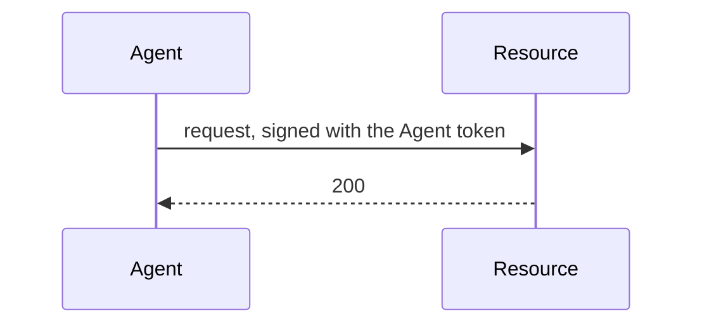
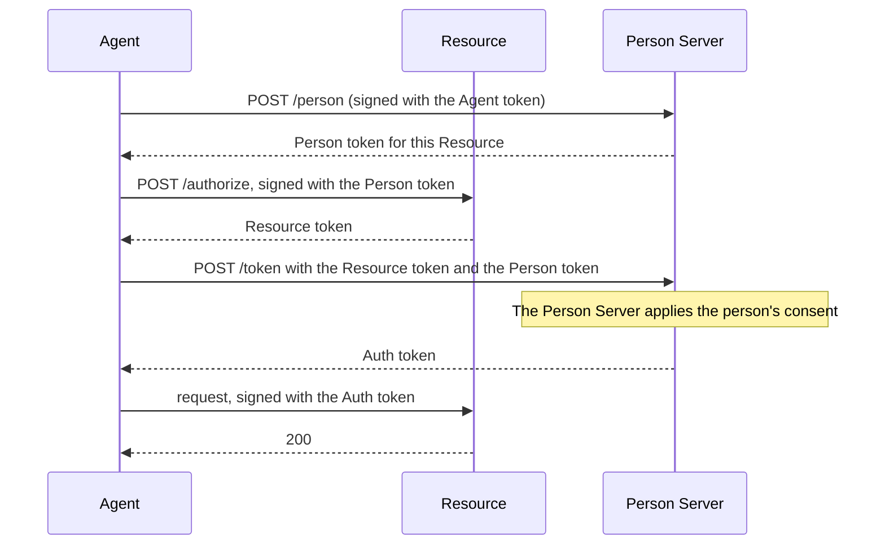
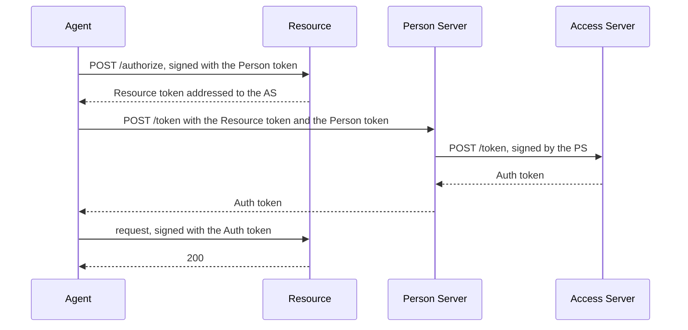

# How AAuth works

AAuth lets an API decide whether to serve a software agent: which agent it is,
which person it acts for, and what that person allowed. This page explains the
parties, the tokens they exchange and the ways an API can decide. The guides
for each role and each feature build on it.

The protocol is defined in a set of drafts by Dick Hardt. This library follows
the versions listed in [SPECIFICATIONS.md](../SPECIFICATIONS.md), and the words
on this page are the drafts' words.

## The parties

| Party | What it does | Package |
| --- | --- | --- |
| **Person** | The user or organization an agent acts for, and who is accountable for what it does. | none |
| **Agent** | An HTTP client acting for a person. It is named by an agent identifier such as `aauth:assistant@ap.example`, and holds its own signing key. | `agent` |
| **Agent Provider (AP)** | Vouches for agents: it issues each agent an Agent token. | `agentprovider` |
| **Resource** | The API the agent calls. It decides what it requires and enforces it. | `resource` |
| **Person Server (PS)** | Represents the person: it knows which person an agent acts for, asks for the person's consent, and issues tokens that say so. The person chooses their PS. | `personserver` |
| **Access Server (AS)** | Decides access for a Resource that keeps its own policy, and issues tokens on its behalf. | `accessserver` |
| **Supervision Server (SS)** | Decides, in the person's place, the requests a Person Server puts to it, and asks the person only about the exceptions. | `supervisionserver` |

These are roles, not machines: one server can play several. Each server role is
named by an HTTPS origin with no port or path, such as `https://ps.example`,
called its **server identifier**. It publishes a metadata document at a
well-known path, for example `https://ps.example/.well-known/aauth-person.json`,
and that document names its **JWKS**: the set of public keys that check its
signatures.

In this library each server role is an `http.Handler` you mount in your own
HTTPS server, and each client sends its requests through the `*http.Client` you
give it.

## Signed requests

Every request an agent sends is signed with the agent's private key, using HTTP
Message Signatures ([RFC 9421](https://www.rfc-editor.org/rfc/rfc9421)). Three
headers carry the signature:

- `Signature-Key` carries the token that names the signing key, so the server
  knows which key to check the signature with.
- `Signature-Input` lists what the signature covers: here, at least the method,
  the host, the path, the query and the `Authorization` header when there are
  any, and `Signature-Key` itself. When the request has a body, the signature
  also covers a `Content-Digest` header, a SHA-256 hash of the body, and
  `Content-Type`.
- `Signature` is the signature.

A server that refuses a signature answers `401` with a `Signature-Error` header
naming the reason. [Errors](errors.md) lists the reasons and what to do about
each.

## Tokens

All AAuth tokens are signed JWTs. Agent, Person and Auth tokens name the
agent's public key in their `cnf` (confirmation) claim, and a server accepts
one only on a request signed with the matching private key: a stolen token is
useless without the agent's key. A Resource token names the agent's key by its
thumbprint instead, in `agent_jkt`.

| Token | Issued by | Says |
| --- | --- | --- |
| **Agent token** | Agent Provider | This is agent `aauth:assistant@ap.example`, and this is its key. It may name the agent's Person Server in a `ps` claim. |
| **Resource token** | Resource | A signed challenge: this Resource needs these scopes, for this agent and person, from this Person Server or Access Server. |
| **Person token** | Person Server | This agent acts for this person, at this one Resource. It names the person with an identifier that only that Resource sees. It grants nothing. |
| **Auth token** | Person Server or Access Server | This agent may use these scopes at this Resource, for this person, until this time. |

A **scope** is a name for a kind of access, such as `records.read`, that the
Resource defines and describes in its metadata.

In this library, AAuth tokens and the keys they name are Ed25519 or ES256.
Ed25519 is what the examples use; ES256 suits a key held in hardware that
offers only ECDSA P-256.

## Challenges and waiting

A Resource says what it needs in an `AAuth-Requirement` response header. The
value of `requirement` is one of:

| Value | Status | The agent should |
| --- | --- | --- |
| `agent-token` | 401 | sign the request with its Agent token |
| `person-token` | 401 | get a Person token for this Resource from its Person Server |
| `auth-token` | 401 | take the Resource token in the header to its Person Server |
| `interaction` | 202 | send the person to the URL in the header, then poll |
| `approval` | 202 | wait for someone to approve, then poll |
| `clarification` | 202 | answer the question in the body |
| `claims` | 202 | (Access Server to Person Server only) supply the identity claims asked for |

A `202 Accepted` response means the answer is not ready. It has a `Location`
header naming a **pending URL**, and the agent sends signed `GET` requests to
that URL, waiting at least `Retry-After` seconds between them, until the
response is not `202`. In this library, a method that can be deferred returns
an `agent.Pending` value, and each `Poll` sends one of those requests.

## How an API decides

The drafts define five ways, called access modes. A Resource can use a
different one on each endpoint.

| Mode | The Resource learns | Who says so | In this library |
| --- | --- | --- | --- |
| Agent identity | which agent | the Agent Provider | `resource.NewAgentIdentity` |
| Resource-managed | which person | the Resource's own login | `resource.NewResourceManaged` (Resource) and `BeginResourceSession` (Agent) |
| Person identity | which person | the Person Server | `resource.NewPersonIdentity` |
| PS authorization (three-party) | the person and what they consented to | the Person Server | `resource.NewPSAuthorization` |
| Federated authorization (four-party) | the person and the Access Server's decision | the Access Server | `resource.NewFederatedAuthorization` |

### Agent identity

The agent signs with its Agent token, and the Resource checks the token and
decides from who the agent is. This replaces an API key with the agent's own
key. [Get started](getting-started.md) runs this mode.

### Three-party: the Person Server authorizes

The Resource wants to know the person, and that the person allowed the access.
It trusts the Person Server that issued the agent's Person token.

The agent can also call the Resource first with its Person token. The Resource
then answers `401` with `requirement=auth-token` and a Resource token in the
header, and the agent takes that Resource token to `POST /token`. In this
library, `Authorize` asks for the Resource token up front, and `Begin` makes
the first call. [Person Server](roles/person-server.md) runs this flow.

### Four-party: the Access Server decides

The Resource has its own Access Server. Its Resource token is addressed to that
Access Server, and the Person Server asks the Access Server for the Auth token
after the person consents.

[Access Server](roles/access-server.md) runs this flow.

## Missions and supervision

A person can require their agent to work under a **mission**: a description of
what the agent intends to do, which the agent proposes and the person approves
at the Person Server. Tokens obtained under a mission carry its hash,
`mission_s256`, so every request can be checked against it.
[Missions](features/missions.md) covers this. A
[supervision server](features/supervision.md) can make those checks in the
person's place.

## What the library leaves to you

The library signs, verifies and decides. Your service:

- runs the HTTPS listener and its certificates, and mounts the handlers;
- chooses which Agent Providers, Person Servers and Access Servers to trust,
  and says so in the `Admit` and trust callbacks;
- authenticates people and records their consent;
- stores what each role must remember, in stores that pass the `storetest`
  contracts; the stores in `testutil` keep everything in memory and are for
  tests and examples;
- protects its signing keys;
- makes repeated requests safe: a signed request can be replayed within its
  60-second window, so an operation that changes state needs its own
  idempotency key.

[SECURITY.md](../SECURITY.md) and [USE-IN-YOUR-SERVICE.md](../USE-IN-YOUR-SERVICE.md)
cover each of these in detail.
