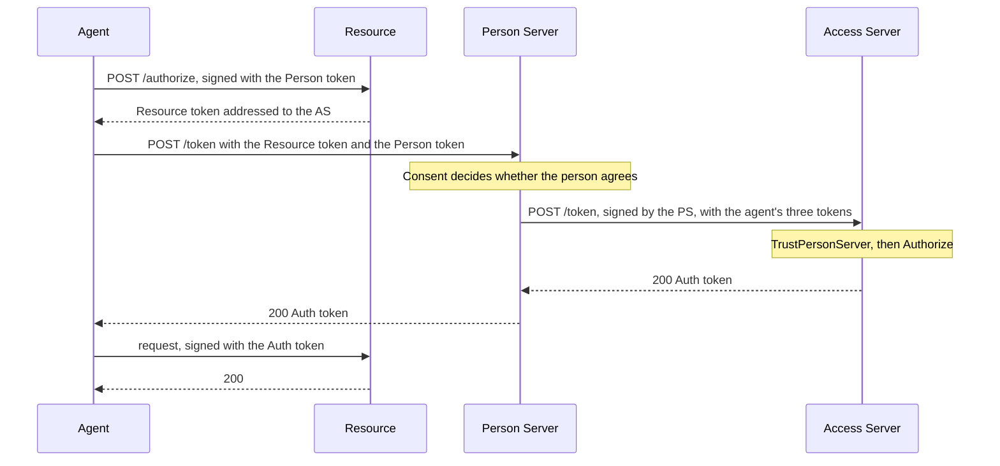

# Access Server

An Access Server decides access for a Resource that keeps its own rules. The
agent still goes through its Person Server, which handles the person's
consent, but the Auth token comes from the Resource's Access Server: the
Person Server asks it, signing the request as itself, and passes the answer on.
This is four-party access.

The Access Server never talks to the agent. It answers only Person Servers it
trusts.

Package: `accessserver`. Terms are defined in
[How AAuth works](../how-aauth-works.md).

## Flow



The Access Server can also make the request wait: `202` for an approval,
for claims about the person or for the person to visit a page of its own, and
`402` for a payment. The Person Server holds the request, and the agent polls
the Person Server until it ends.

## Smallest working code

From `example/fourparty`, which runs the four-party flow with and without a
mission. `missionBound` says which run this is.

<!-- sample: example/fourparty/main.go -->
```go
access := must(accessserver.New(accessserver.Config{
	Issuer: accessServerID, SigningKey: accessKey,
	KeyResolver: resolver, Clock: clock,
	NewID: func() string { return "auth-token-1" },
	TrustPersonServer: func(_ context.Context, issuer string) error {
		if issuer != personServerID {
			return errors.Join(accessserver.ErrAccessDenied, errors.New("untrusted person server"))
		}
		return nil
	},
	Authorize: func(_ context.Context, request accessserver.AuthorizationRequest) (accessserver.Decision, error) {
		if (request.MissionS256 != "") != missionBound {
			return accessserver.Decision{}, errors.Join(accessserver.ErrAccessDenied, errors.New("unexpected mission context"))
		}
		return accessserver.Decision{Scopes: request.Scopes, Lifetime: 30 * time.Minute}, nil
	},
}))
```

The Resource names its Access Server:

<!-- sample: example/fourparty/main.go -->
```go
protectedResource := must(resource.NewFederatedAuthorization(resource.FederatedAuthorizationConfig{
	Issuer: resourceID, AccessServer: accessServerID,
	SigningKey: resourceKey, KeyResolver: resolver, Clock: clock,
	NewID:             func() string { return "resource-token-1" },
	ScopeDescriptions: map[string]string{scope: "Read records"},
	RequiredScopes:    func(*http.Request) []string { return []string{scope} },
	ResolvePerson: func(_ context.Context, identity resource.PersonIdentity, _ resource.PersonContext) error {
		if identity.Issuer != personServerID || identity.Subject == "" {
			return errors.New("unrecognized person identity")
		}
		return nil
	},
	Protected: protected,
}))
```

```sh
go run ./example/fourparty
```

```text
AAuth missionless four-party flow complete: person-123 has records.read
AAuth mission-bound four-party flow complete: person-123 has records.read
mission completed with person acceptance
AAuth MCP R3 four-party flow complete: person-123 can use records.read
```

## The Access Server

`access.Handler()` serves `POST /token`, its metadata at
`/.well-known/aauth-access.json` and its public key at
`/.well-known/jwks.json`. It accepts a request only when a Person Server
signed it under its own published key. Then it checks the agent's Agent token,
the Resource token and the token the agent presented to the Resource, and
calls your two functions:

- **`TrustPersonServer`** gets the Person Server's identifier. Return an error
  wrapping `accessserver.ErrAccessDenied` to refuse it (`403 access_denied`).
- **`Authorize`** gets the request: the Person Server, the Resource, the
  agent, the person's identifier at the Resource, the scopes and any mission.
  It returns a `Decision`: the scopes to grant, a subset
  of those asked for, and a lifetime of at most one hour. A decision outside
  those bounds is `500 server_error`. Wrap `ErrAccessDenied` to refuse.

To wait, return a `Decision` with `Pending` set and configure `Deferred` with a
store (`testutil.NewAccessAuthorizationStore()` for tests).
[`example/federatedpayment`](../../example/federatedpayment) asks for payment,
then approval.

## The Person Server side

`personserver.NewFederatedAuthorization` takes the core fields of the
[Person Server](person-server.md#what-your-service-supplies) and:

- **`Consent`**: the person's agreement, before the Person Server asks the
  Access Server. Return nil to go ahead.
- **`AccessServerEndpoint`**: maps the Resource token's audience, the Access
  Server's identifier, to its token endpoint. Return an error for an Access
  Server you do not deal with (`502 as_unreachable`).
- **`HTTPClient`**: the client it calls Access Servers with.
- **`Tokens`**: a store that also records which Access Server each Person
  token was presented to; `testutil.NewMissionStore()` does, for tests.

## Limits

Clarification at the
Access Server, other payment-header formats, and waiting combined with R3 or
Budgets are not implemented.

## Next

- [Person Server](person-server.md): the other half of four-party access.
- [Errors](../errors.md#token-endpoint-errors): what `/token` answers when it
  refuses.
