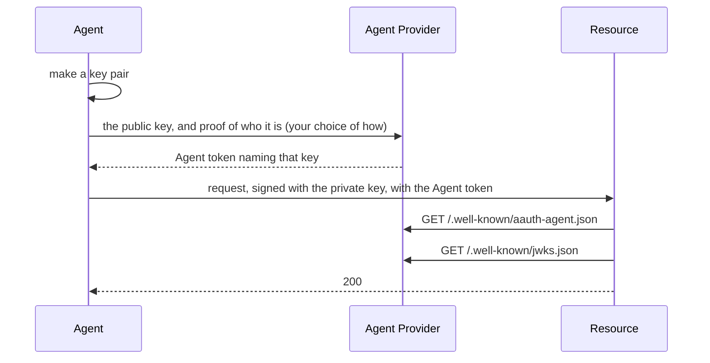

# Agent Provider

An Agent Provider vouches for agents. It gives each agent an **Agent token**: a
JWT, signed with the provider's key, that names the agent
(`aauth:assistant@ap.example`) and the agent's public key. Resources and
Person Servers check the token with the provider's published public key, and
then check that the request was signed with the key the token names.

The provider never holds the agent's private key. The agent makes its own key
pair and gives the provider only the public key.

Package: `agentprovider`. Terms are defined in
[How AAuth works](../how-aauth-works.md).

## Flow



How the agent proves who it is to its provider is not part of the core
protocol. In [Get started](../getting-started.md) the program issues the token
directly. For an agent that runs somewhere else, the package has an enrollment
service (see below).

## Smallest working code

From [Get started](../getting-started.md): the provider, its handler, and the
issuing of an Agent token for a key the agent made.

<!-- sample: example/gettingstarted/main.go -->
```go
provider, err := agentprovider.New(agentprovider.Config{
	Issuer: "https://ap.example", SigningKey: newKey("ap-key-1"), Clock: clock,
	NewID: rand.Text,
})
if err != nil {
	return err
}
if err := network.Serve("ap.example", provider.Handler()); err != nil {
	return err
}
```

<!-- sample: example/gettingstarted/main.go -->
```go
func enroll(ctx context.Context, provider *agentprovider.Server, name string,
	keys signaturekey.KeyResolver, client *http.Client,
) (*agent.Client, error) {
	key := newKey(name + "-key-1")
	identifier := "aauth:" + name + "@ap.example"
	token, err := provider.Issue(aauth.AgentTokenRequest{
		Agent: identifier, PublicKey: key.PublicJWK(), Lifetime: 10 * time.Minute,
	})
	if err != nil {
		return nil, err
	}
	return agent.New(ctx, agent.Config{
		Identifier: identifier, SigningKey: key, AgentToken: token,
		KeyResolver: keys, HTTPClient: client, Clock: aauth.SystemClock{},
	})
}
```

`provider.Handler()` serves:

| Path | What it is |
| --- | --- |
| `GET /.well-known/aauth-agent.json` | the provider's metadata: `issuer` and `jwks_uri`, and the optional endpoints below |
| `GET /.well-known/jwks.json` | the provider's public key |

## What your service supplies

- **`Issuer`**: the provider's server identifier, an `https://` origin with no
  port or path. Agent identifiers end in its host: a provider at
  `https://ap.example` issues `aauth:<name>@ap.example`.
- **`SigningKey`**: the provider's Ed25519 key, from
  `jose.NewEd25519SigningKey`, or an ES256 key, from
  `jose.NewSigningKeyForAlgorithm`. Keep the private key where your service
  keeps secrets. The key ID you give it goes in every token's header. The
  agents you issue tokens for may hold either kind of key.
- **`NewID`**: a source of unique token IDs (`jti`), such as `rand.Text`.
- **`Clock`**: `aauth.SystemClock{}` in a service.
- **The decision to issue.** `Issue` checks that the token's claims are well
  formed. It does not check who is asking: your service decides that before it
  calls `Issue`.
- **`AgentTokenRequest.PersonServer`**: set it to name the agent's Person
  Server in the token's `ps` claim. A Resource that wants the person's consent
  sends the agent to that server.

## Also in this package

- **Sub-agents.** `IssueSubagent` issues a token for a child agent with its own
  key, named after its parent and capped at the parent's expiry.
  `SubagentHandler` serves the request a parent agent sends for one
  ([`example/subagent`](../../example/subagent)).
- **Revocation.** `NewRevocationClient` sends a signed revocation of an Agent
  token to a Person Server (`RevokeAgentToken`) or to a Resource that accepts
  Agent identity (`RevokeAgentTokenAtResource`). It reaches only the servers
  you send it to ([`example/revocation`](../../example/revocation)).
- **Events.** With `Config.Events` set, the provider publishes an
  `event_endpoint` and accepts events for its agents
  ([Events](../features/events.md)).
- **Enrollment and refresh.** `NewEnrollmentService` serves an enrollment and
  token-refresh endpoint for agents that run elsewhere, using profiles this
  library defines, because the drafts leave the endpoints open. CONFORMANCE.md
  lists it as Partial ([`example/bootstrap`](../../example/bootstrap)).
- **Self-hosted agents.** `NewSelfHostedAgent` is an agent that is its own
  provider: its Agent tokens name the provider's own key ([`example/selfhosted`](../../example/selfhosted),
  [LOCAL-AGENT-PROFILE.md](../../LOCAL-AGENT-PROFILE.md)).

## Next

- [Agent](agent.md): what the agent does with its token.
- [Resource](resource.md): how an API checks it.
