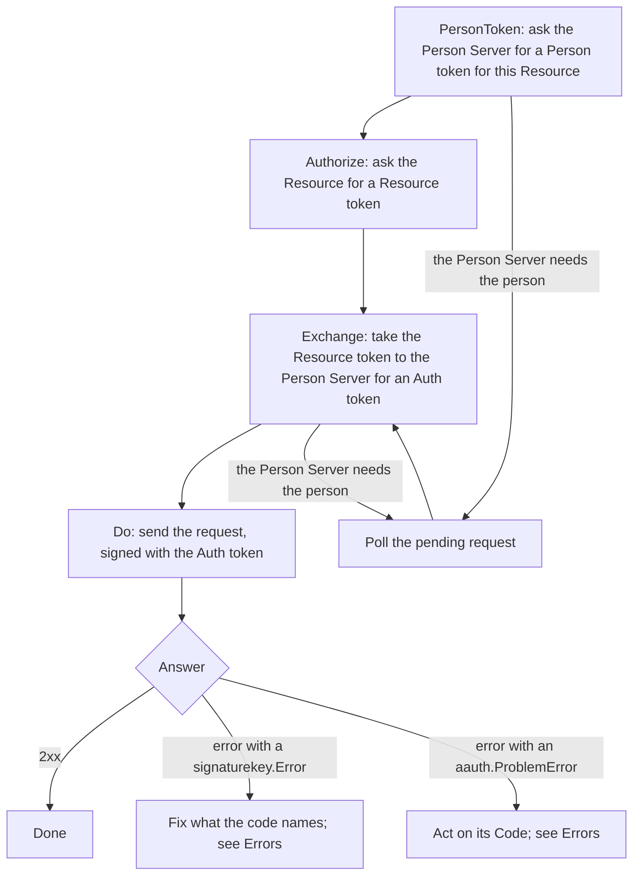

# Agent

An agent is an HTTP client acting for a person. With the `agent` package it
holds its private key and its Agent token, signs each request, reads what
servers ask for, and checks the tokens they send back before using them.

Each method of `agent.Client` performs one protocol step. It does not open a
browser, sleep, loop or retry, so nothing is sent twice unless your code sends
it twice. There is no client in the package that answers challenges by itself:
your code reads each answer and chooses the next step.

Package: `agent`. Terms are defined in
[How AAuth works](../how-aauth-works.md).

## Flow

What an agent does to reach a Resource that wants the person's consent, and
with each answer:



For a Resource that wants only the agent's identity, one call is enough:
`CallAsAgent` signs the request with the Agent token and sends it.
[Get started](../getting-started.md) does that.

## Smallest working code

This is the agent's part of `example/threeparty`, which runs an Agent Provider,
a Person Server and a Resource in one process. `httpClient` reaches those
servers, and `resolver` holds their keys.

<!-- sample: example/threeparty/main.go -->
```go
reader := must(clientagent.New(context.Background(), clientagent.Config{
	Identifier: agentID, SigningKey: agentKey, AgentToken: agentToken,
	KeyResolver: resolver, HTTPClient: httpClient, Clock: clock,
}))
ctx := context.Background()
personResult := must(reader.PersonToken(ctx, clientagent.PersonTokenRequest{
	PersonServer: personServerID, Resource: resourceID,
}))
personToken, ok := personResult.Token()
if !ok {
	log.Fatal("example Person Server unexpectedly required interaction")
}
resourceToken := must(reader.Authorize(ctx, clientagent.AuthorizeRequest{
	Resource: resourceID, PersonToken: personToken, Scopes: []string{scope},
}))
authToken := must(reader.Exchange(ctx, clientagent.ExchangeRequest{
	PersonServer: personServerID, ResourceToken: resourceToken, PresentedToken: personToken,
}))
request := must(http.NewRequestWithContext(ctx, http.MethodGet, resourceID+"/records/42", nil))
response := must(reader.Do(ctx, clientagent.Call{Request: request, AuthToken: authToken}))
```

```sh
go run ./example/threeparty
```

```text
AAuth three-party flow complete: person-123 has records.read
```

## Keys and tokens

- **The signing key.** `jose.NewEd25519SigningKey(id, privateKey)` wraps an
  `ed25519.PrivateKey`. To keep an agent's key across restarts, store the
  32-byte seed (`privateKey.Seed()`) where your service keeps secrets, and
  rebuild the key with `ed25519.NewKeyFromSeed`.
- **A hardware key.** Where the key lives in a secure enclave that offers
  only ECDSA P-256, use ES256:
  `jose.NewSigningKeyForAlgorithm(id, jose.ES256Algorithm, signer)` takes any
  `crypto.Signer` whose public key is on P-256, and never sees the private
  key. Every role in this library accepts ES256 agent keys and tokens.
- **The Agent token.** Your Agent Provider issues it for
  `key.PublicJWK()`. `agent.New` checks that the token names the configured
  `Identifier` and key, and refuses it otherwise. A client holds one Agent
  token: when it nears expiry, get a new one and make a new client.
- **The key resolver.** `Config.KeyResolver` holds the keys of the servers the
  agent deals with, and checks every token they send. Use
  `signaturekey.NewHTTPKeyResolver`, as in
  [Get started](../getting-started.md), or `signaturekey.StaticKeyResolver`
  for keys you configure.
- **The HTTP client.** `Config.HTTPClient` sends every request. The agent
  never follows a redirect.

## Signing

- `CallAsAgent` first reads the Resource's metadata at
  `/.well-known/aauth-resource.json`, which can list extra parts of the
  request to sign, then signs with the Agent token and sends.
  `CallAsAgentWithComponents` skips the metadata and signs exactly the
  components you name.
- A Resource need not publish metadata. When its well-known URL answers
  `404`, the client knows the Resource by its origin and uses the defaults:
  no extra components, no `authorization_endpoint` (so `Authorize` refuses,
  and the Resource asks for tokens with `401` answers instead), and none of
  the R3 or Budgets members. Any other failure, and every document that is
  published, is checked as before.
- `Do` sends a request signed with an Auth token. `Begin` sends the first
  request with a Person token and returns the Resource's answer: a response,
  a checked `auth-token` requirement, or a request the Resource is holding.
- A body is signed by its SHA-256 digest (`Content-Digest`), together with
  `Content-Type` when there is one. Bodies are limited to 1 MiB unless you set
  `Config.MaxSignedBodyBytes`.
- To sign a request yourself, `signaturekey.SignJWTRequest` adds the
  `Signature-Key`, `Signature-Input` and `Signature` headers. Call it last,
  once the URL, headers and body are final.

## Checking what servers send

The client checks each token before it hands it to you: the Person token from
`PersonToken`, the Resource token from `Authorize` or `Begin`, and the Auth
token from `Exchange`. Each must be signed by the server it came from, be for
this agent's key, and be for the Resource you named. A token that fails is an
error, and is never returned.

## Waiting for an answer

A server that needs the person answers `202`, and the method gives you the
request to poll instead of a token:

- `PersonToken` returns a `PersonTokenResult`; `Pending()` gives the request,
  and `PollPersonToken` polls it.
- `Exchange` returns a `*PendingExchangeError`; its `Pending()` goes to
  `PollExchange`. `BeginExchange` and `PollExchange` return an
  `ExchangeResult`: `Pending()` while the request waits, `Token()` once the
  Auth token is issued.
- Most other steps return an `agent.Pending`, whose `Poll` sends one signed
  `GET` to the pending URL and returns. It refuses to poll before the server's
  `Retry-After` has passed (`*PollTooEarlyError`), and `NextPollAt` says when.

From `example/psconsent`, after the person approves the exchange:

<!-- sample: example/psconsent/main.go -->
```go
completion, err := restoredReader.PollExchange(ctx, restored)
if err != nil {
	return fmt.Errorf("poll deferred auth-token exchange: %w", err)
}
authToken, ok := completion.Token()
if !ok {
	return errors.New("approved exchange did not return an auth token")
}
```

Each pending value also carries what the server asked for: an interaction URL
and code to show the person, an approval to wait for, or a clarification
question, which `AnswerClarification` answers. `Cancel` withdraws the request.

## Also in this package

- Missions: `BeginMission`, `UpdateMission`, `CompleteMission`,
  `ReadMission` ([Missions](../features/missions.md)).
- Metadata: `aauth.DecodePersonServerMetadata`, `DecodeResourceMetadata`,
  `DecodeAccessServerMetadata` and `DecodeAgentProviderMetadata` check a
  document you fetched and return its fields. The client uses them for every
  document it reads.
- Call chaining: the `UpstreamToken` fields
  ([Call chaining](../features/call-chaining.md)).
- R3 and Budgets: `BeginR3Call` and `BeginBudgetCall`
  ([R3](../features/r3.md), [Budgets](../features/budgets.md)).
- Events: `RegisterPublicSubscription` and `AcceptEvent`
  ([Events](../features/events.md)).
- Permission, audit and questions for the person: `RequestPermission`,
  `SubmitAudit` and `AskPersonQuestion`.
- Sub-agents: `RequestSubagentToken` gets a token for an agent this agent
  starts ([`example/subagent`](../../example/subagent)).
- Sessions that a Resource manages itself: `BeginResourceSession`.
- After the agent's signing key changes, every Auth token bound to the old key
  stops working, and `Reauthorize` gets a new one for the same access.
- After a Resource refuses a revoked Auth token and asks for a Person token,
  calls return `*agent.PersonTokenRequiredError`. Get a new Person token and
  start again ([`example/revocation`](../../example/revocation)).

## Next

- [Resource](resource.md): the other end of each request.
- [Person Server](person-server.md): where the Person and Auth tokens come
  from.
- [Errors](../errors.md): what each refusal means for the agent.
