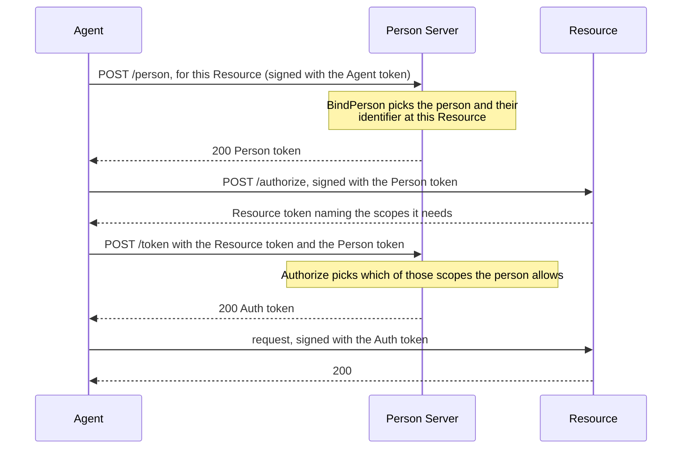

# Person Server

A Person Server speaks for a person. It knows which person an agent acts for,
asks for that person's consent, and issues the tokens that say so: a **Person
token**, which tells one Resource who the person is, and an **Auth token**,
which tells it what the person allowed. In four-party access it asks the
Resource's Access Server for the Auth token instead of issuing it.

The person chooses their Person Server. An agent's Agent token can name it in
its `ps` claim.

Package: `personserver`. Terms are defined in
[How AAuth works](../how-aauth-works.md).

## Flow

Three-party access, with the two decisions your service makes:



When the person has to be asked first, the Person Server answers `202` with
`requirement=interaction`, a URL and a code instead, and the agent polls until
your service records the person's answer. See
[Waiting for the person](#waiting-for-the-person).

## Smallest working code

From `example/threeparty`. `resolver` holds the keys of the Agent Provider and
the Resource; `newMemoryTokenStore` is the example's own in-memory store.

<!-- sample: example/threeparty/main.go -->
```go
ids := []string{"person-token-1", "auth-token-1"}
people := must(personserver.NewPSAuthorization(personserver.PSAuthorizationConfig{
	Issuer: personServerID, SigningKey: personKey,
	KeyResolver: resolver, Clock: clock, Tokens: newMemoryTokenStore(),
	NewID: func() string {
		id := ids[0]
		ids = ids[1:]
		return id
	},
	BindPerson: func(_ context.Context, request personserver.PersonTokenRequest) (personserver.Person, error) {
		if request.Agent != agentID || request.Resource != resourceID {
			return personserver.Person{}, errors.New("unexpected person-token request")
		}
		return personserver.Person{Subject: "person-123", Lifetime: time.Hour}, nil
	},
	Authorize: func(_ context.Context, request personserver.AuthorizationRequest) (personserver.AuthorizationDecision, error) {
		return personserver.AuthorizationDecision{Scopes: request.Scopes, Lifetime: 30 * time.Minute}, nil
	},
}))
```

```sh
go run ./example/threeparty
```

```text
AAuth three-party flow complete: person-123 has records.read
```

## Endpoints

`people.Handler()` serves these, all on the Person Server's `Issuer` origin:

| Path | What it does |
| --- | --- |
| `GET /.well-known/aauth-person.json` | metadata: the endpoints below and `jwks_uri` |
| `GET /.well-known/jwks.json` | the Person Server's public key |
| `POST /person` | issues a Person token for one Resource |
| `POST /token` | issues an Auth token for a Resource token |
| `GET /person/pending/{id}`, `/token/pending/{id}` | pending requests the agent polls |

Options add more: `/mission` with missions, `/permission` with permission,
`/audit`, `/interaction`, and `/revoke` with revocation stores.

## What your service supplies

- **`BindPerson`** decides which person an agent acts for, for one Resource.
  It returns a `Person`: the person's identifier at that Resource (`Subject`)
  and how long the Person token lasts. The library does not authenticate
  people. Your service links each agent to a person before this runs; an error
  refuses the request with `403 person_token_denied`.
- **`Authorize`** decides what the person allows: given the scopes the
  Resource asked for, it returns the scopes to grant and the Auth token's
  lifetime. Return an error that wraps `personserver.ErrAccessDenied` to refuse
  (`403 access_denied`); any other error is `500 server_error`.
- **`Tokens`** records each Person token issued, so that `/token` can check the
  one the agent presents. `testutil.NewMissionStore()` is an in-memory store
  for tests; a service needs one that survives restarts.
- **`SigningKey`**, **`NewID`** and **`Clock`**, as for the
  [Agent Provider](agent-provider.md#what-your-service-supplies).
- **`KeyResolver`**, with the keys of the Agent Providers and Resources you
  deal with. A Resource you have never met names its own issuer in its
  Resource token, so `Admit` decides which ones may be fetched.

## Waiting for the person

To ask the person before granting, set `RequireAuthorizationInteraction` and
`AuthorizationInteractions` (a store; `testutil.NewDeferredAuthorizationStore()`
for tests). For each request, `RequireAuthorizationInteraction` decides
whether to ask, and returns the base URL of your consent page. The agent
receives `202` with a URL under it, `{your URL}/{reference}`, and a code. It
sends the person there and polls.

On your page, after you authenticate the person:

1. `ConsumeAuthorizationInteractionCode(ctx, reference, code)` finds the
   request from the reference in the URL and the code the person brings
   (`ConsumeAuthorizationInteractionVisit` also keeps a callback URL to return
   the person to);
2. `ApproveAuthorizationInteraction` grants it, with an
   `AuthorizationDecision` as `Authorize` returns, or
   `DenyAuthorizationInteraction` refuses it.

The agent's next poll then gets the Auth token or the refusal. The person can
also ask the agent a question first, with `RequestAuthorizationClarification`.
`example/psconsent` runs all of this:

```sh
go run ./example/psconsent
```

`RequirePersonTokenInteraction` does the same for `POST /person`.

## Options

| Field | Adds | Guide |
| --- | --- | --- |
| `Missions` | tasks the person approves up front | [Missions](../features/missions.md) |
| `CallChaining`, `IssuedTokens` | a Resource calling another Resource for the same person | [Call chaining](../features/call-chaining.md) |
| `R3` | grants of named operations instead of scopes | [R3](../features/r3.md) |
| `Budget` | spending caps on Auth tokens | [Budgets](../features/budgets.md) |
| `Supervision` | a supervision server that decides for some agents | [Supervision](../features/supervision.md) |
| `Permission`, `Audit`, `InteractionQuestion` | asking the person about one action, recording what an agent did, and questions from the agent | [USE-IN-YOUR-SERVICE.md](../../USE-IN-YOUR-SERVICE.md#compose-authorization-features) |
| `AgentTokenRevocations`, `AgentBindingRevocations`, `TokenRevocation` | refusing revoked Agent tokens, agent-person links and tokens | [`example/revocation`](../../example/revocation) |

**Four-party.** `personserver.NewFederatedAuthorization` takes the same core
fields and, instead of `Authorize`, a `Consent` callback and an
`AccessServerEndpoint` that maps each Resource token's audience to its Access
Server. [Access Server](access-server.md) shows it.

## Next

- [Access Server](access-server.md): the four-party flow.
- [Errors](../errors.md#token-endpoint-errors): what `/person` and `/token`
  answer when they refuse.
