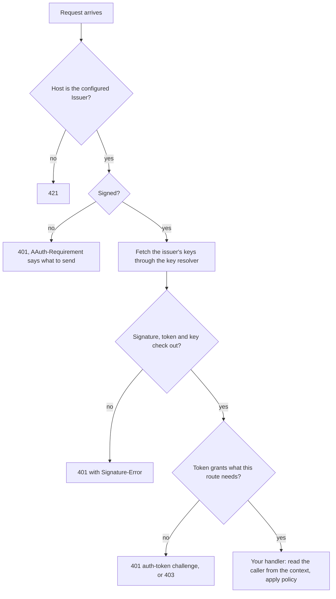

# Resource

A Resource is the API an agent calls. With the `resource` package it checks
each request before your handler runs: the HTTP signature, the token that
carries the agent's key, and, when you ask for more than the agent's identity,
the person's consent. Your handler then gets the verified caller from the
request's context and applies your own policy.

Each constructor returns a server whose `Handler()` is the `http.Handler` to
mount in your HTTPS server. The handler also serves the Resource's metadata at
`/.well-known/aauth-resource.json`.

Package: `resource`. Terms are defined in
[How AAuth works](../how-aauth-works.md).

## Flow



## Smallest working code

From [Get started](../getting-started.md): a Resource that accepts any agent
whose Agent Provider it trusts, and a handler that admits one agent.

<!-- sample: example/gettingstarted/main.go -->
```go
hello := http.HandlerFunc(func(w http.ResponseWriter, r *http.Request) {
	caller, _ := resource.AgentPrincipalFromContext(r.Context())
	if caller.Agent != "aauth:assistant@ap.example" {
		http.Error(w, "not admitted", http.StatusForbidden)
		return
	}
	fmt.Fprintf(w, "hello, %s", caller.Agent)
})
api, err := resource.NewAgentIdentity(resource.AgentIdentityConfig{
	Issuer: "https://api.example", KeyResolver: apiKeys, Clock: clock,
	Protected: hello,
})
```

- `Issuer` is the Resource's server identifier: the `https://` origin agents
  sign requests for, lowercase, with no port or path. A request for another
  host is refused with `421` before anything else runs. Behind a reverse
  proxy, forward the original `Host`; `Forwarded` and `X-Forwarded-Host` do not
  count.
- `KeyResolver` holds the keys of the Agent Providers you trust. See
  [Fetch issuer keys](#fetch-issuer-keys).
- `Protected` runs only for a verified request.
  `resource.AgentPrincipalFromContext` returns the agent identifier, its Agent
  Provider and the key it signed with.

## Fetch issuer keys

A Resource checks each token with its issuer's public key. The key resolver
finds those keys.

**Keys you configure.** `signaturekey.StaticKeyResolver` is a map from the
issuer, its metadata document and the key ID to the public key. Nothing is
fetched.

**Keys fetched over HTTPS.** `signaturekey.NewHTTPKeyResolver` fetches the
issuer's metadata (for an Agent Provider, `/.well-known/aauth-agent.json`),
then the key set it names, and caches both. It takes:

- `Client`: the `*http.Client` it fetches with. Nil uses a direct client.
- `Clock`: `aauth.SystemClock{}` in a service. Nil uses the system clock.
- `Admit`: a function that receives each URL before it is fetched and returns
  an error to refuse it. Nil uses `signaturekey.AdmitHTTPS`, which admits
  every HTTPS URL, so the resolver fetches from any issuer at a public
  address. To fetch only from the issuers you have chosen to trust, admit only
  those: the token names its own issuer.

So `signaturekey.NewHTTPKeyResolver(signaturekey.HTTPKeyResolverConfig{})` is
a safe default for issuers on the public internet.

The resolver also checks where each connection goes. By default it resolves
the host itself and refuses to connect if any address is private, loopback,
link-local or otherwise not public, then connects to the exact address it
checked. It never follows a redirect. To do this it dials through a copy of
your client's `*http.Transport`, so `NewHTTPKeyResolver` refuses a client whose
transport is something else, or has a proxy, or sets a dialer other than
`DialContext`.

What to set depends on where your issuers are:

| Your issuers are | Set | Effect |
| --- | --- | --- |
| on the public internet | nothing | Leave `Client.Transport` nil or a plain `*http.Transport`; its `DialContext` is kept. |
| on your own network, at private addresses | `AllowDestination`, and `LookupAddresses` if the system resolver does not know the hosts | `AllowDestination` is a function that admits the addresses you choose, for example your internal range; every other private address is still refused. |
| reached through a transport that controls connections itself, or makes none: a test, an in-memory handler, an outbound proxy that enforces its own rules | `TransportEnforcesEgress: true` | The resolver uses your client unchanged, and does no destination checks of its own. |

[Get started](../getting-started.md) uses the last row: its client connects
only to its own two loopback servers. The programs under `walkthrough/` pass a
custom loopback client without that setting, because they are pinned to older
commits of this library, from before the resolver checked destinations. Copied
into a module at a current commit, that client's key fetches are refused until
you add `TransportEnforcesEgress: true`.

If every signed request gets `401` with `Signature-Error: error=invalid_key`,
the resolver may have refused to fetch the issuer's keys. Wrap the handler in
`diagnostics.Handler` to see why
([Diagnose a refused request](../../USE-IN-YOUR-SERVICE.md#diagnose-a-refused-request)).

## Request bodies

A signed request with a body must also sign the body: the signature covers a
`Content-Digest` header (a SHA-256 hash of the body) and `Content-Type` when
there is one. The Resource checks the digest against the bytes it received
before your handler runs. A request without a body needs no digest. This is
the default, and you need not configure it. Signed bodies are limited to 1 MiB
unless you set `MaxSignedBodyBytes`.

`AdditionalSignatureComponents` adds components that every request must
cover, empty or not, and the Resource lists them in its metadata. Leave it
unset unless you need it. In particular, listing `content-digest` there makes
an empty `GET` carry a digest too. This library's agent reads the metadata
and signs what it lists, but an agent that does not read it is refused with
`401` and `Signature-Error: error=invalid_input`, naming the missing
component in `required_input`. aauth-rust's `Agent::sign`, for example, signs
a listed component only when it is given the list with
`with_additional_signature_components`.

## Asking for the person's consent

`resource.NewPSAuthorization` asks for an Auth token from the agent's Person
Server. A request without one gets `401` with `requirement=auth-token` and a
Resource token, which the agent takes to its Person Server. This is from
`example/threeparty`:

<!-- sample: example/threeparty/main.go -->
```go
protected := http.HandlerFunc(func(response http.ResponseWriter, request *http.Request) {
	principal, ok := resource.AuthPrincipalFromContext(request.Context())
	if !ok {
		http.Error(response, "missing AAuth principal", http.StatusInternalServerError)
		return
	}
	fmt.Fprintf(response, "AAuth three-party flow complete: %s has %s\n", principal.Subject, principal.Scope[0])
})
protectedResource := must(resource.NewPSAuthorization(resource.PSAuthorizationConfig{
	Issuer: resourceID, SigningKey: resourceKey, KeyResolver: resolver, Clock: clock,
	NewID:             func() string { return "resource-token-1" },
	ScopeDescriptions: map[string]string{scope: "Read records"},
	RequiredScopes:    func(*http.Request) []string { return []string{scope} },
	ResolvePerson: func(_ context.Context, identity resource.PersonIdentity, _ resource.PersonContext) error {
		if identity.Issuer != personServerID || identity.Subject == "" {
			return errors.New("unrecognized person identity")
		}
		return nil
	},
	Protected: protected,
}))
```

- `SigningKey` signs the Resource tokens. The handler publishes its public
  key at `/.well-known/jwks.json`, where the Person Server fetches it to check
  them.
- `ScopeDescriptions` lists every scope, with the text the person sees. The
  metadata publishes them.
- `RequiredScopes` says which scopes a request needs.
- `ResolvePerson` matches the person the Person Server names to a record of
  yours, or makes one on first use, or refuses with an error.
- `resource.AuthPrincipalFromContext` gives the handler the Person Server, the
  person's identifier at this Resource (`Subject`) and the granted scopes.

The other constructors:

| Constructor | For |
| --- | --- |
| `NewFederatedAuthorization` | Auth tokens from your own Access Server ([Access Server](access-server.md)) |
| `NewPersonIdentity` | knowing the person from a Person token, with no consent step |
| `NewResourceManaged` | your own decision about the agent, or your own login page, followed by a session token the agent keeps |

## What your service supplies

- The HTTPS listener and its certificate, and a `Host` header that reaches the
  handler unchanged.
- The issuers you trust, in the key resolver's `Admit`.
- Your access policy, in the handler.
- Idempotency for anything that changes state: a signed request can be sent
  again, unchanged, within its 60-second window, and it still verifies.
- For revocation, `AgentTokenRevocations` (Agent identity) or
  `AuthTokenStatuses` (Auth tokens): a store that keeps revocations across
  restarts. `testutil` has in-memory ones for tests.

## Next

- [Agent](agent.md): the other end of each request.
- [Person Server](person-server.md): where Auth tokens come from.
- [Errors](../errors.md): what each refusal means.
- [Use it in your service](../../USE-IN-YOUR-SERVICE.md#verify-an-agent-at-your-http-endpoint):
  the reference for every Resource option.
