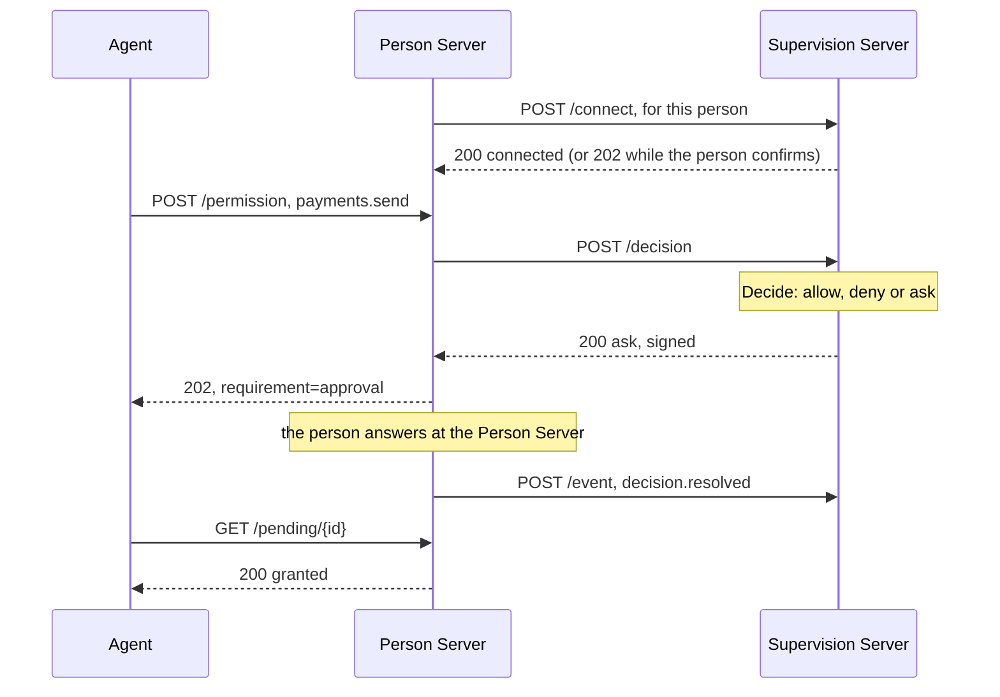

# Supervision Server

A supervision server decides, in the person's place, what their agents may do.
The person connects it to their Person Server. From then on the Person Server
puts each request from those agents to the supervision server: mission
proposals and their updates and completions, Person and Auth token requests,
and permission requests. The supervision server answers allow, deny or ask,
and the person is asked only when it says ask.

The supervision server talks only to Person Servers. It issues no tokens: the
Person Server applies its answer and issues them.

Package: `supervisionserver`, with the wire values in `supervision`. Terms
are defined in [How AAuth works](../how-aauth-works.md).

## Flow



## Smallest working code

From `example/supervision`, which runs one person with two agents under two
supervision servers: their organization's, and their own.

<!-- sample: example/supervision/main.go -->
```go
var organizationPolicy standingPolicy
organizationKey := keys["organization"]
organization, err := supervisionserver.New(supervisionserver.Config{
	Issuer: organizationSSID, Name: "Organization supervisor", SigningKey: &organizationKey,
	KeyResolver: resolver, Clock: clock, Store: testutil.NewSupervisorStore(),
	Connect: func(_ context.Context, request supervisionserver.ConnectRequest) (supervisionserver.ConnectResult, error) {
		return supervisionserver.ConnectResult{Accept: request.Tenant == "example.org"}, nil
	},
	Decide: organizationPolicy.decide,
})
```

The policy allows everything except a payment, which it asks the person
about. Once the person allows payments for the rest of the mission, the server
applies that answer to the next payment without calling the policy:

<!-- sample: example/supervision/main.go -->
```go
func (standingPolicy) decide(_ context.Context, request supervisionserver.DecisionRequest) (supervisionserver.DecisionResult, error) {
	allow := supervision.Decision{Verdict: supervision.VerdictAllow}
	if request.Request.Kind == supervision.KindMissionProposal {
		allow.Mission = &supervision.MissionTerms{
			Description:       request.Request.Description + "\n\nAsk before any payment.",
			ApprovedTools:     request.Request.Tools,
			ApprovedResources: request.Request.Resources,
		}
	}
	if request.Request.Kind != supervision.KindPermission || request.Request.Action != "payments.send" {
		return supervisionserver.DecisionResult{Decision: &allow}, nil
	}
	return supervisionserver.DecisionResult{Decision: &supervision.Decision{
		Verdict: supervision.VerdictAsk, Summary: "The agent wants to pay an invoice.",
		Recommendation: supervision.VerdictAllow,
		ApplyOptions: []supervision.ApplyOption{
			{Value: supervision.ApplyOnce, Label: "This payment only"},
			{Value: supervision.ApplyMission, Label: "Any payment on this mission"},
		},
	}}, nil
}
```

```sh
go run ./example/supervision
```

```text
Personal supervisor connected after the person confirmed https://person.example
Work agent: builds.start granted by the organization's supervisor
Mission approved as refined: "Ask before any payment."
Asked the person: The agent wants to pay an invoice. (supervisor recommends allow)
Person allowed it for the mission; the next payment was granted without asking
Personal supervisor offline: the person allowed the person-token request
Supervisor back online, told: decision.resolved (supervisor unavailable), person_token.issued
Signed decisions in the log verified: 1 by https://governance.example, 3 by https://supervisor.example
```

## The supervision server

`supervisionserver.New` needs:

- **`Issuer`**, **`KeyResolver`** and **`Clock`**, as for the other roles. The
  resolver finds Person Servers' keys: every request must be signed by a
  Person Server under its own published key.
- **`Store`**: connections, missions, decisions and deliveries.
  `testutil.NewSupervisorStore()` keeps them in memory, for tests.
- **`Connect`**: whether to accept a person, from the Person Server, their
  identifier and their tenant. Accept at once (`Accept: true`), or send the
  person to a page of yours to confirm (`Interaction`). That page calls
  `ConsumeConnectCode` with the code the person brings, then `ConfirmConnect`
  or `DeclineConnect`.
- **`Decide`**: the answer to each request. Return exactly one of a
  `Decision` (allow, deny or ask), a `Clarify` question for the agent, or a
  `Defer` to decide later with `ResolveDecision`. An allow may narrow a
  mission's terms, as above. The terms replace the proposal: a proposed
  tool left out of `ApprovedTools` is not approved.

Optional:

- **`SigningKey`**: sign every decision. A Person Server requires signed
  decisions unless it sets `AllowUnsignedDecisions`, and it keeps them in its
  log, where `supervision.VerifyExchange` can check them again later.
- **`Observe`**: receives the events and reports the Person Server sends,
  such as `decision.resolved` with how far the person's answer reaches. The
  server itself applies an answer given for the rest of the mission or for
  always to the agent's later requests of the same kind, before `Decide`;
  `Kind` sets what the same kind means. A reach your own policy offered is
  yours to apply.
- **`TrustPersonServer`**: refuse Person Servers you do not serve, with an
  error wrapping `supervisionserver.ErrUnsupportedIss`. Without it, every
  Person Server is accepted.

`Handler()` serves `/.well-known/aauth-supervisor.json`, the key at
`/.well-known/jwks.json` when there is a `SigningKey`, and `/connect`,
`/mission`, `/decision`, `/event` and the pending URLs.

## The Person Server side

The Person Server routes each agent to its supervision server with
`SupervisionConfig.Route`. [Supervision](../features/supervision.md) covers
that side.

## Limits

From [CONFORMANCE.md](../../CONFORMANCE.md): Resource-initiated interaction
for a supervised agent is refused, the supervisor sees an R3 document only by
reference, and the stores in `testutil` are in memory. No other
implementation has been run against these roles.

## Next

- [Supervision](../features/supervision.md): what happens to each request.
- [Person Server](person-server.md): the role a supervision server answers.
